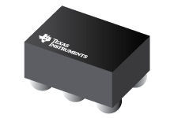
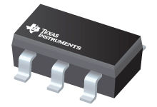
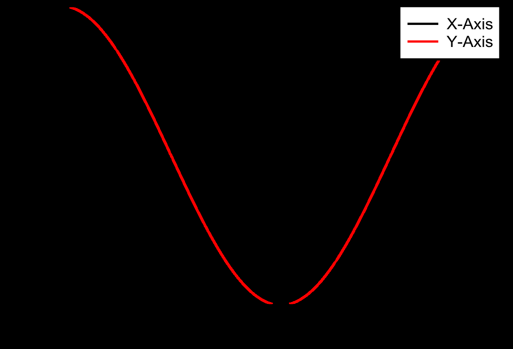

参考文献

**TMAG3001** ZHCSR44C – NOVEMBER 2023 – REVISED MAY 2025

### **TMAG3001** 采用**WCSP** 封装、具有**I2C** 接口和唤醒检测功能的低功耗**3D** 线性和

### 角度霍尔效应传感器

###### **1** 特性

###### **3** 说明

• 可配置的电源模式，包括： – 活动模式电流：2.1mA – 唤醒和睡眠模式电流：0.45µA – 睡眠模式电流：40nA • X、Y 或 Z 轴上的线性磁场范围可选： – TMAG3001A1 样片：±40mT、±80mT – TMAG3001A2：±120mT、±240mT • 集成角度计算以及增益和偏移调整，用于支持离轴 放置 • 由 I2C 或专用 INT 引脚触发转换 • 中断信号，基于 – 磁性或角度阈值交叉 – 相对于上一次测量的变化 • 可配置 3D 或角度开关模式 • 经优化具有低噪声，支持高达 20kSPS 的单轴转换 率 • 具有循环冗余校验 (CRC) 功能的 I2C 接口： – 最大 1MHz I2C 时钟速度 – ADDR 引脚支持在同一总线上使用 4 个器件 • 集成温度补偿，支持多种磁体类型 • 内置温度传感器 • 电源电压 VCC 范围：1.65V 至 3.6V • 工作温度范围：-40°C 至 125°C

TMAG3001 是一款低功耗线性 3D 霍尔效应传感器， 适用于各种工业和个人电子产品应用。此器件在 X、Y 和 Z 轴集成三个独立的霍尔效应传感器。精密模拟信 号链和集成的 12 位 ADC 对测量的模拟磁场值进行数 字化。支持多个工作 VCC 范围时，I2C 接口可确保使用 低电压微控制器实现无缝的数据通信。

可以通过 I2C 接口来配置 TMAG3001，以实现磁轴和 温度测量的任意组合。此外，该器件可以配置为各种电 源选项（包括唤醒和睡眠模式），从而支持设计人员根 据其系统级需求优化系统功耗。多个传感器转换方案和 I2C 读取帧有助于优化吞吐量和准确性。专用的 INT 引 脚可以在低功耗唤醒和睡眠模式期间充当系统中断，也 可以被微控制器用来触发新的传感器转换。该器件还具 有用于磁性或角度测量的可配置低功耗开关模式。

集成角度计算引擎 (CORDIC) 为同轴和离轴角度测量 拓扑提供完整的 360° 角度位置信息。使用用户选择的 两个磁轴执行角度计算。该器件具有磁增益和偏轴校正 功能，可减轻系统机械误差源的影响。

TMAG3001 具有一个 ADDR 引脚，可用于拥有四个不 同的 I2C 地址。每个可订购器件可配置为选择在系统校 准期间适合磁体强度和元件放置的两个磁场范围之一。

该器件在 –40°C 至 125°C 的宽环境温度范围内能够 保持稳定一致的优异性能。

###### **2** 应用

• 电子智能锁 • 门窗传感器 • 磁接近传感器 • 移动机器人电机控制 • 智能手表 • 传动器 • 位置传感器 • 可折叠智能手机和平板电脑 • 游戏手柄和游戏控制器

| 器件型号     | 封装 (1)       | 封装尺寸(2)         |
|----------|--------------|-----------------|
| TMAG3001 | YBG（DSBGA，6） | 0.83mm × 1.32mm |

(1) 如需了解所有可用封装，请参阅数据表末尾的封装选项附录。 (2) 封装尺寸（长 × 宽）为标称值，并包括引脚（如适用）。

1.65 V to 3.6 V

1.2 V to 5.5 V

VCC

INT

**TMAG3001µController**

ADDR

SCL

SDA

GND

应用方框图

本资源的原文使用英文撰写。 为方便起见，TI 提供了译文；由于翻译过程中可能使用了自动化工具，TI 不保证译文的准确性。 为确认 准确性，请务必访问 ti.com 参考最新的英文版本（控制文档）。

English Data Sheet: SLYS053

---

**TMAG3001** ZHCSR44C – NOVEMBER 2023 – REVISED MAY 2025 **www.ti.com.cn**

内容

**1** 特性................................................................................... 1 **2** 应用................................................................................... 1 **3** 说明................................................................................... 1 **4** 引脚配置和功能................................................................. 3 **5** 规格................................................................................... 4

6.3 特性说明....................................................................14 6.4 器件功能模式............................................................ 21 6.5 编程...........................................................................23 **7** 寄存器映射.......................................................................39

7.1 TMAG3001 寄存器....................................................39 **8** 应用和实施.......................................................................58

5.1 绝对最大额定值...........................................................4 5.2 ESD 等级.................................................................... 4 5.3 建议运行条件.............................................................. 4 5.4 热性能信息..................................................................4 5.5 电气特性......................................................................5 5.6 温度传感器..................................................................6 5.7 A1 的磁特性................................................................ 6 5.8 A2 的磁特性................................................................ 8 5.9 磁温度补偿特性...........................................................9 5.10 I2C 接口时序............................................................. 9 5.11 上电时序.................................................................. 11 5.12 时序图..................................................................... 11 5.13 典型特性..................................................................12 **6** 详细说明.......................................................................... 13

8.1 应用信息....................................................................58 8.2 典型应用....................................................................68 8.3 优秀设计实践............................................................ 71 8.4 电源相关建议............................................................ 72 8.5 布局...........................................................................72 **9** 器件和文档支持............................................................... 73

9.1 文档支持....................................................................73 9.2 接收文档更新通知..................................................... 73 9.3 支持资源....................................................................73 9.4 商标...........................................................................73 9.5 静电放电警告............................................................ 73 9.6 术语表....................................................................... 73 **10** 修订历史记录.................................................................73 **11** 机械、封装和可订购信息............................................... 74

6.1 概述...........................................................................13 6.2 功能方框图................................................................13

2 提交文档反馈 Copyright © 2025 Texas Instruments Incorporated

Product Folder Links: *TMAG3001*

English Data Sheet: SLYS053

---

**TMAG3001** ZHCSR44C – NOVEMBER 2023 – REVISED MAY 2025

**www.ti.com.cn**

###### **4** 引脚配置和功能

1 2

A

VCC ADDR

B

INT GND

C

SDA SCL

Not to scale

###### 图**4-1. YBG (6 - DSBGA)** 顶视图

| 引脚  |      | 类型  | 说明                                                   |
|-----|------|-----|------------------------------------------------------|
| 编号  | 名称   |     |                                                      |
| A1  | VCC  | 电源  | 电源。                                                  |
| A2  | ADDR | 输入  | 地址引脚。可连接至 SDA、SCL、VCC 或 GND。                         |
| B1  | INT  | IO  | 中断输出和触发输入。当用作开漏输出时，需要使用一个上拉电阻器。当用作触 发输入时，不需要使用上拉电阻器。 |
| B2  | GND  | 接地  | 参考接地。                                                |
| C1  | SDA  | IO  | 串行数据。                                                |
| C2  | SCL  | IO  | 串行时钟。                                                |

Copyright © 2025 Texas Instruments Incorporated 提交文档反馈 3

Product Folder Links: *TMAG3001*

English Data Sheet: SLYS053

---

**TMAG3001** ZHCSR44C – NOVEMBER 2023 – REVISED MAY 2025 **www.ti.com.cn**

###### **5** 规格

|       |                       | 最小值     | 最大值 | 单位  |
|-------|-----------------------|---------|-----|-----|
| V CC  | 主电源电压                 | -0.3 4  |     | V   |
| I OUT | 输出电流，SDA，INT          | 0 10    |     | mA  |
| V OUT | 输出电压，SDA，INT          | -0.3 7  |     | V   |
| V IN  | 输入电压，SCL，SDA，ADDR，INT | -0.3 7  |     | V   |
| B MAX | 磁通量密度                 | 无限      |     | T   |
| T J   | 结温                    | -40 150 |     | °C  |
| T stg | 贮存温度                  | -65 170 |     | °C  |

(1) 超出“绝对最大额定值”运行可能会对器件造成永久损坏。绝对最大额定值并不表示器件在这些条件下或在建议运行条件以外的任何其 他条件下能够正常运行。如果超出“建议运行条件”但在“绝对最大额定值”范围内使用，器件可能不会完全正常运行，这可能影响器 件的可靠性、功能和性能并缩短器件寿命。

###### **5.2 ESD** 等级

|         |      |                                                |                 | 值              | 单位  |
|---------|------|------------------------------------------------|-----------------|----------------|-----|
| V (ESD) | 静电放电 | 人体放电模型 (HBM)，符合 ANSI/ESDA/JEDEC JS-001 标准(1) ± |                 | 2000 ±700 ±500 | V   |
|         |      | 充电器件模型 (CDM)，符合 ANSI/ ESDA/JEDEC JS-002 标准(2)  | 转角引脚（1、6、3 和 4） |                |     |
|         |      |                                                | 其他引脚            |                |     |

(1) JEDEC 文档 JEP155 指出：500V HBM 时能够在标准 ESD 控制流程下安全生产。 (2) JEDEC 文档 JEP157 指出：250V CDM 时能够在标准 ESD 控制流程下安全生产。

###### **5.3** 建议运行条件

|       |                | 最小值   | 标称值 | 最大  | 值 单位   |
|-------|----------------|-------|-----|-----|--------|
| V CC  | 电源电压           | 1.65  |     |     | 3.6 V  |
| V OUT | 输出电压，SDA，INT   | 0     |     |     | 3.6 V  |
| I OUT | 输出电流，SDA，INT   |       |     |     | 4.5 mA |
| T A   | 自然通风条件下的工作温度范围 | -40 1 |     |     | 25 C   |

###### **5.4** 热性能信息

|              |            | TMAG3001        |      |
|--------------|------------|-----------------|------|
| 热指标(1)       |            | YBG (WCSP) 6 引脚 | 单位   |
| RθJA         | 结至环境热阻     | 131.8           | °C/W |
| RθJC(top)    | 结至外壳（顶部）热阻 | 1.4             | °C/W |
| RθJC(bottom) | 结至外壳（底部）热阻 | 不适用             | °C/W |
| RθJB         | 结至电路板热阻    | 36.4            | °C/W |
| Ψ JT         | 结至顶部特征参数   | 0.3             | °C/W |
| Ψ JB         | 结至电路板特征参数  | 36.4            | °C/W |

(1) 有关新旧热指标的更多信息，请参阅半导体和 IC 封装热指标应用手册。

4 提交文档反馈 Copyright © 2025 Texas Instruments Incorporated

Product Folder Links: *TMAG3001*

English Data Sheet: SLYS053

---

**TMAG3001** ZHCSR44C – NOVEMBER 2023 – REVISED MAY 2025

**www.ti.com.cn**

| 参数           |                                                   | 测试条件                    | 最小值         | 典型值 | 最大值 | 单位  |
|--------------|---------------------------------------------------|-------------------------|-------------|-----|-----|-----|
| I/O 特性       |                                                   |                         |             |     |     |     |
| V OL         | 输出低电压，SDA，INT 引脚                                  | I = 2mA OUT             | 0 0.4       |     |     | V   |
| V IH         | 输入高电压                                             | V = 1.65V 至 1.9V CC     | 0.7 × V CC  |     |     | V   |
|              |                                                   | V = 2.3V 至 3.6V CC      | 0.65 × V CC |     |     | V   |
| V IL         | 输入低电压                                             | V = 1.65V 至 1.9V CC     | 0.3 × V CC  |     |     | V   |
|              |                                                   | V = 2.3V 至 3.6V CC      | 0.35 × V CC |     |     | V   |
| I OZ         | 输出漏电流，SDA，INT 引脚                                  | 输出禁用 V = 5.5V OZ        | ±100        |     |     | nA  |
| t FALL_INT   | INT 输出下降时间                                        | R = 10kΩ PU C = 20pF L  | 6           |     |     | ns  |
| t INT (INT)  | 脉冲模式下 INT 中断持续时间                                  | INT_Mode[2:0] = 1h 或 2h | 10          |     |     | µs  |
| t INT (SCL)  | SCL 中断持续时间                                        | INT_Mode[2:0] = 3h 或 4h | 10          |     |     | µs  |
| C IN         | 输入电容                                              | f = 1MHz s              | 7.5         |     |     | pF  |
| 直流电源部分       |                                                   |                         |             |     |     |     |
| I ACTIVE     | 活动模式电流 X、Y、Z 或热传感器有效转换                            | LP_LN = 0h V = 1.8V CC  | 2.1 3.5     |     |     | mA  |
|              |                                                   | LP_LN = 1h V = 1.8V CC  | 2.8 4.5     |     |     | mA  |
|              |                                                   | LP_LN = 0h V = 3.3V CC  | 2.4 4       |     |     | mA  |
|              |                                                   | LP_LN = 1h V = 3.3V CC  | 3.0 4.8     |     |     | mA  |
| I STANDBY    | 待机模式电流                                            | 器件处于触发模式，未开始转换          | 0.45 1      |     |     | mA  |
| I SLEEP      | 睡眠模式电流                                            |                         | 40          |     |     | nA  |
| 占空比模式期间的平均功率 |                                                   |                         |             |     |     |     |
| I CC_DCM     | W&S 模式电流消耗 唤醒间隔 5000ms LP_LN = 0h                 | 磁性单通道转换 V = 1.8V CC     | 0.4 1.1     |     |     | µA  |
|              |                                                   | 磁性 1 通道转换 V = 3.3V CC   | 0.5 1.3     |     |     | µA  |
|              | W&S 模式电流消耗 唤醒间隔 1ms Conv_AVG[2:0] = 0h LP_LN = 0h | 磁性单通道转换 V = 3.3V CC     | 110 250     |     |     | µA  |
|              |                                                   | 磁性 4 通道转换 V = 3.3V CC   | 230 375     |     |     | µA  |

Copyright © 2025 Texas Instruments Incorporated 提交文档反馈 5

Product Folder Links: *TMAG3001*

English Data Sheet: SLYS053

---

**TMAG3001** ZHCSR44C – NOVEMBER 2023 – REVISED MAY 2025 **www.ti.com.cn**

| 参数           |                       | 测试条件              | 最小值     | 典型值 | 最大值 | 单位    |
|--------------|-----------------------|-------------------|---------|-----|-----|-------|
| T SENS_RANGE | 温度检测范围                |                   | -40 125 |     |     | ℃     |
| T SENS_RES   | 温度检测分辨率（16 位格式）       |                   | 58.2    |     |     | LSB/℃ |
| T ADC_T0     | 25°C 室温下以十进制值表示的温度结 果 |                   | 17512   |     |     |       |
| T ERR        | 温度误差精度                | T = –40℃ 至 125℃ A | ±0.5 ±5 |     |     | ℃     |
| NRMS_T       | RMS (1 Σ) 温度噪声        | Conv_AVG = 5h     | 0.05    |     |     | ℃     |
| NRMS_T       | RMS (1 Σ) 温度噪声        | Conv_AVG = 0h     | 0.3     |     |     | ℃     |

| 参数             |                            | 测试条件                  | 最小值                                                                           | 典型值 | 最大值 | 单位     |
|----------------|----------------------------|-----------------------|-------------------------------------------------------------------------------|-----|-----|--------|
| B IN           | 线性磁场范围                     | _RANGE = 0h           | ±37 ±75                                                                       |     |     | mT     |
|                |                            | _RANGE = 1h           |                                                                               |     |     |        |
| SENS           | 灵敏度，X、Y 或 Z 轴 LP_LN = 1h   | ±40mT 范围              | 885 446                                                                       |     |     | LSB/mT |
|                |                            | ±80mT 范围              |                                                                               |     |     |        |
| SENS ERR       | 灵敏度误差，X、Y 或 Z 轴 LP_LN = 1h | T = 25°C A            | ±1.8 ±7.7                                                                     |     |     | %      |
| SENS ERR_DR    | 灵敏度漂移 X、Y 或 Z 轴            | T = -40°C 至 25°C A    | -0.069 0.037 -0.028 0.069 -0.113 0.086                                        |     |     | %/°C   |
|                |                            | T = 25°C 至 85°C A     |                                                                               |     |     |        |
|                |                            | T = 85°C 至 125°C A    |                                                                               |     |     |        |
| SENS LER       | 灵敏度线性误差，X 或 Y 轴            | T = 25°C A            | ±0.11 ±0.9 ±0.30 ±1.1                                                         |     |     | %      |
|                | 灵敏度线性误差，Z 轴                |                       |                                                                               |     |     |        |
| SENS DRLER     | 灵敏度漂移线性误差                  | X 和 Y 轴               | 3.5 4.3                                                                       |     |     | %      |
|                |                            | Z 轴                   |                                                                               |     |     |        |
| SENS MS        | 灵敏度失配，X-Y 轴                | T = 25°C A LP_LN = 1h | ±2.8 ±6 ±3.5 ±8.7                                                             |     |     | %      |
|                | 灵敏度失配，Y-Z 轴或 X-Z 轴         |                       |                                                                               |     |     |        |
| SENS MS_DR     | 灵敏度失配漂移 X-Y 轴              | T = -40°C 至 25°C A    | -0.027 0.029 -0.032 0.023 -0.041 0.029 -0.054 0.027 -0.063 0.023 -0.067 0.036 |     |     | %/°C   |
|                |                            | T = 25°C 至 85°C A     |                                                                               |     |     |        |
|                |                            | T = 85°C 至 125°C A    |                                                                               |     |     |        |
|                | 灵敏度失配漂移 X-Z 或 Y-Z 轴        | T = -40°C 至 25°C A    |                                                                               |     |     |        |
|                |                            | T = 25°C 至 85°C A     |                                                                               |     |     |        |
|                |                            | T = 85°C 至 125°C A    |                                                                               |     |     |        |
| SENS MS_DR_LIN | 灵敏度失配漂移线性误差                | X-Y 轴                 | 1.5                                                                           |     |     | %      |
|                |                            | Y-Z 轴或 X-Z 轴          | 1.5                                                                           |     |     | %      |
| B off          | 偏移 T = 25°C A              | 范围 = 0h               | ±85 ±750                                                                      |     |     | µT     |
|                |                            | 范围 = 1h               | ±70 ±650                                                                      |     |     | µT     |
| B off_DR       | 相对于 25°C 值的温漂              | T = -40°C 至 25°C A    | ±1 ±9.3                                                                       |     |     | µT/°C  |
|                |                            | T = 25°C 至 125°C A    | ±1 ±9.6                                                                       |     |     | µT/°C  |
| B off_DR_LIN   | 温漂线性误差                     | 范围 = 0h               | 0.06                                                                          |     |     | %      |
|                |                            | 范围 = 1h               | 0.04                                                                          |     |     | %      |

6 提交文档反馈 Copyright © 2025 Texas Instruments Incorporated

Product Folder Links: *TMAG3001*

English Data Sheet: SLYS053

---

**TMAG3001** ZHCSR44C – NOVEMBER 2023 – REVISED MAY 2025

**www.ti.com.cn**

| 参数         |                                     | 测试条件                     | 最小值        | 典型值 | 最大值 | 单位  |
|------------|-------------------------------------|--------------------------|------------|-----|-----|-----|
| N RMS      | RMS (1 Σ) 磁噪声（X 或 Y 轴）              | LP_LN = 0h Conv_AVG = 0h | 105        |     |     | µT  |
|            |                                     | LP_LN = 1h Conv_AVG = 0h | 95         |     |     | µT  |
|            |                                     | LP_LN = 0h Conv_AVG = 5h | 17.5       |     |     | µT  |
|            |                                     | LP_LN = 1h Conv_AVG = 5h | 16         |     |     | µT  |
| N RMS      | RMS (1 Σ) 磁噪声（Z 轴）                  | LP_LN = 0h Conv_AVG = 0h | 58         |     |     | µT  |
|            |                                     | LP_LN = 1h Conv_AVG = 0h | 53         |     |     | µT  |
|            |                                     | LP_LN = 0h Conv_AVG = 5h | 10         |     |     | µT  |
|            |                                     | LP_LN = 1h Conv_AVG = 5h | 9          |     |     | µT  |
| A (1) ERR  | 角度误差 T = 25°C A LP_LN = 1h          | X-Y 轴                    | 0.4 ±0.95  |     |     | 度   |
|            |                                     | X-Z 轴                    | 0.43 ±1.0  |     |     | 度   |
|            |                                     | Y-Z 轴                    | 0.38 ±0.90 |     |     | 度   |
|            | 角度误差 T = –40°C 至 125°C A LP_LN = 1h | X-Y 轴                    | ±2.3       |     |     | 度   |
|            |                                     | X-Z 轴                    | ±1.5       |     |     | 度   |
|            |                                     | Y-Z 轴                    | ±1.8       |     |     | 度   |
| A (1) NRMS | RMS (1 Σ) 角度噪声 (X-Y)                | LP_LN = 1h               | 0.042      |     |     | 度   |
|            | RMS (1 Σ) 角度噪声（X-Z 或 Y-Z）           |                          | 0.036      |     |     | 度   |

(1) 通过将磁体与传感器对齐来执行角度测量

Copyright © 2025 Texas Instruments Incorporated 提交文档反馈 7

Product Folder Links: *TMAG3001*

English Data Sheet: SLYS053

---

**TMAG3001** ZHCSR44C – NOVEMBER 2023 – REVISED MAY 2025 **www.ti.com.cn**

| 参数             |                            | 测试条件                  | 最小值                                                                           | 典型值 | 最大值 | 单位     |
|----------------|----------------------------|-----------------------|-------------------------------------------------------------------------------|-----|-----|--------|
| B IN           | 线性磁场范围                     | _RANGE = 0h           | ±120 ±240                                                                     |     |     | mT     |
|                |                            | _RANGE = 1h           |                                                                               |     |     |        |
| SENS           | 灵敏度，X、Y 或 Z 轴 LP_LN = 1h   | ±120mT 范围             | 273 137                                                                       |     |     | LSB/mT |
|                |                            | ±240mT 范围             |                                                                               |     |     |        |
| SENS ERR       | 灵敏度误差，X、Y 或 Z 轴 LP_LN = 1h | T = 25°C A            | ±0.5 ±6                                                                       |     |     | %      |
| SENS ERR_DR    | 灵敏度漂移 X、Y 或 Z 轴            | T = -40°C 至 25°C A    | -0.063 0.042 -0.018 0.072 -0.071 0.046                                        |     |     | %/°C   |
|                |                            | T = 25°C 至 85°C A     |                                                                               |     |     |        |
|                |                            | T = 85°C 至 125°C A    |                                                                               |     |     |        |
| SENS LER       | 灵敏度线性误差，X 或 Y 轴            | T = 25°C A            | ±0.10 1.5 ±0.10 1.5                                                           |     |     | %      |
|                | 灵敏度线性误差，Z 轴                | T = 25°C A            |                                                                               |     |     |        |
| SENS DRLER     | 灵敏度漂移线性误差                  | X 和 Y 轴               | 2.5 3.5                                                                       |     |     | %      |
|                |                            | Z 轴                   |                                                                               |     |     |        |
| SENS MS        | X 与 Y 轴之间的灵敏度不匹配           | T = 25°C A LP_LN = 1h | ±0.75 ±4.5 ±0.55 ±6.5                                                         |     |     | %      |
|                | Y 与 Z 轴或 X 与 Z 轴之间的灵敏度不 匹配 |                       |                                                                               |     |     |        |
| SENS MS_DR     | 灵敏度失配漂移 X-Y 轴              | T = -40°C 至 25°C A    | -0.041 0.041 -0.046 0.044 -0.057 0.055 -0.063 0.024 -0.074 0.035 -0.083 0.070 |     |     | %/°C   |
|                |                            | T = 25°C 至 85°C A     |                                                                               |     |     |        |
|                |                            | T = 85°C 至 125°C A    |                                                                               |     |     |        |
|                | 灵敏度失配漂移 X-Z 或 Y-Z 轴        | T = -40°C 至 25°C A    |                                                                               |     |     |        |
|                |                            | T = 25°C 至 85°C A     |                                                                               |     |     |        |
|                |                            | T = 85°C 至 125°C A    |                                                                               |     |     |        |
| SENS MS_DR_LIN | 灵敏度失配漂移线性误差，X-Y 轴          |                       | 3.2 3.5                                                                       |     |     | %      |
|                | 灵敏度失配漂移线性误差，Z 轴            |                       |                                                                               |     |     |        |
| B off          | 偏移                         | T = 25°C，范围 = 0h A    | ±75 ±600 ±75 ±750                                                             |     |     | µT     |
|                |                            | T = 25°C，范围 = 1h A    |                                                                               |     |     |        |
| B off_DR       | 相对于 25°C 值的温漂              | T = -40°C 至 25°C A    | ±1 ±9.1 ±1 ±8                                                                 |     |     | µT/°C  |
|                |                            | T = 25°C 至 125°C A    |                                                                               |     |     |        |
| B off_DR_LIN   | 温漂线性误差                     | 范围 = 0h               | 0.07 0.04                                                                     |     |     | %      |
|                |                            | 范围 = 1h               |                                                                               |     |     |        |

8 提交文档反馈 Copyright © 2025 Texas Instruments Incorporated

Product Folder Links: *TMAG3001*

English Data Sheet: SLYS053

---

**TMAG3001** ZHCSR44C – NOVEMBER 2023 – REVISED MAY 2025

**www.ti.com.cn**

| 参数         |                                                   | 测试条件                     | 最小值         | 典型值 | 最大值 | 单位  |
|------------|---------------------------------------------------|--------------------------|-------------|-----|-----|-----|
| N RMS      | RMS (1 Σ) 磁噪声（X 或 Y 轴）                            | LP_LN = 0h Conv_AVG = 0h | 116         |     |     | µT  |
|            |                                                   | LP_LN = 1h Conv_AVG = 0h | 106         |     |     |     |
|            |                                                   | LP_LN = 0h Conv_AVG = 5h | 20          |     |     |     |
|            |                                                   | LP_LN = 1h Conv_AVG = 5h | 19          |     |     |     |
|            | RMS (1 Σ) 磁噪声（Z 轴）                                | LP_LN = 0h Conv_AVG = 0h | 80          |     |     |     |
|            |                                                   | LP_LN = 1h Conv_AVG = 0h | 77          |     |     |     |
|            |                                                   | LP_LN = 0h Conv_AVG = 5h | 14.5        |     |     |     |
|            |                                                   | LP_LN = 1h Conv_AVG = 5h | 14          |     |     |     |
| A (1) ERR  | 角度误差 T = 25°C A Conv_AVG = 5h LP_LN = 1h          | X-Z 轴                    | ±0.35 ±0.85 |     |     | 度   |
|            |                                                   | X-Y 轴                    | ±0.43 ±1.4  |     |     |     |
|            |                                                   | Y-Z 轴                    | ±0.17 ±0.55 |     |     |     |
|            | 角度误差 T = –40°C 至 125°C A Conv_AVG = 5h LP_LN = 1h | X-Z 轴                    | ±1.4        |     |     |     |
|            |                                                   | X-Y 轴                    | ±2.25       |     |     |     |
|            |                                                   | Y-Z 轴                    | ±2.0        |     |     |     |
| A (1) NRMS | RMS (1 Σ) 角度噪声 (X-Y)                              | LP_LN = 1h Conv_AVG = 5h | 0.03        |     |     | 度   |
|            | RMS (1 Σ) 角度噪声（X-Z 或 Y-Z）                         |                          | 0.025       |     |     |     |

(1) 在磁体与传感器对齐并使用 X Y Z 寄存器输出值进行增益和偏移校准的情况下执行角度测量。

| 参数  |               | 测试条件        | 最小值  | 典型值 | 最大值 | 单位   |
|-----|---------------|-------------|------|-----|-----|------|
| TC  | 温度补偿（X、Y、Z 轴） | TEMPCO = 0h | 0    |     |     | %/°C |
|     |               | TEMPCO = 1h | 0.12 |     |     | %/°C |
|     |               | TEMPCO = 2h | 0.03 |     |     | %/°C |
|     |               | TEMPCO = 3h | 0.2  |     |     | %/°C |

|           |                              | 快速模式  |     | 快速+ 模式 |     | 单位  |
|-----------|------------------------------|-------|-----|--------|-----|-----|
|           |                              | 最小值   | 最大值 | 最小值    | 最大值 |     |
| f (SCL)   | SCL 运行频率                     | 1 400 |     | 1 1000 |     | kHz |
| t (BUF)   | 停止和启动条件之间的总线空闲时间             | 1.3   |     | 0.5    |     | µs  |
| t (SUSTA) | 重复启动条件建立时间                   | 0.6   |     | 0.26   |     | µs  |
| t (HDSTA) | 重复启动条件后的保持时间。 在此周期后，生成第一个时钟。 | 0.1   |     | 0.1    |     | µs  |

Copyright © 2025 Texas Instruments Incorporated 提交文档反馈 9

Product Folder Links: *TMAG3001*

English Data Sheet: SLYS053

---

**TMAG3001** ZHCSR44C – NOVEMBER 2023 – REVISED MAY 2025 **www.ti.com.cn**

|           |                | 快速模式                   |     | 快速+ 模式                 |     | 单位  |
|-----------|----------------|------------------------|-----|------------------------|-----|-----|
|           |                | 最小值                    | 最大值 | 最小值                    | 最大值 |     |
| t (SUSTO) | 停止条件建立时间       | 0.6                    |     | 0.26                   |     | µs  |
| t (HDDAT) | 数据保持时间(1)      | 15 900                 |     | 15 150                 |     | ns  |
| t (SUDAT) | 数据建立时间         | 100                    |     | 50                     |     | ns  |
| t (LOW)   | SCL 时钟低电平周期    | 1.3                    |     | 0.5                    |     | µs  |
| t (HIGH)  | SCL 时钟高电平周期    | 0.6                    |     | 0.26                   |     | µs  |
| t R       | SDA 和 SCL 上升时间 | 20 300                 |     | 120                    |     | ns  |
| t F       | SDA 和 SCL 下降时间 | 20 × (V / 300 CC 5.5V) |     | 20 × (V / 120 CC 5.5V) |     | ns  |
| t LPF     | 毛刺信号抑制滤波器      | 50                     |     | 50                     |     | ns  |

(1) 对于快速模式，t(HDDAT) 最大值可达 0.9µs，比 t(VDAT) 最大值要小一个转换时间。

10 提交文档反馈 Copyright © 2025 Texas Instruments Incorporated

Product Folder Links: *TMAG3001*

English Data Sheet: SLYS053

---

**TMAG3001** ZHCSR44C – NOVEMBER 2023 – REVISED MAY 2025

**www.ti.com.cn**

| 参数                   |                                | 测试条件                                                | 最小 值        | 典型 值 | 最大 值 | 单位  |
|----------------------|--------------------------------|-----------------------------------------------------|-------------|------|------|-----|
| t start_power_up V C | 电源电压超过 V 后进入待机模式所需的时间 C CC_MIN |                                                     | 237 270 302 |      |      | µs  |
| t 从 start_sleep      | 睡眠模式进入待机模式所需的时间(1)             |                                                     | 44 50 56    |      |      | µs  |
| t start_measure 从    | 待机模式进入连续测量模式所需的时间              |                                                     | 54 62 70    |      |      | µs  |
| t measure 转          | 换时间                            | Conv_AVG[2:0] = 0h Operating_Mode[1:0] = 2h 仅启用一个通道 | 44 50 56    |      |      | µs  |
| t measure 转          | 换时间                            | Conv_AVG[2:0] = 5h Operating_Mode[1:0] = 2h 仅启用一个通道 | 726 825 924 |      |      | µs  |
| t go_sleep SC        | L 变为高电平后进入睡眠模式所需的时间            |                                                     | 17 20 23    |      |      | µs  |

(1) 在待机或连续测量模式期间，器件仅识别来自控制器的 I2C 通信。器件处于睡眠模式时，有效的目标地址会唤醒器件，但不会向控制器 发送响应。应考虑在唤醒后寻址器件之前的启动时间。

###### **5.12** 时序图

|       |     |     |          | t LOW t R | t F t HIGH |     |                   |     |          |     |                   |     |     |
|-------|-----|-----|----------|-----------|------------|-----|-------------------|-----|----------|-----|-------------------|-----|-----|
|       |     |     |          |           |            |     |                   |     |          |     |                   |     |     |
| t BUF |     |     | t HD;STA |           |            |     | t HD;DAT t VD;DAT |     | t SU;DAT |     | t t SU;STA SU;STO |     |     |
|       |     |     |          |           |            |     |                   |     |          |     |                   |     |     |
| P     | S   |     |          |           |            |     |                   |     |          | S   |                   | P   |     |

VIH

VIL SCL

VIH

VIL SDA

###### 图**5-1. I2C** 时序图

Copyright © 2025 Texas Instruments Incorporated 提交文档反馈 11

Product Folder Links: *TMAG3001*

English Data Sheet: SLYS053

---

**TMAG3001** ZHCSR44C – NOVEMBER 2023 – REVISED MAY 2025 **www.ti.com.cn**

###### **5.13** 典型特性

| 图 5-2. I 与温度间的关系 ACTIVE                                                                                                                                           | 0.7 VCC = 1.65V 0.6 VCC = 3.3V 0.5 (mA) 0.4 Current 0.3 0.2 0.1 0 -40 -15 10 35 60 85 110 125 Temperature (C) 图 5-3. I 与温度间的关系 STANDBY                                         |
|-------------------------------------------------------------------------------------------------------------------------------------------------------------------|---------------------------------------------------------------------------------------------------------------------------------------------------------------------------------|
| 225 VCC = 1.65V 200 VCC = 3.3V 175 150 (nA) 125 Current 100 75 50 25 0 -40 -15 10 35 60 85 110 125 Temperature (C) 图 5-4. I 与温度间的关系 SLEEP                        | 2.5 2 1.5 1 (%) 0.5 Error 0 Sensitivity -0.5 -1 -1.5 X-Axis -2 Y-Axis Z-Axis -2.5 -40 -15 10 35 60 85 110 125 Temperature (C) 图 5-5. A2 灵敏度误差与温度间的关系，V = 1.8V CC               |
| 2.5 2 1.5 1 (%) 0.5 Error 0 Sensitivity -0.5 -1 -1.5 X-Axis -2 Y-Axis Z-Axis -2.5 -40 -15 10 35 60 85 110 125 Temperature (C) 图 5-6. A2 灵敏度误差与温度间的关系，V = 3.3V CC | 1 0.75 0.5 0.25 () Error 0 Angle -0.25 -0.5 XY-Axes -0.75 XZ-Axes YZ-Axes -1 0 30 60 90 120 150 180 210 240 270 300 330 360 Angle 图 5-7. A2 角度误差与角度间的关系，V = 3.3V，T CC A = 25°C |

| VCC = 1.65V VCC = 3.3V |     |     |
|------------------------|-----|-----|
|                        |     |     |
|                        |     |     |
|                        |     |     |
|                        |     |     |

| C = 1.65 | V   |     |     |     |     |
|----------|-----|-----|-----|-----|-----|
| C = 3.3V |     |     |     |     |     |
|          |     |     |     |     |     |
|          |     |     |     |     |     |
|          |     |     |     |     |     |
|          |     |     |     |     |     |
|          |     |     |     |     |     |
|          |     |     |     |     |     |
|          |     |     |     |     |     |

|     |     |         |
|-----|-----|---------|
|     |     |         |
|     |     |         |
|     |     |         |
|     |     |         |
|     |     |         |
|     |     |         |
|     |     |         |
|     |     | X-A Y-A |
|     |     | Z-A     |

|     |     |     |     |     |             |
|-----|-----|-----|-----|-----|-------------|
|     |     |     |     |     |             |
|     |     |     |     |     |             |
|     |     |     |     |     |             |
|     |     |     |     |     |             |
|     |     |     |     |     |             |
|     |     |     |     |     |             |
|     |     |     |     |     |             |
|     |     |     |     |     |             |
|     |     |     |     | X   | -Axis       |
|     |     |     |     | Y Z | -Axis -Axis |

|     |     |           |
|-----|-----|-----------|
|     |     |           |
|     |     |           |
|     |     |           |
|     |     |           |
|     |     |           |
|     |     | XY-A XZ-A |
|     |     | YZ-A      |

12 提交文档反馈 Copyright © 2025 Texas Instruments Incorporated

Product Folder Links: *TMAG3001*

English Data Sheet: SLYS053

---

**TMAG3001** ZHCSR44C – NOVEMBER 2023 – REVISED MAY 2025

**www.ti.com.cn**

###### **6** 详细说明

###### **6.1** 概述

TMAG3001 IC 基于德州仪器 (TI) 的霍尔效应技术和精密混合信号电路。输出信号（原始 X、Y、Z 磁数据和温度 数据）可通过 I2C 接口访问。

该 IC 包含以下功能块和构建块： • 电源管理和振荡器块包含一个低功耗振荡器、偏置电路和一个快速振荡器。 • 传感和温度测量模块包含霍尔偏置、带多路复用器的霍尔传感器、噪声滤波器、积分器电路、温度传感器和 ADC。霍尔效应传感器数据和温度数据通过同一 ADC 进行多路复用。 • 接口模块包含 I2C 控制电路、ESD 保护电路和所有 I/O 电路。TMAG3001 支持多个 I2C 读取帧以及集成循环 冗余校验 (CRC)。

###### **6.2** 功能方框图

VCC

SCL

Power Management and Oscillator

| Z   | X   |
|-----|-----|
| Y   |     |

Result Registers

+

SDA

ADC Gain and Filtering

Interface

MUX

ADDR

–

Config Registers

Temperature sensor

INT

Digital Core

GND

Copyright © 2025 Texas Instruments Incorporated 提交文档反馈 13

Product Folder Links: *TMAG3001*

English Data Sheet: SLYS053

---

**TMAG3001** ZHCSR44C – NOVEMBER 2023 – REVISED MAY 2025 **www.ti.com.cn**

###### **6.3** 特性说明

###### ***6.3.1*** 磁通量方向

如 图 6-1 所示，TMAG3001 将生成正 ADC 代码，以响应 Y 轴和 Z 轴附近的磁北极以及 X 轴附近的南极。同 样，如果相反的磁极从同一方向接近，TMAG3001 将生成负 ADC 代码。

N S

S N

X-Axis

Z-Axis

*图 6-1. 灵敏度方向*

Y-Axis

C2 B2

A1

A2

N S

###### 图**6-1.** 灵敏度方向

###### ***6.3.2*** 传感器位置

图 6-2 显示了 X、Y、Z 霍尔元件在 TMAG3001 中的位置。显示了从芯片中心到 Z 元件中心的距离。从 Z 元件中 心到 X 元件中心的距离在 X 方向上为 0.10mm。从 Z 元件中心到 Y 元件中心的距离在 Y 方向上为 0.099mm。

| m   |     | 0.25 mm |
|-----|-----|---------|
|     |     |         |

| Ball C2 Corner Die center |     |     |
|---------------------------|-----|-----|
|                           |     |     |
|                           |     |     |
|                           |     |     |
|                           |     |     |

###### 图**6-2. X** 、**Y** 、**Z** 霍尔元件的位置

14 提交文档反馈 Copyright © 2025 Texas Instruments Incorporated

Product Folder Links: *TMAG3001*

English Data Sheet: SLYS053

---

**TMAG3001** ZHCSR44C – NOVEMBER 2023 – REVISED MAY 2025

**www.ti.com.cn**

###### ***6.3.3*** 中断功能

TMAG3001 通过 INT 或 SCL 引脚支持灵活且可配置的中断功能。INT 引脚提供开漏输出。即使 INT 引脚用于中 断输出，INTB_POL 和 INT_POL_EN 位也会在中断期间选择输出电平。表 6-1 显示了该器件支持的不同中断模 式。

| INT_MODE | 模式说明                  | 输出引脚 |
|----------|-----------------------|------|
| 0h       | 无中断                   | 无    |
| 1h       | 通过 INT 实现中断           | INT  |
| 2h       | 通过 INT 实现中断           | INT  |
| 3h       | 通过 SCL 实现中断           | SCL  |
| 4h       | 通过 SCL 实现中断，I2C 繁忙时除外 | SCL  |
| 5h       | 通过 INT 实现单极开关模式       | INT  |
| 6h       | 通过 INT 实现全极开关模式       | INT  |

表 6-1 展示了在不同转换完成事件下，结果寄存器和 SET_COUNT 位更新，以及结果寄存器和 SET_COUNT 位 不更新的情况。用于创建中断事件的结果寄存器仅在 I2C 总线不忙时更新。

|      |                         | I2C 总线繁忙，未在与器件通信 |               | I2C 总线繁忙并正在与器件通信 |               | I2C 总线不忙 |               |
|------|-------------------------|------------------|---------------|------------------|---------------|----------|---------------|
| 输出引脚 | INT_MODE                | 结果更新？            | SET_COUNT 更新？ | 结果更新？            | SET_COUNT 更新？ | 结果更新？    | SET_COUNT 更新？ |
| INT  |                         | 是                | 是             | 否                | 否             | 是        | 是             |
| SCL  | 通过 SCL 实现 中断            | 是                | 是             | 否                | 否             | 是        | 是             |
| SCL  | 通过 SCL 实现 中断，I2C 繁忙 时除外 | 否                | 否             | 否                | 否             | 是        | 是             |

备注

当将 SCL 引脚用于中断功能时，TI 不建议与多个目标器件共用同一条 I2C 总线。如果同一 I2C 总线中 存在其他目标器件，SCL 中断可能会破坏与其他目标器件的事务。

Copyright © 2025 Texas Instruments Incorporated 提交文档反馈 15

Product Folder Links: *TMAG3001*

English Data Sheet: SLYS053

---

**TMAG3001** ZHCSR44C – NOVEMBER 2023 – REVISED MAY 2025 **www.ti.com.cn**

###### 通过**SCL** 实现中断

图 6-3 展示了通过 SCL 引脚实现中断功能的示例，其中器件编程为以预定义的间隔以唤醒和睡眠模式检测阈值交 叉。唤醒间隔可以通过 SLEEPTIME 位进行设置。检测到磁性阈值交叉后，器件通过 SCL 引脚将一个固定宽度中 断信号置为有效，接着保持低功耗等待状态达设定的时长，然后控制器才能处理中断事件。在下图显示的情况 中，控制器在等待状态期间响应中断事件并将器件重新置于唤醒和睡眠模式。

Wake-up & Sleep Mode

Wait state

Operating Mode

Part is placed again in Wake- up & Sleep Mode by Primary

X Channel High Threshold

X Magnetic Field

X Channel low Threshold

Interrupt through SCL

Time

###### 图**6-3.** 通过**SCL** 实现中断

###### 通过**INT** 实现固定宽度中断

图 6-4 展示了通过 INT 引脚实现固定宽度中断功能的示例。INT_STATE 寄存器位设置为 1b。在检测到磁性阈值 交叉后，器件会通过 INT 引脚将一个固定宽度的中断信号置为有效。如果器件被编程为处于唤醒和睡眠模式以检 测磁性阈值，则器件首先保持低功耗等待状态达设定的时长，然后控制器才能处理中断事件。最新结果将被保 存，并可在等待状态下通过 I2C 总线进行访问。如果控制器在等待时间内没有读取结果寄存器，则器件进入低功 耗状态并继续保持唤醒和睡眠模式。

Wake-up & Sleep Mode

Wait state

Icc (mA)

Wait for for 64 us (I2C enabled to access results)

X Channel High Threshold

X Magnetic Field

X Channel low Threshold

Interrupt through INT (Fixed width)

Time

###### 图**6-4.** 通过**INT** 实现固定宽度中断

###### 通过**INT** 实现锁存中断

图 6-5 展示了通过 INT 引脚实现锁存中断功能的示例。INT_STATE 寄存器位设置为 0b。在检测到磁性阈值交叉 后，器件会通过 INT 引脚将一个锁存中断信号置为有效，然后返回配置模式。在总线上读取任何有效的标准 I2C 3 字节，或对特定器件地址进行任何有效的 I2C 写入或 1 字节 I2 、C 读取后，中断锁存被清除。如果器件被编程为

16 提交文档反馈 Copyright © 2025 Texas Instruments Incorporated

Product Folder Links: *TMAG3001*

English Data Sheet: SLYS053

---

**TMAG3001** ZHCSR44C – NOVEMBER 2023 – REVISED MAY 2025

**www.ti.com.cn**

处于唤醒和睡眠模式以检测磁性阈值，则器件首先保持低功耗等待状态达设定的时长，然后控制器才能处理中断 事件。如果控制器进入等待状态，则器件保持等待状态，此时 I2C 保持有效。

| Mode erating Mode Channel High Threshold agnetic Field Channel low Threshold t through INT (Latched) Transaction | up & Sleep Mode by Primary Wait state               |
|------------------------------------------------------------------------------------------------------------------|-----------------------------------------------------|
|                                                                                                                  |                                                     |
|                                                                                                                  | INT is cleared if valid I2C transaction takes place |

###### 图**6-5.** 通过**INT** 实现锁存中断

###### 通过**INT** 实现单极开关

TMAG3001 支持通过 INT 引脚实现开关模式，此时该器件充当可配置为对磁性或角度阈值交叉敏感的智能开关。 将该器件可以在待机、工作或唤醒和睡眠模式下被置于此单极开关模式。如果该器件配置为开关并被置于低功耗 唤醒和睡眠模式，则该器件保持低功耗唤醒和睡眠模式，以防检测到任何中断事件。图 6-6 显示了通过 INT 引脚 实现开关模式中断功能的示例。在检测到磁性阈值交叉后，INT 引脚会更改状态。

| Wake-up & Sleep Mode |     |      |
|----------------------|-----|------|
|                      |     |      |
|                      |     | Time |
|                      |     |      |
|                      |     |      |
|                      |     |      |

###### 图**6-6.** 通过**INT** 实现单极开关

###### 通过**INT** 实现全极开关

TMAG3001 支持通过 INT 引脚实现全极开关模式，此时该器件充当可配置为对磁性阈值交叉敏感的智能开关。图 6-7 显示了通过 INT 引脚实现全极开关模式中断功能的示例。在检测到磁性阈值交叉后，INT 引脚会更改状态。如 果该器件配置为全极开关，则该器件保持低功耗唤醒和睡眠模式，以防检测到任何中断事件。

Copyright © 2025 Texas Instruments Incorporated 提交文档反馈 17

Product Folder Links: *TMAG3001*

English Data Sheet: SLYS053

---

**TMAG3001** ZHCSR44C – NOVEMBER 2023 – REVISED MAY 2025 **www.ti.com.cn**

| Mode |     |     |     |
|------|-----|-----|-----|
| d d  |     |     |     |
|      |     |     |     |
|      |     |     |     |
|      |     |     |     |
|      |     |     |     |
|      |     |     |     |
|      |     |     |     |
|      |     |     |     |

Time

###### 图**6-7.** 通过**INT** 实现全极开关

###### ***6.3.4*** 变化时唤醒

TMAG3001 支持对磁场或角度测量进行相对磁体限值检查。对于仅关注相对测量的应用，可以将器件配置为通过 WOC_SEL 位进行响应。在该模式下，器件监测磁轴之一或角度输出的变化，并通过提供基于 INT_MODE[2:0] 位 的中断响应来唤醒系统。当获得中断响应时，新的传感器测量结果将用作连续测量结果的基准阈值。当 INT_Mode[2:0] 设置为单极或全极开关模式或当 THR_SEL ≠ 0h 时，变化时唤醒功能被禁用。该器件可配置为在 待机、活动或唤醒和睡眠模式下提供变化时唤醒响应。如果主机在器件处于唤醒和睡眠模式时因变化时唤醒功能 中断后从器件读取数据，则主机必须在重新进入唤醒和睡眠模式之前启动转换以保存结果。

当 WOC_SEL 设置为 2h 时，器件仅根据 MAG_CH_EN 的设置，在首个启用的磁轴上监测输出测量值的变化。 例如，如果 MAG_CH_EN 设置为 5h，则仅监测 Z 通道的变化时唤醒。如果 MAG_CH_EN 设置为 9h，则仅监测 Y 通道的变化时唤醒。图 6-8 显示了该模式下的器件响应示例。在该示例中，MAG_CH_EN 设置为 1h，其中器件 响应 X 磁场。超过阈值时，基准阈值的新值被设置为传感器输出值。迟滞使用 THR_HYST 位来配置。如果新测 量值的变化比前一个测量值大设定的迟滞值，则提供中断响应。在此处，INT_Mode[2:0] 设置为 1h 以通过 INT 引 脚提供中断响应，INT_STATE 设置为 1h 以提供固定中断响应。

磁轴测量的变化时唤醒功能会在从正磁场转换到负磁场时触发中断，反之亦然。角度测量的变化时唤醒功能会将 从 0° 到 359°或从 359° 到 0° 的角度转换视为 359°的净变化，以便与阈值设置进行比较。

| ple THR_HYST EF mple output eference THR_HYST |     | Reference is updated a er threshold crossing to the sensor’s new value |     |
|-----------------------------------------------|-----|-------------------------------------------------------------------------|-----|

###### 图**6-8.** 磁轴测量的变化时唤醒，**WOC_SEL = 2h** ，**INT_State = 1h**

18 提交文档反馈 Copyright © 2025 Texas Instruments Incorporated

Product Folder Links: *TMAG3001*

English Data Sheet: SLYS053

---

**TMAG3001** ZHCSR44C – NOVEMBER 2023 – REVISED MAY 2025

**www.ti.com.cn**

图 6-9 展示了 WOC_SEL = 1h 时的器件响应，其中器件响应使用 ANGLE_EN 位设置的角度测量。当前测量的阈 值是根据前一个测量值和使用 ANG_HYS 位配置的迟滞设置的。如果新测量值的变化比前一个测量值大设定的迟 滞值，则提供中断响应。

|     | Reference is updated a er  threshold crossing to the sensor’s new value |     | Time |
|-----|--------------------------------------------------------------------------|-----|------|

New sample

ANG_HYS

ANG_REF

Sensor’s �rst sample output is set as the reference

ANG_HYS

###### 图**6-9.** 角度测量的变化时唤醒，**WOC_SEL = 1h** ，**INT_State = 1h**

|            | WAC_SEL 设置   | THR_SEL 设置   | INT_MODE 设置      | 由……配置的迟滞  |
|------------|--------------|--------------|------------------|-----------|
| 变化时唤醒（角 度） | WOC_SEL = 1h | THR_SEL = 0h | INT_MODE ≠ 5h，6h | ANGLE_HYS |
| 变化时唤醒（磁 场） | WOC_SEL = 2h | THR_SEL = 0h | INT_MODE ≠ 5h，6h | THR_HYST  |

###### ***6.3.5*** 器件***I2C*** 地址

表 6-4 显示了 TMAG3001 的默认工厂编程 I2C 地址，以及使用每个器件版本的 ADDR 引脚获得的四种不同地址 选项。ADDR 引脚仅在待机或连续模式下（Operating_Mode[1:0] = 0h 或 2h ）采样。如果 I2C_Address_Update_EN 设置为 1h ，TMAG3001 将使用 I2C_Address[6:0] 作为器件地址。如果使用 Operating_Mode[1:0] = 1h 或 3h，则必须使用所需的 I2C 地址更新 I2C_Address[6:0] 位字段，并将 I2C_Address_Update_En 设置为 1h。通过将 I2C_Address_Update_EN 位设置为 1h，可以分配最多 128 个唯一 地址。

除下表所列地址外，TMAG3001 还支持 00h 的通用呼叫 I2C 地址。

| 器件版本       | 磁场范围                         | ADDR 引脚连接 | I2C 地址（7 个 MSB 位） | I2C 写入地址（8 位） | I2C 读取地址（8 位） |
|------------|------------------------------|-----------|-------------------|---------------|---------------|
| TMAG3001Ax | ±40mT、 ±80mT、 ±120mT、 ±240mT | GND       | 34h               | 68h           | 69h           |
|            |                              | VCC       | 35h               | 6Ah           | 6Bh           |
|            |                              | SDA       | 36h               | 6Ch           | 6Dh           |
|            |                              | SCL       | 37h               | 6Eh           | 6Fh           |

Copyright © 2025 Texas Instruments Incorporated 提交文档反馈 19

Product Folder Links: *TMAG3001*

English Data Sheet: SLYS053

---

**TMAG3001** ZHCSR44C – NOVEMBER 2023 – REVISED MAY 2025 **www.ti.com.cn**

此处显示了在任何 Operating_Mode[1:0] 下使用 ADDR 指定的 I2C 地址的示例过程。根据系统配置的需要调整 I2C_Address[6:0]。

• 在 ADDR 连接到 SDA 时为 TMAG3001 上电 • 将 6Dh 写入寄存器 0Ch (I2C_Address)，以将 7 位 I2C_Address[6:0] 设置为 36h，直到器件断电。 • 根据需要配置 Operating_Mode[1:0]

###### ***6.3.6*** 磁场范围选择

表 6-5 展示了 TMAG3001 器件的磁场范围选择。X、Y 和 Z 轴范围可以通过 X_Y_RANGE 和 Z_RANGE 寄存器 位进行选择。

|         | 范围寄存器设置        | TMAG3001A1 | TMAG3001A2 | 注释     |
|---------|----------------|------------|------------|--------|
| X、Y 轴磁场 | X_Y_RANGE = 0h | ±40mT      | ±120mT     | 较高的分辨率 |
|         | X_Y_RANGE = 1h | ±80mT      | ±240mT     | 较高的范围  |
| Z 轴磁场   | Z_RANGE = 0h   | ±40mT      | ±120mT     | 较高的分辨率 |
|         | Z_RANGE = 1h   | ±80mT      | ±240mT     | 较高的范围  |

###### ***6.3.7*** 更新速率设置

TMAG3001 提供多种更新速率，为系统设计人员提供了设计灵活性。可以通过 Conv_AVG[2:0] 寄存器位选择不同 的更新速率。表 6-6 展示了 TMAG3001 的不同更新速率设置。

| 工作      | 寄存器设置              | 更新速率     |          |          | 注释        |
|---------|--------------------|----------|----------|----------|-----------|
| 模式      |                    | 单轴       | 两轴       | 三轴       |           |
| X、Y、Z 轴 | Conv_AVG[2:0] = 0h | 20.0kSPS | 13.3kSPS | 10.0kSPS | 最快的更新速率   |
| X、Y、Z 轴 | Conv_AVG[2:0] = 1h | 13.3kSPS | 8.0kSPS  | 5.7kSPS  |           |
| X、Y、Z 轴 | Conv_AVG[2:0] = 2h | 8.0kSPS  | 4.4kSPS  | 3.1kSPS  |           |
| X、Y、Z 轴 | Conv_AVG[2:0] = 3h | 4.4kSPS  | 2.4kSPS  | 1.6kSPS  |           |
| X、Y、Z 轴 | Conv_AVG[2:0] = 4h | 2.4kSPS  | 1.2kSPS  | 0.8kSPS  |           |
| X、Y、Z 轴 | Conv_AVG[2:0] = 5h | 1.2kSPS  | 0.6kSPS  | 0.4kSPS  | 最佳 SNR 情况 |

20 提交文档反馈 Copyright © 2025 Texas Instruments Incorporated

Product Folder Links: *TMAG3001*

English Data Sheet: SLYS053

---

**TMAG3001** ZHCSR44C – NOVEMBER 2023 – REVISED MAY 2025

**www.ti.com.cn**

###### **6.4** 器件功能模式

TMAG3001 支持多种功能模式，适用于各种应用，如图 6-10 中所述。通过在 Operating_Mode[1:0] 寄存器位中 设置相应的值来选择特定的功能模式。在 VCC 电源超过建议运行条件 (ROC) 表中指定的最小阈值后，器件开始 上电。在任何工作模式下，正在进行转换期间的触发转换将被忽略。正在进行的转换不会重新启动。

###### ***6.4.1*** 待机（触发）模式

TMAG3001 首次上电后会进入待机模式。在该模式下，数字电路和振荡器处于激活状态，器件已准备好接受控制 器的命令。根据命令，器件可以启动传感器数据转换，进入节能模式或通过 I2C 接口开始数据传输。可以通过 I2C 命令或 INT 引脚触发新的转换。使用 I2C 触发时，转换将在通过 SCL 线向触发位发出时钟信号后立即开始。在此 模式下，器件会将刚刚的转换结果数据保存在相应的结果寄存器中。器件从上电转到待机模式所需的时间用 Tstart_power_up 表示。

###### ***6.4.2*** 睡眠模式

TMAG3001 支持超低功耗睡眠模式，在该模式下器件可保留重要的用户配置设置。在该模式下，器件不会保留转 换结果数据。控制器可以通过 I2C 通信或 INT 引脚将器件从睡眠模式唤醒。在通过 I2C 接口从睡眠模式转换到待 机模式期间，INT 引脚会短暂设置中断。在器件完全转换到待机模式且 RESULT_STATUS 位设置为 0h，表示没 有完成转换时，INT 引脚会恢复正常状态。为了防止该中断，用户可以在器件进入睡眠模式之前将 MASK_INTB 位设置为 1h，然后在唤醒后将 MASK_INTB 位设置回 0h（如果需要 INT 引脚）。器件从睡眠模式进入待机模式 所需的时间由 Tstart_sleep 表示。

###### ***6.4.3*** 唤醒和睡眠***(W&S)*** 模式

在该模式下，TMAG3001 可配置为进入睡眠状态并以特定的时间间隔唤醒，然后根据 SLEEP_TIME 寄存器位设 置测量传感器数据。该器件可以设置为通过 INT_CONFIG_1 寄存器生成中断。转换完成并且满足中断条件后， TMAG3001 退出 W&S 模式并进入等待状态达固定的时长。在该状态下，最后测得的数据将存储在相应的结果寄 存器中。如果控制器在等待状态下未响应中断事件，则器件继续处于 (W&S) 模式。如果不满足中断条件，器件会 保持处于 W&S 模式，并以指定的时间间隔唤醒和测量数据。控制器可以通过 I2C 总线或 INT 引脚随时唤醒处于 W&S 模式的 TMAG3001。器件从 W&S 模式进入待机模式所需的时间由 Tstart_sleep 表示。

中断后从 TMAG3001 读取会使器件进入待机模式。如果在中断后执行 I2C 读取，则必须将 TMAG3001 配置回唤 醒和睡眠模式。

Copyright © 2025 Texas Instruments Incorporated 提交文档反馈 21

Product Folder Links: *TMAG3001*

English Data Sheet: SLYS053

---

**TMAG3001** ZHCSR44C – NOVEMBER 2023 – REVISED MAY 2025 **www.ti.com.cn**

###### ***6.4.4*** 连续测量模式

在此模式下，TMAG3001 会根据 Sensor_Config 和 Device_Config 寄存器设置持续测量传感器数据。在此模式 下，可通过 I2C 线路访问结果寄存器。器件从待机模式转到连续测量模式所需的时间用 Tstart_measure 表示。

Device Startup: (VCC crossing MIN threshold specified in the ROC table)

Sleep Mode

Wake-up & Sleep Mode

| T start | _power_up |
|---------|-----------|

| T star   | t_sleep |
|----------|---------|
|          |         |
| T start_ | measure |
|          |         |

| T star | t_sleep |
|--------|---------|

Stand-by (Trigger) Mode

Continuous Measure Mode

###### 图**6-10. TMAG3001** 上电时序

表 6-7 显示了 TMAG3001 器件的不同工作模式。

| 工作模式    | 器件功能                      | 访问用户寄存器 | 保留用户配置 | 注释                                                                                     |
|---------|---------------------------|---------|--------|----------------------------------------------------------------------------------------|
| 连续测量模式  | 连续测量 x、y、z 轴或温度数据         | 是       | 是      |                                                                                        |
| 待机模式    | 器件已准备好接受 I2C 命令并开 始有效转换   | 是       | 是      |                                                                                        |
| 唤醒和睡眠模式 | 以特定的间隔唤醒以测量 x、y、 z 轴或温度数据 | 否       | 是      | 支持的间隔包括 1ms、5ms、10ms、 15ms、20ms、30ms、50ms、100ms、 500ms、1000ms、2000ms、5000ms 和 20000ms。 |
| 睡眠模式    | 器件保留关键配置设置，但不保 留测量数据      | 否       | 是      | 控制器器件可以利用睡眠模式来实现唤醒 和睡眠模式不支持的其他节能间隔。                                                    |

22 提交文档反馈 Copyright © 2025 Texas Instruments Incorporated

Product Folder Links: *TMAG3001*

English Data Sheet: SLYS053

---

**TMAG3001** ZHCSR44C – NOVEMBER 2023 – REVISED MAY 2025

**www.ti.com.cn**

###### **6.5** 编程

###### ***6.5.1 I2C*** 接口

TMAG3001 具有一个标准双向 I2C 接口，该接口在控制器器件的控制下进行配置或用于读取器件的状态。I2C 总 线上的每个目标器件都有一个特定的器件地址，用于区分同一 I2C 总线上的其他目标器件。许多目标器件在启动 时需要进行配置以设置器件行为。这通常在控制器访问具有唯一寄存器地址的目标器件的内部寄存器映射时完 成。一个器件可以有一个或多个用于存储、写入或读取数据的寄存器。在 I2C 事务的开始位，转换结果寄存器被 锁定到最近完成的转换，以防止结果在事务中更改。如果转换在 I2C 事务中完成，器件将在停止条件后立即使用 新值更新结果寄存器。TMAG3001 支持高达 1MHz 的传输数据速率。

物理 I2C 接口由串行时钟 (SCL) 和串行数据 (SDA) 线组成。SDA 和 SCL 线都必须通过上拉电阻器连接至电源。 上拉电阻器的阻值由 I2C 线上的电容值以及通信频率决定。有关更多详细信息，请参阅 *I2C* 上拉电阻器计算 应用 手册。只有当总线处于空闲状态时，才能启动数据传输。如果在停止条件后，SDA 和 SCL 线都为高电平，则认为 总线处于空闲状态。

以下是控制器访问目标器件的一般过程：

1. 如果控制器想要向目标器件发送数据： • 控制器/发送器发送一个 START 条件并对目标接收器进行寻址。 • 控制器/发送器发送所请求的寄存器以支持写入目标接收器。 • 控制器/发送器向目标接收器发送数据。 • 控制器/发送器以 STOP 条件终止传输。 2. 如果控制器想要接收或读取目标器件的数据： • 控制器/接收器发送一个启动条件并对目标发送器进行寻址。 • 控制器/接收器发送所请求的寄存器以支持读取目标发送器。 • 控制器/接收器发送一个重启条件并对目标发送器进行寻址。 • 控制器/接收器接收目标发送器的数据。 • 控制器/接收器以停止条件终止传输。

SCL

SDA

Data Transfer START Condition

STOP Condition

###### 图**6-11.** 启动和停止条件的定义

Copyright © 2025 Texas Instruments Incorporated 提交文档反馈 23

Product Folder Links: *TMAG3001*

English Data Sheet: SLYS053

---

**TMAG3001** ZHCSR44C – NOVEMBER 2023 – REVISED MAY 2025 **www.ti.com.cn**

SDA line is stable while SCL line is high

| 1 0 1 0 1 0 1 0 A | 0   | A   | CK  |
|-------------------|-----|-----|-----|
|                   |     |     |     |

| 1   |     | 0   |     | 1   |     | 0   |     | 1   |     | 0   |     | 1   |
|-----|-----|-----|-----|-----|-----|-----|-----|-----|-----|-----|-----|-----|

Byte: 1010 1010 (AAh)

###### 图**6-12.** 位传输

**6.5.1.1** 转换触发

TMAG3001 支持使用转换触发位来启动新的转换。向该位写入 1 将在寄存器地址解码完成后开始新的转换。控制 寄存器的最后 7 位包含寄存器指针地址。

图 6-13 显示了控制寄存器的结构

Controller controls SDA line

Target controls SDA line

|     |     |     |     |     |     |     |     |     |     |     |
|-----|-----|-----|-----|-----|-----|-----|-----|-----|-----|-----|
| T   |     | P6  | P5  | P4  | P3  | P2  | P1  | P0  | A   |     |
|     |     |     |     |     |     |     |     |     |     |     |

###### 图**6-13.** 控制寄存器

24 提交文档反馈 Copyright © 2025 Texas Instruments Incorporated

Product Folder Links: *TMAG3001*

English Data Sheet: SLYS053

---

**TMAG3001** ZHCSR44C – NOVEMBER 2023 – REVISED MAY 2025

**www.ti.com.cn6.5.1.2** 总线事务

必须向目标器件发送并从目标器件接收数据，而这是通过读取或写入目标器件中的寄存器来完成的。

寄存器是目标器件存储器中的位置，其中包含信息，无论是配置信息还是一些要发送回控制器的采样数据。控制 器必须将信息写入此类寄存器，从而指示目标器件执行任务。

I2C_RD[1:0] 和 CRC_EN 设置可以修改 I2C 读取事务的执行方式，如以下各节所示。当 I2D_RD[1:0] 设置为 0h 或 3h 时，只能使用标准 I2C 读取。如果 I2C_RD[1:0] 设置为 1h 或 2h，则只能使用相应的读取命令。

当读取寄存器映射之外的寄存器时，器件将返回 00h。写事务期间的设置更改在最后一个边沿之后生效

***6.5.1.2.1*** 三通道***I2C*** 写入

若要在 I2C 总线上进行写入，控制器在总线上发送一个开始条件，带有目标器件地址以及设置为 0b 的最后一位 （R/W 位），这表示一次写入。目标器件进行确认，告知控制器它已准备就绪。此后，控制器开始向目标器件发 送控制寄存器数据，直到控制器发送完所有必要的数据，控制器以停止条件终止传输。器件将在每个字节后自动 递增寄存器地址指针。

Controller controls SDA line

Target controls SDA line

Target Address

Register Pointer Address (N)

Data to Register N Data to Register N+1

| S   | A6 A5 | A4 A3 A | 2 A1 | A0  | 0   | A   |
|-----|-------|---------|------|-----|-----|-----|

| T   | P6  | P5  | P4  | P3  | P2  | P1  | P0  | A   |
|-----|-----|-----|-----|-----|-----|-----|-----|-----|

| D7  | D6  | D5  | D4  | D3  | D2  | D1  | D0  | A   |
|-----|-----|-----|-----|-----|-----|-----|-----|-----|

| D7  | D6  | D5  | D4  | D3  | D2  | D1  | D0  | A   |
|-----|-----|-----|-----|-----|-----|-----|-----|-----|

START

R/W

ACK from Target

ACK from Target ACK from Target ACK from Target

Conversion Trigger

Data to Register N+2 Data to Register N+3

| D6  | D5  | D4  | D3  | D2  | D1  | D0  | A   |
|-----|-----|-----|-----|-----|-----|-----|-----|

| D7  | D6  | D5  | D4  | D3  | D2  | D1  | D0  | A   | P   |
|-----|-----|-----|-----|-----|-----|-----|-----|-----|-----|

STOP

ACK from Target ACK from Target

###### 图**6-14.** 标准**I2C** 写入

Copyright © 2025 Texas Instruments Incorporated 提交文档反馈 25

Product Folder Links: *TMAG3001*

English Data Sheet: SLYS053

---

**TMAG3001** ZHCSR44C – NOVEMBER 2023 – REVISED MAY 2025 **www.ti.com.cn6.5.1.2.2*** 通用广播写入

TMAG3001 支持通用广播 I2C 写入命令。这允许同时配置多个器件。

Controller controls SDA line

Target controls SDA line

General Call Address

Register Pointer Address (N)

Data to Register N Data to Register N+1

| S   | 0   | 0   | 0   | 0   | 0   | 0   | 0   | 0   | A   |
|-----|-----|-----|-----|-----|-----|-----|-----|-----|-----|

| T   | P6  | P5  | P4  | P3  | P2  | P1  | P0  | A   |
|-----|-----|-----|-----|-----|-----|-----|-----|-----|

| D7  | D6  | D5  | D4  | D3  | D2  | D1  | D0  | A   |
|-----|-----|-----|-----|-----|-----|-----|-----|-----|

| D7  | D6  | D5  | D4  | D3  | D2  | D1 D0 |
|-----|-----|-----|-----|-----|-----|-------|

START

R/W

ACK from Target

ACK from Target ACK from Target ACK from Target

Conversion Trigger

Data to Register N+2 Data to Register N+3

| D7  | D6  | D5  | D4  | D3  | D2  | D1  | D0  | A   |
|-----|-----|-----|-----|-----|-----|-----|-----|-----|

| D7  | D6  | D5  | D4  | D3  | D2  | D1  | D0  | A   | P   |
|-----|-----|-----|-----|-----|-----|-----|-----|-----|-----|

STOP

ACK from Target ACK from Target

###### 图**6-15.** 通用广播**I2C** 写入

***6.5.1.2.3*** 标准***I2C*** 读取

对于读取操作，控制器发送一个启动条件，后跟目标地址，R/W 位设置为 0b（表示写入）。目标响应写入请求， 控制器发送带有转换触发位和寄存器指针地址的控制字节。在控制寄存器之后，控制器重启，后跟 R/W 位设置为 1b 的目标地址（表示一次读取）。控制器将继续发送时钟脉冲，但释放 SDA 线，以便目标器件可以发送数据。 在每个数据字节结束时，控制器向目标器件发送一个 ACK，知会目标器件它已准备就绪，可接收更多数据。控制 器收到预期的字节数后，会发送一个 NACK，向目标器件发送信号，停止通信并释放 SDA 线。控制器随后会发出 一个停止条件。

26 提交文档反馈 Copyright © 2025 Texas Instruments Incorporated

Product Folder Links: *TMAG3001*

English Data Sheet: SLYS053

---

**TMAG3001** ZHCSR44C – NOVEMBER 2023 – REVISED MAY 2025

**www.ti.com.cn**

Controller controls SDA line

Target controls SDA line

Target Address

Register Pointer Address (N)

Target Address

| S   | A6  | A5 A4 | A3 A2 | A1  | A0  | 0   | A   |
|-----|-----|-------|-------|-----|-----|-----|-----|

| T   | P6  | P5  | P4  | P3  | P2  | P1  | P0  | A   |
|-----|-----|-----|-----|-----|-----|-----|-----|-----|

| Sr  | A6  | A5  | A4  | A3  | A2  | A1  | A0  | 1   | A   |
|-----|-----|-----|-----|-----|-----|-----|-----|-----|-----|

START

R/W

Re-START

R/W

ACK from Target

ACK from Target

ACK from Target

Conversion Trigger

Data from Register N Data from Register N+1

| D7  | D6  | D5  | D4  | D3  | D2  | D1  | D0  | A   |
|-----|-----|-----|-----|-----|-----|-----|-----|-----|

| D7  | D6  | D5  | D4  | D3  | D2  | D1  | D0  | NA  | P   |
|-----|-----|-----|-----|-----|-----|-----|-----|-----|-----|

STOP

ACK from Controller NACK from Controller

###### 图**6-16.** 标准**I2C** 读取（禁用**CRC** ）

Copyright © 2025 Texas Instruments Incorporated 提交文档反馈 27

Product Folder Links: *TMAG3001*

English Data Sheet: SLYS053

---

**TMAG3001** ZHCSR44C – NOVEMBER 2023 – REVISED MAY 2025 **www.ti.com.cn**

Controller controls SDA line

Target controls SDA line

Target Address

Register Pointer Address (N)

Target Address

| S   | A6  | A5  | A4  | A3  | A2  | A1  | A0  | 0   | A   |
|-----|-----|-----|-----|-----|-----|-----|-----|-----|-----|

| T   | P6  | P5  | P4  | P3  | P2  | P1  | P0  | A   |
|-----|-----|-----|-----|-----|-----|-----|-----|-----|

| Sr  | A6  | A5  | A4  | A3  | A2  | A1  | A0 1 |
|-----|-----|-----|-----|-----|-----|-----|------|

START

R/W

Re-START

R/W

ACK from Target

ACK from Target

ACK from Target

Conversion Trigger

Data from Register N Data from Register N+1

Data from Register N+2

| D7  | D6  | D5  | D4  | D3  | D2  | D1  | D0  | A   |
|-----|-----|-----|-----|-----|-----|-----|-----|-----|

| D7  | D6  | D5  | D4  | D3  | D2  | D1  | D0  | A   |
|-----|-----|-----|-----|-----|-----|-----|-----|-----|

|     | D6  | D5  | D4  | D3  | D2  | D1  | D0  |
|-----|-----|-----|-----|-----|-----|-----|-----|

ACK from Controller ACK from Controller

ACK from Controller

Data from Register N+3

CRC Byte

| D7  | D6  | D5  | D4  | D3  | D2  | D1  | D0  | A   |
|-----|-----|-----|-----|-----|-----|-----|-----|-----|

| D7  | D6  | D5  | D4  | D3  | D2  | D1  | D0  | NA  | P   |
|-----|-----|-----|-----|-----|-----|-----|-----|-----|-----|

STOP

ACK from Controller

NACK from Controller

###### 图**6-17.** 标准**I2C** 读取（启用**CRC** ）

***6.5.1.2.4 16*** 位数据的***I2C*** 读取命令

当 I2C_RD[1:0] = 1h（适用于 MSB 和 LSB 数据）时，TMAG3001 允许用户从结果寄存器中读取，无需对控制寄 存器进行写入和设置地址指针。当启用多个通道时，数据按照 X 轴、Y 轴、Z 轴和 Conv_Status 的顺序发送。当 某个通道被禁用时，该通道会在数据序列中被跳过。

在 16 位数据的读取命令中，在启用了 CRC 时，最多只能发送三个通道的数据。如果禁用了 CRC，则此限制不适 用。

28 提交文档反馈 Copyright © 2025 Texas Instruments Incorporated

Product Folder Links: *TMAG3001*

English Data Sheet: SLYS053

---

**TMAG3001** ZHCSR44C – NOVEMBER 2023 – REVISED MAY 2025

**www.ti.com.cn**

Controller controls SDA line

Target controls SDA line

| A6 A5 A4 A3 A2 A1 A0 1 A D7 D6 D5 D4 D3 D2 D1 D0 A D7 D6 D5 D4 D3 D2 D1 D0 A D7 D6 D5 D4 D3 D2 D1 D0 NA P RT R/W STOP |     |     |       |     |     |     |     |     |     |     |     |     |     |     |     |      |     |
|-----------------------------------------------------------------------------------------------------------------------|-----|-----|-------|-----|-----|-----|-----|-----|-----|-----|-----|-----|-----|-----|-----|------|-----|
| A6 A5                                                                                                                 | A4  | A3  | A2 A1 | A0  | 1   | A   | D7  | D6  | D5  | D4  | D3  | D2  | D1  | D0  | NA  |      | P   |
| RT R/W                                                                                                                |     |     |       |     |     |     |     |     |     |     |     |     |     |     |     | STOP |     |

| D7  | D6  | D5  | D4  | D3  | D2  | D1  | D0  | A   |
|-----|-----|-----|-----|-----|-----|-----|-----|-----|

| D7  | D6  | D5  | D4  | D3  | D2  | D1  | D0  | A   |
|-----|-----|-----|-----|-----|-----|-----|-----|-----|

###### 图**6-18.** 禁用**CRC** 、启用**X** 轴时**16** 位数据的**I2C** 读取命令

Controller controls SDA line

Target controls SDA line

Target Address

Data from Y_Result_MSB Data from Y_Result_LSB

| S A6 A | 5 A4 | A3  | A2  | A1  | A0  | 1   | A   |
|--------|------|-----|-----|-----|-----|-----|-----|

| D7  | D6  | D5  | D4  | D3  | D2  | D1  | D0  | A   |
|-----|-----|-----|-----|-----|-----|-----|-----|-----|

| D7  | D6  | D5  | D4  | D3  | D2  | D1  | D0  | A   |
|-----|-----|-----|-----|-----|-----|-----|-----|-----|

START

R/W

ACK from Target

ACK from Controller ACK from Controller

Data from Conv_Status

Data from Z_Result_MSB Data from Z_Result_LSB

| 6 D5 | D4  | D3  | D2  | D1  | D0  | A   |
|------|-----|-----|-----|-----|-----|-----|

| D7  | D6  | D5  | D4  | D3  | D2  | D1  | D0  | A   |
|-----|-----|-----|-----|-----|-----|-----|-----|-----|

| D7  | D6  | D5  | D4  | D3  | D2  | D1  | D0  | NA  | P   |
|-----|-----|-----|-----|-----|-----|-----|-----|-----|-----|

D7

STOP

NACK from Controller

ACK from Controller ACK from Controller

###### 图**6-19.** 禁用**CRC** 、启用**Y** 和**Z** 轴时**16** 位数据的**I2C** 读取命令

Copyright © 2025 Texas Instruments Incorporated 提交文档反馈 29

Product Folder Links: *TMAG3001*

English Data Sheet: SLYS053

---

**TMAG3001** ZHCSR44C – NOVEMBER 2023 – REVISED MAY 2025 **www.ti.com.cn**

Controller controls SDA line

Target controls SDA line

Target Address

Data from X_Result_MSB Data from X_Result_LSB

Data from Y_Result_MSB

| S   | A6  | A5  | A4  | A3  | A2  | A1  | A0  | 1   | A   |
|-----|-----|-----|-----|-----|-----|-----|-----|-----|-----|

| D7  | D6  | D5  | D4  | D3  | D2  | D1  | D0  | A   |
|-----|-----|-----|-----|-----|-----|-----|-----|-----|

| D7  | D6  | D5  | D4  | D3  | D2  | D1  | D0  | A   |
|-----|-----|-----|-----|-----|-----|-----|-----|-----|

| D7  | D6  | D5  | D4  | D3 D | 2 D1 D0 |
|-----|-----|-----|-----|------|---------|

START

R/W

ACK from Target

ACK from Controller ACK from Controller

ACK from Controller

Data from Conv_Status

Data from Z_Result_MSB Data from Z_Result_LSB

Data from Y_Result_LSB

| D7  | D6  | D5  | D4  | D3  | D2  | D1  | D0  | A   |
|-----|-----|-----|-----|-----|-----|-----|-----|-----|

| D7  | D6  | D5  | D4  | D3  | D2  | D1  | D0  | A   |
|-----|-----|-----|-----|-----|-----|-----|-----|-----|

| D7  | D6  | D5  | D4  | D3  | D2  | D1  | D0  | A   |
|-----|-----|-----|-----|-----|-----|-----|-----|-----|

| D7  | D6  | D5  | D4  | D3 D | 2 D1 D0 |
|-----|-----|-----|-----|------|---------|

STOP

NACK from Controller

ACK from Controller ACK from Controller

ACK from Controller

###### 图**6-20.** 禁用**CRC** 、启用**X** 、**Y** 和**Z** 轴时**16** 位数据的**I2C** 读取命令

仅显示了具有 CRC 的 X 轴，但启用的其他通道将使用相同的序列格式。

Controller controls SDA line

Target controls SDA line

Target Address

Data from X_Result_MSB Data from X_Result_LSB

| S   | A6  | A5  | A4  | A3  | A2  | A1  | A0  | 1   | A   |
|-----|-----|-----|-----|-----|-----|-----|-----|-----|-----|

| D7  | D6  | D5  | D4  | D3  | D2  | D1  | D0  | A   |
|-----|-----|-----|-----|-----|-----|-----|-----|-----|

| D7  | D6  | D5  | D4  | D3  | D2  | D1  | D0 A |
|-----|-----|-----|-----|-----|-----|-----|------|

START

R/W

ACK from Target

ACK from Controller ACK from Controller

CRC Byte

Data from Conv_Status

| D7  | D6  | D5  | D4  | D3  | D2  | D1  | D0  | A   |
|-----|-----|-----|-----|-----|-----|-----|-----|-----|

| D7  | D6  | D5  | D4  | D3  | D2  | D1  | D0  | NA  | P   |
|-----|-----|-----|-----|-----|-----|-----|-----|-----|-----|

STOP

NACK from Controller

ACK from Controller

###### 图**6-21.** 启用**CRC** 且启用**X** 轴时**16** 位数据的**I2C** 读取命令

30 提交文档反馈 Copyright © 2025 Texas Instruments Incorporated

Product Folder Links: *TMAG3001*

English Data Sheet: SLYS053

---

**TMAG3001** ZHCSR44C – NOVEMBER 2023 – REVISED MAY 2025

**www.ti.com.cn6.5.1.2.5 8*** 位数据的***I2C*** 读取命令

当 I2C_RD[1:0] = 2h（仅适用于 MSB 数据）时，TMAG3001 允许用户从结果寄存器中读取，无需对控制寄存器 进行写入和设置地址指针。当启用多个通道时，数据按照 X 轴、Y 轴、Z 轴和 Conv_Status 的顺序发送。当某个 通道被禁用时，该通道会在数据序列中被跳过。

在 8 位数据的读取命令中，在启用了 CRC 时，最多只能发送三个通道的数据。如果禁用了 CRC，则此限制不适 用。

Controller controls SDA line

Target controls SDA line

| S A6 A5 A4 A3 A2 A1 A0 1 A D7 D6 D5 D4 D3 D2 D1 D0 A D7 D6 D5 D4 D3 D2 D1 D0 NA P ART R/W STOP |     |     |     |     |     |     |     |     |     |     |     |     |     |     |     |     |     |      |     |
|------------------------------------------------------------------------------------------------|-----|-----|-----|-----|-----|-----|-----|-----|-----|-----|-----|-----|-----|-----|-----|-----|-----|------|-----|
| S A6                                                                                           | A5  | A4  | A3  | A2  | A1  | A0  | 1   | A   | D7  | D6  | D5  | D4  | D3  | D2  | D1  | D0  | NA  |      | P   |
| ART R/W                                                                                        |     |     |     |     |     |     |     |     |     |     |     |     |     |     |     |     |     | STOP |     |

| D7  | D6  | D5  | D4  | D3  | D2  | D1  | D0  | A   |
|-----|-----|-----|-----|-----|-----|-----|-----|-----|

###### 图**6-22.** 禁用**CRC** 、启用**X** 轴时**8** 位数据的**I2C** 读取命令

Controller controls SDA line

Target controls SDA line

| A6 A5 A4 A3 A2 A1 A0 1 A D7 D6 D5 D4 D3 D2 D1 D0 A D7 D6 D5 D4 D3 D2 D1 D0 A D7 D6 D5 D4 D3 D2 D1 D0 NA P RT R/W STO |      |     |       |     |     |     |     |     |     |     |     |     |     |     |     |     |     |
|----------------------------------------------------------------------------------------------------------------------|------|-----|-------|-----|-----|-----|-----|-----|-----|-----|-----|-----|-----|-----|-----|-----|-----|
| A6 A                                                                                                                 | 5 A4 | A3  | A2 A1 | A0  | 1   | A   | D7  | D6  | D5  | D4  | D3  | D2  | D1  | D0  | NA  |     | P   |
| RT R/W                                                                                                               |      |     |       |     |     |     |     |     |     |     |     |     |     |     |     | STO |     |

| D7  | D6  | D5  | D4  | D3  | D2  | D1  | D0  | A   |
|-----|-----|-----|-----|-----|-----|-----|-----|-----|

| D7  | D6  | D5  | D4  | D3  | D2  | D1  | D0  | A   |
|-----|-----|-----|-----|-----|-----|-----|-----|-----|

###### 图**6-23.** 禁用**CRC** 、启用**Y** 和**Z** 轴时**8** 位数据的**I2C** 读取命令

Copyright © 2025 Texas Instruments Incorporated 提交文档反馈 31

Product Folder Links: *TMAG3001*

English Data Sheet: SLYS053

---

**TMAG3001** ZHCSR44C – NOVEMBER 2023 – REVISED MAY 2025 **www.ti.com.cn**

Controller controls SDA line

Target controls SDA line

Target Address

Data from X_Result_MSB Data from Y_Result_MSB

| S   | A6  | A5  | A4  | A3  | A2  | A1  | A0  | 1   | A   |
|-----|-----|-----|-----|-----|-----|-----|-----|-----|-----|

| D7  | D6  | D5  | D4  | D3  | D2  | D1  | D0  | A   |
|-----|-----|-----|-----|-----|-----|-----|-----|-----|

| D7  | D6  | D5  | D4  | D3  | D2 D1 | D0 A |
|-----|-----|-----|-----|-----|-------|------|

START

R/W

ACK from Target

ACK from Controller ACK from Controller

Data from Z_Result_MSB Data from Conv_Status

| D7  | D6  | D5  | D4  | D3  | D2  | D1  | D0  | A   |
|-----|-----|-----|-----|-----|-----|-----|-----|-----|

| D7  | D6  | D5  | D4  | D3  | D2  | D1  | D0  | NA  | P   |
|-----|-----|-----|-----|-----|-----|-----|-----|-----|-----|

STOP

ACK from Controller NACK from Controller

###### 图**6-24.** 禁用**CRC** 、启用**X** 、**Y** 和**Z** 轴时**8** 位数据的**I2C** 读取命令

仅显示了具有 CRC 的 X 轴，但启用的其他通道将使用相同的序列格式。

Controller controls SDA line

Target controls SDA line

| S A6 A5 A4 A3 A2 A1 A0 1 A D7 D6 D5 D4 D3 D2 D1 D0 A D7 D6 D5 D4 D3 D2 D1 D0 A D7 D6 D5 D4 D3 D2 D1 D0 A P TART R/W STO |     |     |     |     |     |     |     |     |     |     |     |      |        |      |     |     |
|-------------------------------------------------------------------------------------------------------------------------|-----|-----|-----|-----|-----|-----|-----|-----|-----|-----|-----|------|--------|------|-----|-----|
| S                                                                                                                       | A6  | A5  | A4  | A3  | A2  | A1  | A0  | 1   | A   | D7  | D6  | D5 D | 4 D3 D | 2 D1 | D0  | A P |
| TART R/W                                                                                                                |     |     |     |     |     |     |     |     |     |     |     |      |        |      |     | STO |

| D7  | D6  | D5  | D4  | D3  | D2  | D1  | D0  | A   |
|-----|-----|-----|-----|-----|-----|-----|-----|-----|

| D7  | D6  | D5  | D4  | D3  | D2  | D1  | D0  | A   |
|-----|-----|-----|-----|-----|-----|-----|-----|-----|

###### 图**6-25.** 启用**CRC** 且启用**X** 轴时**8** 位数据的**I2C** 读取命令

32 提交文档反馈 Copyright © 2025 Texas Instruments Incorporated

Product Folder Links: *TMAG3001*

English Data Sheet: SLYS053

---

**TMAG3001** ZHCSR44C – NOVEMBER 2023 – REVISED MAY 2025

**www.ti.com.cn6.5.1.2.6 I2C*** 读取***CRC***

TMAG3001 在 I2C 读取期间支持可选的 CRC。CRC 可通过 CRC_EN 寄存器位启用。CRC 是对由 I2C 读取类型 决定的数据串执行的。CRC 信息作为数据字节之后的单字节发送。代码由多项式 x8 + x2 + x + 1 生成。初始 CRC 位为 FFh。如果 I2C 总线上有多个器件，则与 TMAG3001 通信时的第一个 CRC 可能不正确。

可以使用以下公式来计算 CRC：

d = Data Input, c = Initial CRC (FFh) (1)

newcrc[0] = d[7] ^ d[6] ^ d[0] ^ c[0] ^ c[6] ^ c[7] (2)

newcrc[1] = d[6] ^ d[1] ^ d[0] ^ c[0] ^ c[1] ^ c[6] (3)

newcrc[2] = d[6] ^ d[2] ^ d[1] ^ d[0] ^ c[0] ^ c[1] ^ c[2] ^ c[6] (4)

newcrc[3] = d[7] ^ d[3] ^ d[2] ^ d[1] ^ c[1] ^ c[2] ^ c[3] ^ c[7] (5)

newcrc[4] = d[4] ^ d[3] ^ d[2] ^ c[2] ^ c[3] ^ c[4] (6)

newcrc[5] = d[5] ^ d[4] ^ d[3] ^ c[3] ^ c[4] ^ c[5] (7)

newcrc[6] = d[6] ^ d[5] ^ d[4] ^ c[4] ^ c[5] ^ c[6] (8)

newcrc[7] = d[7] ^ d[6] ^ d[5] ^ c[5] ^ c[6] ^ c[7] (9)

以下示例展示了基于各种输入数据计算出的 CRC 字节：

I2C 数据 00h：CRC = F3h

I2C 数据 FFh：CRC = 00h

I2C 数据 80h：CRC = 7Ah

I2C 数据 4Ch：CRC = 10h

I2C 数据 E0h：CRC = 5Dh

I2C 数据 00000000h：CRC = D1h

I2C 数据 FFFFFFFFh：CRC = 0Fh

Copyright © 2025 Texas Instruments Incorporated 提交文档反馈 33

Product Folder Links: *TMAG3001*

English Data Sheet: SLYS053

---

**TMAG3001** ZHCSR44C – NOVEMBER 2023 – REVISED MAY 2025 **www.ti.com.cn**

###### ***6.5.2*** 数据定义

**6.5.2.1** 磁传感器数据

X、Y 和 Z 磁传感器数据以 16 位二进制补码形式存储在相应通道的 _Result_MSB 和 _Result_LSB 寄存器中。当 Conv_AVG = 0h 时，ADC 输出会将 16 位结果寄存器的 12 个 MSB 位以及 4 个 LSB 位加载为零。当 Conv_AVG ≠ 0h 时，所有 16 位都用于存储结果。表 6-8 展示了 X_Result[15:0] 的示例数据输出。对于该表，计算使用小数 点后三位。Y_Result[15:0] 和 Z_Result[15:0] 的数据格式相同。每个磁场范围的 LSB 大小为：

• 40mT：885LSB/mT • 80mT：446LSB/mT • 120mT：273LSB/mT • 240mT：137LSB/mT

| 磁场 (mT)      |              |               |               | X_RESULT[15:0]      |       |
|--------------|--------------|---------------|---------------|---------------------|-------|
| RANGE = 40mT | RANGE = 80mT | RANGE = 120mT | RANGE = 240mT | 二进制                 | 十六进制  |
| -39.009      | -78.019      | -120.029      | -239.182      | 1000 0000 0000 0000 | 8000h |
| -19.504      | -39.009      | -60.014       | -119.591      | 1100 0000 0000 0000 | C000h |
| -0.001       | -0.002       | -0.003        | -0.007        | 1111 1111 1111 1111 | FFFFh |
| 0            | 0            | 0             | 0             | 0000 0000 0000 0000 | 0000h |
| 0.001        | 0.002        | 0.003         | 0.007         | 0000 0000 0000 0001 | 0001h |
| 19.504       | 39.009       | 60.014        | 119.591       | 0100 0000 0000 0000 | 4000h |
| 39.008       | 78.016       | 120.025       | 239.175       | 0111 1111 1111 1111 | 7FFFh |

**6.5.2.2** 温度传感器数据

TMAG3001 将测量温度并将值存储在 T_Result_MSB 和 T_Result_LSB 寄存器的 Temp_Result[15:0] 字段中。表 6-9 展示了以 16 位二进制补码格式存储在两个 8 位寄存器中的传感器输出。对于该表，计算仅使用小数点后三 位。数据可以结合 MSB 和 LSB 寄存器以 16 位格式检索，也可以通过 MSB 寄存器以 8 位格式检索。

对于 16 位数据，可以使用方程式 10 来计算测量的温度（以摄氏度为单位），而对于 8 位数据，可以使用方程式 11 来计算测量的温度（以摄氏度为单位）。

Temp_Result[15:0]  –  TADC_T0 TADC_RES (10)

T = TSENS_T0 +

其中

• T 是测得的温度，以摄氏度为单位。 • TSENS_T0 为 25°C • TADC_RES 为 58.2LSB/°C • TADC_T0 为 17512 • Temp_Result[15:0] 是温度寄存器的十进制值

256  ×   TADC_T  − Temp_Result[15:8] 256 TADC_RES (11)

T = TSENS_T0 +

34 提交文档反馈 Copyright © 2025 Texas Instruments Incorporated

Product Folder Links: *TMAG3001*

English Data Sheet: SLYS053

---

**TMAG3001** ZHCSR44C – NOVEMBER 2023 – REVISED MAY 2025

**www.ti.com.cn**

| 温度    | TEMP_RESULT[15:0]   |       |
|-------|---------------------|-------|
| (°C)  | 二进制                 | 十六进制  |
| -40   | 0011 0101 1010 0001 | 35A1h |
| -25   | 0011 1001 0000 1010 | 390Ah |
| 0     | 0011 1110 1011 1001 | 3EB9h |
| 25    | 0100 0100 0110 1000 | 4468h |
| 25.02 | 0100 0100 0110 1001 | 4469h |
| 85    | 0101 0001 1111 1100 | 520Ch |
| 125   | 0101 1011 0000 1100 | 5B0Ch |

**6.5.2.3** 磁传感器增益校正

如果需要，TMAG3001 可以对磁轴之一进行增益校正。表 6-10 显示了用于设置磁增益的寄存器配置。 MAG_GAIN_CH 和 ANGLE_EN[1:0] 位用于设置可为增益修改配置的特定磁通道。Sensor_Config_4 寄存器用于 存储要作为 8 位值进行校正的 Gain_Config。

| 寄存器名称           | ANGLE_EN = 1b 且 THR_SEL = 00、01 或 11b 时的寄存器别名 | 说明                                                                 |
|-----------------|-----------------------------------------------|--------------------------------------------------------------------|
| Sensor_Config_4 | Gain_Config[7:0]                              | 配置由 Sensor_Config_2 寄存器的 MAG_GAIN_CH 和 ANGLE_EN[1:0] 值定义 的磁通道之一的增益 |

Gain_Config[7:0] 是测得的磁场的直接乘数，其值介于 0 和 1 之间。Gain_Config[7:0] 的 LSB 大小为 0.00390625。例如，如果 TMAG3001 测得的磁场为 20mT，并且使用 Gain_Config[7:0] 设置 80h，增益设置为 0.5，则 X_Result 的结果值为 10mT。

| 增益 (mT/mT) | GAIN_CONFIG[7:0] |      |
|------------|------------------|------|
|            | 二进制              | 十六进制 |
| 0          | 0000 0000        | 00h  |
| 0.00390625 | 0000 0001        | 01h  |
| 0.25       | 0100 0000        | 40h  |
| 0.5        | 1000 0000        | 80h  |
| 0.75       | 1100 0000        | C0h  |
| 0.99609375 | 1111 1111        | FFh  |

例如，图 6-26 显示了使用 Gain_Config[7:0] 寄存器设置校正后的磁场幅度。传感器的选择和顺序在 ANGLE_EN[1:0] 寄存器位设置中定义。如果 Gain_Config[7:0] 寄存器设置为 00h，则禁用所选通道的增益校正。

Copyright © 2025 Texas Instruments Incorporated 提交文档反馈 35

Product Folder Links: *TMAG3001*

English Data Sheet: SLYS053

---

**TMAG3001** ZHCSR44C – NOVEMBER 2023 – REVISED MAY 2025 **www.ti.com.cn**

Magnetic field, B (mT)

BX

BCORR Ax

Angle (degrees)

ACORR

###### 图**6-26.** 磁传感器数据增益校正

**6.5.2.4** 磁传感器偏移校正

TMAG3001 支持对一对磁轴进行偏移校正。

| 寄存器名称           | ANGLE_EN[1:0] = 1h、2h 或 3h 时的寄存器别 名。或者 THR_SEL[1:0] = 0h、1h 或 3h | 说明         |
|-----------------|------------------------------------------------------------------|------------|
| Sensor_Config_5 | Offset_Config_1                                                  | 设置第一个通道的偏移 |
| Sensor_Config_6 | Offset_Config_2                                                  | 设置第二个通道的偏移 |

偏移校正以 8 位二进制补码格式存储。表 6-13 显示了 Offset_Config_x 的偏移示例，其中 x 可以是第一个或第二 个通道。该表仅显示小数点后三位。Offset_Config_1[7:0] 和 Offset_Config_2[7:0] 的数据格式相同。每个磁场范 围的 LSB 大小为：

• 40mT：51.2LSB/mT • 80mT：25.6LSB/mT • 120mT：15.3985LSB/mT • 240mT：7.70LSB/mT

| 磁场偏移 (mT)    |              |               |               | OFFSET_CONFIG_X[7:0] |      |
|--------------|--------------|---------------|---------------|----------------------|------|
| RANGE = 40mT | RANGE = 80mT | RANGE = 120mT | RANGE = 240mT | 二进制                  | 十六进制 |
| -2.5         | -5           | -8.313        | -16.625       | 1000 0000            | 80h  |
| -1.992       | -3.984       | -6.624        | -13.248       | 1001 1010            | 9Ah  |
| -0.019       | -0.039       | -0.065        | -0.130        | 1111 1111            | FFh  |
| 0            | 0            | 0             | 0             | 0000 0000            | 00h  |
| 0.019        | 0.039        | 0.065         | 0.130         | 0000 0001            | 01h  |
| 1.992        | 3.984        | 6.624         | 13.248        | 0110 0110            | 66h  |
| 2.480        | 4.961        | 8.248         | 16.495        | 0111 1111            | 7Fh  |

例如，如果特定轴的未校正波形值的偏移为 2mT，则应在相应的 Offset_Config_x[7:0] 位字段中输入偏移校正值 -2mT。该值将在应用任何增益设置之前（或之后）添加到测得的磁场。传感器的选择和顺序在 ANGLE_EN 寄存 器位设置中定义。当启用偏移校正时，这些偏移校正寄存器的默认值设置为零。

36 提交文档反馈 Copyright © 2025 Texas Instruments Incorporated

Product Folder Links: *TMAG3001*

English Data Sheet: SLYS053

---

**TMAG3001** ZHCSR44C – NOVEMBER 2023 – REVISED MAY 2025

**www.ti.com.cn6.5.2.5** 角度和幅度定义

TMAG3001 会根据 Angle_EN[1:0] 设置，利用一对磁轴计算角度。13 位 Angle_Result[12:0] 值存储在 Angle_Result_MSB 和 Andle_Result_LSB 寄存器中。数据格式是无符号角度值，LSB 大小为 0.0625°。下表显示 了示例角度值。

| 角度 (°) | ANGLE_RESULT[12:0] |       |
|--------|--------------------|-------|
|        | 二进制                | 十六进制  |
| 0      | 0 0000 0000 0000   | 0000h |
| 0.0625 | 0 0000 0000 0001   | 0001h |
| 90     | 0 0101 1010 0000   | 05A0h |
| 180    | 0 1011 0100 0000   | 0B40h |
| 270    | 1 0000 1110 0000   | 10E0h |
| 360    | 1 0110 1000 0000   | 1680h |

在角度计算期间，Magnitude_Result[7:0] 将所得矢量幅度存储在 Magnitude_Result 寄存器中。 Magnitude_Result[7:0] 是一个无符号值，其 LSB 大小取决于器件的范围。下表仅显示小数点后 3 位。

• 40mT：3.281LSB/mT • 80mT：1.640LSB/mT • 120mT：1.066LSB/mT • 240mT：0.535LSB/mT

对于同轴角度测量，幅度值必须在整个 360° 测量范围内保持恒定。

| 幅度 (mT)      |              |               |               | MAGNITUDE_RESULT7:0] |      |
|--------------|--------------|---------------|---------------|----------------------|------|
| RANGE = 40mT | RANGE = 80mT | RANGE = 120mT | RANGE = 240mT | 二进制                  | 十六进制 |
| 0            | 0            | 0             | 0             | 0000 0000            | 00h  |
| 0.304        | 0.609        | 0.937         | 1.868         | 0000 0001            | 01h  |
| 4.571        | 9.142        | 14.065        | 28.029        | 0000 1111            | 0Fh  |
| 37.7904      | 75.580       | 116.278       | 231.708       | 0111 CC00            | 7Ch  |
| 77.714       | 155.428      | 239.120       | 476.496       | 1111 1111            | FFh  |

Copyright © 2025 Texas Instruments Incorporated 提交文档反馈 37

Product Folder Links: *TMAG3001*

English Data Sheet: SLYS053

---

**TMAG3001** ZHCSR44C – NOVEMBER 2023 – REVISED MAY 2025 **www.ti.com.cn6.5.2.6** 角度偏移校正

TMAG3001 支持对一对磁轴进行偏移校正来设置零基准，用于补偿安装后产生的磁体放置误差。 THR_CONFIG_3 寄存器存储偏移值。这些偏移校正寄存器的默认值设置为零。要启用角度偏移校正，应将 Angle_Offset_EN 位设置为 1h。传感器的选择和顺序在 Angle_EN[1:0] 寄存器位设置中定义。Angle_Offset_DIR 提供添加或减去角度偏移值的功能。TMAG3001 能够以 1°/LSB 的分辨率校正 ±255 度的角度偏移。

| 寄存器名称        | THR_SEL[1:0] = 1h 或 3h 时的寄存器别名 | 说明                                          |
|--------------|--------------------------------|---------------------------------------------|
| THR_Config_3 | Angle_Offset[7:0]              | 将角度偏移添加到 Angle_Result[12:0]。角度 偏移的分辨率为 1 度。 |

| 角度 (°) | Angle_Offset[7:0] |      |
|--------|-------------------|------|
|        | 二进制               | 十六进制 |
| 0      | 0000 0000         | 00h  |
| 1      | 0000 0001         | 01h  |
| 90     | 0101 1010         | 5Ah  |
| 180    | 1011 0100         | B4h  |
| 255    | 1111 1111         | FFh  |

38 提交文档反馈 Copyright © 2025 Texas Instruments Incorporated

Product Folder Links: *TMAG3001*

English Data Sheet: SLYS053

---

**TMAG3001** ZHCSR44C – NOVEMBER 2023 – REVISED MAY 2025

**www.ti.com.cn**

###### **7** 寄存器映射

###### **7.1 TMAG3001** 寄存器

结果和状态寄存器值在任何 I2C 事务开始时被锁定。如果转换在 I2C 事务期间完成，则在该事务的停止位之后立 即更新最新结果。

| 地址                                           | 类型  | 复位  | 首字母缩写词 | 寄存器名称 | 章节  |
|----------------------------------------------|-----|-----|--------|-------|-----|
| 0h R/W 00h Device_Config_1 配置器件工作模式 转到       |     |     |        |       |     |
| 1h R/W 00h Device_Config_2 配置器件工作模式 转到       |     |     |        |       |     |
| 2h R/W 00h Sensor_Config_1 传感器器件工作模式 转到      |     |     |        |       |     |
| 3h R/W 00h Sensor_Config_2 传感器器件工作模式 转到      |     |     |        |       |     |
| 4h R/W 00h THR_Config_1 阈值配置 转到              |     |     |        |       |     |
| 5h R/W 00h THR_Config_2 阈值配置 转到              |     |     |        |       |     |
| 6h R/W 00h THR_Config_3 阈值配置 转到              |     |     |        |       |     |
| 7h R/W 00h Sensor_Config_3 配置器件工作模式 转到       |     |     |        |       |     |
| 8h R/W 00h INT_Config_1 配置器件工作模式 转到          |     |     |        |       |     |
| 9h R/W 00h Sensor_Config_4 配置器件工作模式 转到       |     |     |        |       |     |
| Ah R/W 00h Sensor_Config_5 配置器件工作模式 转到       |     |     |        |       |     |
| Bh R/W 00h Sensor_Config_6 配置器件工作模式 转到       |     |     |        |       |     |
| Ch R/W 00h I2C_Address I2C 地址寄存器 转到          |     |     |        |       |     |
| Dh R 0xh Device_ID 器件裸片的 ID 转到               |     |     |        |       |     |
| Eh R 49h Manufacturer_ID_LSB 制造商 ID 低位字节 转到  |     |     |        |       |     |
| Fh R 54h Manufacturer_ID_MSB 制造商 ID 高位字节 转到  |     |     |        |       |     |
| 10h R 00h T_Result_MSB 转换结果寄存器 转到            |     |     |        |       |     |
| 11h R 00h T_Result_LSB 转换结果寄存器 转到            |     |     |        |       |     |
| 12h R 00h X_Result_MSB 转换结果寄存器 转到            |     |     |        |       |     |
| 13h R 00h X_Result_LSB 转换结果寄存器 转到            |     |     |        |       |     |
| 14h R 00h Y_Result_MSB 转换结果寄存器 转到            |     |     |        |       |     |
| 15h R 00h Y_Result_LSB 转换结果寄存器 转到            |     |     |        |       |     |
| 16h R 00h Z_Result_MSB 转换结果寄存器 转到            |     |     |        |       |     |
| 17h R 00h Z_Result_LSB 转换结果寄存器 转到            |     |     |        |       |     |
| 18h R 00h Conv_Status 转换状态寄存器 转到             |     |     |        |       |     |
| 19h R 00h Angle_Result_MSB 转换结果寄存器 转到        |     |     |        |       |     |
| 1Ah R 00h Angle_Result_LSB 转换结果寄存器 转到        |     |     |        |       |     |
| 1Bh R 00h Magnitude_Result 转换结果寄存器 转到        |     |     |        |       |     |
| 1Ch R 00h Device_Status Device_Diag 状态寄存器 转到 |     |     |        |       |     |

| 访问类型   | 代码   | 说明       |
|--------|------|----------|
| 读取类型   |      |          |
| R      | R    | 读取       |
| 写入类型   |      |          |
| W      | W    | 写入       |
| W1C    | W 1C | 写入 1 以清零 |
| 复位或默认值 |      |          |

Copyright © 2025 Texas Instruments Incorporated 提交文档反馈 39

Product Folder Links: *TMAG3001*

English Data Sheet: SLYS053

---

**TMAG3001** ZHCSR44C – NOVEMBER 2023 – REVISED MAY 2025 **www.ti.com.cn**

| 访问类型 | 代码  | 说明        |
|------|-----|-----------|
| - n  |     | 复位后的值或默认值 |

###### **7.1.1 Device_Config_1** 寄存器（地址**= 0h** ）**[** 复位**= 00h]**

Device_Config_1 支持配置 CRC、磁温度系数、均值计算和 I2C 读取模式。

返回寄存器映射。

| 7      | 6               | 5   | 4             | 3   | 2   | 1           | 0   |
|--------|-----------------|-----|---------------|-----|-----|-------------|-----|
| CRC_EN | MAG_Tempco[1:0] |     | Conv_AVG[2:0] |     |     | I2C_RD[1:0] |     |
| R/W-0h | R/W-0h          |     | R/W-0h        |     |     | R/W-0h      |     |

| 位   | 字段              | 类型  | 复位  | 说明                                                                                                                                                                                                                                                              |
|-----|-----------------|-----|-----|-----------------------------------------------------------------------------------------------------------------------------------------------------------------------------------------------------------------------------------------------------------------|
| 7   | CRC_EN          | R/W | 0h  | 启用向 I2C 读取事务添加 I2C CRC 字节 0h = 禁用 CRC 1h = 启用 CRC                                                                                                                                                                                                               |
| 6-5 | MAG_Tempco[1:0] | R/W | 0h  | 检测磁体的温度系数 0h = 0%（电流传感器应用） 1h = 0.12%/°C (NdBFe) 2h = 0.03%/°C (SmCo) 3h = 0.2%/°C（陶瓷）                                                                                                                                                                          |
| 4-2 | Conv_AVG[2:0]   | R/W | 0h  | 启用对传感器数据进行额外采样，以降低噪声影响（或提高分辨率） 0h = 1x - 10.5ksps（3 轴）或 22ksps（1 轴） 1h = 2x - 5.9ksps（3 轴）或 14.3ksps（1 轴） 2h = 4x - 3.1ksps（3 轴）或 8.3ksps（1 轴） 3h = 8x - 1.6ksps（3 轴）或 4.5ksps（1 轴） 4h = 16x - 0.8ksps（3 轴）或 2.4ksps（1 轴） 5h = 32x - 0.4ksps（3 轴）或 1.2ksps（1 轴） |
| 1-0 | I2C_RD[1:0]     | R/W | 0h  | 定义 I2C 读取模式 0h = 标准 I2C 3 字节读取命令 1h = 16 位传感器数据和转换状态的 1 字节 I2C 读取命令 2h = 8 位传感器 MSB 数据和转换状态的 1 字节 I2C 读取命令 3h = 保留                                                                                                                                              |

40 提交文档反馈 Copyright © 2025 Texas Instruments Incorporated

Product Folder Links: *TMAG3001*

English Data Sheet: SLYS053

---

**TMAG3001** ZHCSR44C – NOVEMBER 2023 – REVISED MAY 2025

**www.ti.com.cn**

###### **7.1.2 Device_Config_2** 寄存器（地址**= 01h** ）**[** 复位**= 00h]**

Device_Config_2 可用于配置器件运行。

返回寄存器映射。

| 7             | 6   | 5   | 4      | 3                  | 2            | 1                   | 0   |
|---------------|-----|-----|--------|--------------------|--------------|---------------------|-----|
| THR_HYST[2:0] |     |     | LP_LN  | I2C_Glitch_Filte r | Trigger_Mode | Operating_Mode[1:0] |     |
| R/W-0h        |     |     | R/W-0h | R/W-0h             | R/W-0h       | R/W-0h              |     |

| 位   | 字段                  | 类型  | 复位  | 说明                                                                                                                                                                                                                                                                                                                                                                                                                                                                                                      |
|-----|---------------------|-----|-----|---------------------------------------------------------------------------------------------------------------------------------------------------------------------------------------------------------------------------------------------------------------------------------------------------------------------------------------------------------------------------------------------------------------------------------------------------------------------------------------------------------|
| 7-5 | THR_HYST[2:0]       | R/W | 0h  | 为开关模式（INT_MODE = 5h 或 6h）或变化时唤醒模式 (WOC_SEL = 2h) 下的磁场阈值选择迟滞 0h =阈值 2LSB，12 位分辨率（开关模式）\|阈值 1LSB，8 位分辨率 （变化时唤醒模式） 1h =阈值 4LSB，12 位分辨率（开关模式）\|阈值 2LSB，8 位分辨率 （变化时唤醒模式） 2h =阈值 8LSB，12 位分辨率（开关模式）\|阈值 4LSB，8 位分辨率 （变化时唤醒模式） 3h =阈值 16LSB，12 位分辨率（开关模式）\|阈值 8LSB，8 位分辨率 （变化时唤醒模式） 4h =阈值 32LSB，12 位分辨率（开关模式）\|阈值 16LSB，8 位分辨 率（变化时唤醒模式） 5h =阈值 64LSB，12 位分辨率（开关模式）\|阈值 32LSB，8 位分辨 率（变化时唤醒模式） 6h =阈值 128LSB，12 位分辨率（开关模式）\|阈值 64LSB，8 位分辨 率（变化时唤醒模式） 7h =阈值 256LSB，12 位分辨率（开关模式）\|阈值 128LSB，8 位分 辨率（变化时唤醒模式） |
| 4   | LP_LN               | R/W | 0h  | 在低有效电流模式和低噪声模式之间选择 0h = 低有效电流模式 1h = 低噪声模式                                                                                                                                                                                                                                                                                                                                                                                                                                                              |
| 3   | I2C_Glitch_Filter   | R/W | 0h  | I2C 干扰滤波器 0h = 干扰滤波器开启 1h = 干扰滤波器关闭                                                                                                                                                                                                                                                                                                                                                                                                                                                                     |
| 2   | Trigger_Mode        | R/W | 0h  | 根据已配置的寄存器选择启动单次转换的条件。正在运行的转换会在 执行触发之前完成。冗余触发将被忽略。TRIGGER_MODE 仅在 OPERATING_MODE[1:0] 中明确提及的模式期间可用。 0h = 转换从 I2C 命令位开始，默认设置 1h = 转换通过 INT 引脚上的触发信号开始                                                                                                                                                                                                                                                                                                                                                     |
| 1-0 | Operating_Mode[1:0] | R/W | 0h  | 如果器件从唤醒和睡眠模式转换到待机模式，则选择工作模式并根据 工作模式更新值。 0h = 待机模式（在触发事件时开始新的转换） 1h = 睡眠模式 2h = 连续模式 3h = 唤醒和睡眠模式（占空比模式）                                                                                                                                                                                                                                                                                                                                                                                                 |

Copyright © 2025 Texas Instruments Incorporated 提交文档反馈 41

Product Folder Links: *TMAG3001*

English Data Sheet: SLYS053

---

**TMAG3001** ZHCSR44C – NOVEMBER 2023 – REVISED MAY 2025 **www.ti.com.cn**

###### **7.1.3 Sensor_Config_1** 寄存器（地址**= 02h** ）**[** 复位**= 00h]**

Sensor_Config_1 可用于配置启用的磁通道以及在唤醒和睡眠模式下运行的睡眠时间。

返回寄存器映射。

| 7              | 6   | 5   | 4   | 3              | 2   | 1   | 0   |
|----------------|-----|-----|-----|----------------|-----|-----|-----|
| MAG_CH_EN[3:0] |     |     |     | SLEEPTIME[3:0] |     |     |     |
| R/W-0h         |     |     |     | R/W-0h         |     |     |     |

| 位   | 字段             | 类型  | 复位  | 说明                                                                                                                                                                                                                                                                  |
|-----|----------------|-----|-----|---------------------------------------------------------------------------------------------------------------------------------------------------------------------------------------------------------------------------------------------------------------------|
| 7-4 | MAG_CH_EN[3:0] | R/W | 0h  | 启用磁轴通道的数据采集 0h = 所有磁通道关闭，默认设置 1h = X 通道启用 2h = Y 通道启用 3h = X、Y 通道启用 4h = Z 通道启用 5h = Z、X 通道启用 6h = Y、Z 通道启用 7h = X、Y、Z 通道启用 8h = XYX 通道启用 9h = YXY 通道启用 Ah = YZY 通道启用 Bh = XZX 通道启用 CH = X、Y、Z 与正极诊断偏移 Dh = X、Y、Z 与负极诊断偏移 Eh = 霍尔电阻检查 + ADC 检查 Fh = 霍尔偏移检查 + AFE 检查 |
| 3-0 | SLEEPTIME[3:0] | R/W | 0h  | 选择 Operating_Mode[1:0] = 3h 时转换之间处于低功耗模式的时间 0h = 1ms 1h = 5ms 2h = 10ms 3h = 15ms 4h = 20ms 5h = 30ms 6h = 50ms 7h = 100ms 8h = 500ms 9h = 1000ms Ah = 2000ms Bh = 5000ms Ch = 20000ms                                                                              |

42 提交文档反馈 Copyright © 2025 Texas Instruments Incorporated

Product Folder Links: *TMAG3001*

English Data Sheet: SLYS053

---

**TMAG3001** ZHCSR44C – NOVEMBER 2023 – REVISED MAY 2025

**www.ti.com.cn**

###### **7.1.4 Sensor_Config_2** 寄存器（地址**= 03h** ）**[** 复位**= 00h]**

Sensor_Config_2 可用于配置一般传感器运行。

返回寄存器映射

| 7      | 6        | 5           | 4           | 3             | 2   | 1         | 0       |
|--------|----------|-------------|-------------|---------------|-----|-----------|---------|
| T_Rate | INTB_POL | MAG_THR_DIR | MAG_Gain_CH | Angle_EN[1:0] |     | X_Y_Range | Z_Range |
| R/W-0h | R/W-0h   | R/W-0h      | R/W-0h      | R/W-0h        |     | R/W-0h    | R/W-0h  |

| 位   | 字段            | 类型  | 复位  | 说明                                                                                                                      |
|-----|---------------|-----|-----|-------------------------------------------------------------------------------------------------------------------------|
| 7   | T_Rate        | R/W | 0h  | 温度均值计算 0h = 如果 MAG_CH_EN > 0，则进行单次温度转换 1h = 根据 Conv_AVG[2:0] 进行滤波                                                       |
| 6   | INTB_POL      | R/W | 0h  | 选择中断事件的极性 0h = INTB 引脚默认设置为高电平，在中断事件期间低电平有效 1h = INTB 引脚默认设置为低电平，在中断事件期间高电平有效                                           |
| 5   | MAG_THR_DIR   | R/W | 0h  | 选择阈值检查的方向 0h = 为高于阈值的外部磁场设置中断 1h = 为低于阈值的外部磁场设置中断                                                                       |
| 4   | MAG_Gain_CH   | R/W | 0h  | 为在 Sensor_Config_4 寄存器中输入的幅度增益校正值选择轴。 0h = 选择第一个通道进行增益调整 1h = 选择第二个通道进行增益调整                                             |
| 3-2 | Angle_EN[1:0] | R/W | 0h  | 启用两个选定磁通道之间的角度计算、磁增益和偏移校正 0h = 无角度计算 1h = X 第一，Y 第二 2h = Y 第一，Z 第二 3h = X 第一，Z 第二                                       |
| 1   | X_Y_Range     | R/W | 0h  | 从 2 个不同的选项中选择 X 轴和 Y 轴磁场范围： 0h = ±40mT (TMAG3001x1) 或 ±120mT (TMAG3001x2) 1h = ±80mT (TMAG3001x1) 或 ±240mT (TMAG3001x2) |
| 0   | Z_Range       | R/W | 0h  | 从 2 个不同的选项中选择 Z 轴磁场范围： 0h = ±40mT (TMAG3001x1) 或 ±120mT (TMAG3001x2) 1h = ±80mT (TMAG3001x1) 或 ±240mT (TMAG3001x2)      |

Copyright © 2025 Texas Instruments Incorporated 提交文档反馈 43

Product Folder Links: *TMAG3001*

English Data Sheet: SLYS053

---

**TMAG3001** ZHCSR44C – NOVEMBER 2023 – REVISED MAY 2025 **www.ti.com.cn**

###### **7.1.5 THR_Config_1** 寄存器（地址**= 04h** ）**[** 复位**= 00h]**

THR_Config_1 可用于通过 Threshold1[7:0] 字段配置 X_THRLO、ANGLE_TH_REF 和 MAG_THRLO。

返回寄存器映射

| 7               | 6   | 5   | 4   | 3   | 2   | 1   | 0   |
|-----------------|-----|-----|-----|-----|-----|-----|-----|
| Threshold1[7:0] |     |     |     |     |     |     |     |
| R/W-00h         |     |     |     |     |     |     |     |

| 位   | 字段              | 类型  | 复位  | 说明                                                                                                                                                                                                                                                                                                                                                                                                                                                                                                                                                                     |
|-----|-----------------|-----|-----|------------------------------------------------------------------------------------------------------------------------------------------------------------------------------------------------------------------------------------------------------------------------------------------------------------------------------------------------------------------------------------------------------------------------------------------------------------------------------------------------------------------------------------------------------------------------|
| 7-0 | Threshold1[7:0] | R/W | 00h | 配置功能和 LSB 基于 THR_SEL[1:0] 位： 如果 THR_SEL[1:0] = 1h，则 Threshold1[7:0] = A_THR_REF（角度 的基准阈值）。A_THR_REF 是以无符号 8 位值编码的绝对角度，分 辨率为 2°/LSB，最大范围为 360° 如果 THR_SEL[1:0] = 2h，则 Threshold1[7:0] = X_THR_LO（X 通道 的阈值下限）。如果 INT_Mode≠5h，则 X_THR_LO[6:0]会为 X 通 道创建正磁阈值下限（忽略 X_THR_LO[7]）。如果 INT_Mode = 5h （单极开关模式），则 X_THR_LO 被视为 8 位有符号幅度整数，其 中 X_THR_LO[7]表示符号（0 表示正，1 表示负），X_THR_LO[6:0] 表示幅度。 如果 THR_SEL[1:0] = 11b，则 Threshold1[7:0] = M_THR_LO（幅度 的阈值下限）。M_THR_LO 是一个无符号 8 位值，其 LSB 大小取决 于器件的范围。 • 40mT：3.281LSB/mT • 80mT：1.640LSB/mT • 120mT：1.066LSB/mT • 240mT：0.535LSB/mT |

###### **7.1.6 THR_Config_2** 寄存器（地址**= 05h** ）**[** 复位**= 00h]**

THR_Config_2 可用于通过 Threshold2[7:0] 字段配置 Y_THRLO、ANGLE_TH_BAND 和 MAG_THRHI。

返回寄存器映射

| 7               | 6   | 5   | 4   | 3   | 2   | 1   | 0   |
|-----------------|-----|-----|-----|-----|-----|-----|-----|
| Threshold2[7:0] |     |     |     |     |     |     |     |
| R/W-00h         |     |     |     |     |     |     |     |

44 提交文档反馈 Copyright © 2025 Texas Instruments Incorporated

Product Folder Links: *TMAG3001*

English Data Sheet: SLYS053

---

**TMAG3001** ZHCSR44C – NOVEMBER 2023 – REVISED MAY 2025

**www.ti.com.cn**

| 位   | 字段              | 类型  | 复位  | 说明                                                                                                                                                                                                                                                                                                                                                                                                                                                                                                                                                                        |
|-----|-----------------|-----|-----|---------------------------------------------------------------------------------------------------------------------------------------------------------------------------------------------------------------------------------------------------------------------------------------------------------------------------------------------------------------------------------------------------------------------------------------------------------------------------------------------------------------------------------------------------------------------------|
| 7-0 | Threshold2[7:0] | R/W | 00h | 配置功能和 LSB 基于 THR_SEL[1:0] 位： 如果 THR_SEL[1:0] = 1h，则 Threshold2[7:0] = A_THR_BAND（角 度的阈值区间）。A_THR_BAND 是以无符号 8 位值编码的绝对角 度，分辨率为 1°/LSB，最大范围高达 180°。 如果 THR_SEL[1:0] = 2h，则 Threshold2[7:0] = Y_THR_LO（Y 通道 的阈值下限）。如果 INT_Mode≠5h，则 Y_THR_LO[6:0]会为 Y 通 道创建正磁阈值下限（忽略 Y_THR_LO[7]）。如果 INT_Mode = 5h （单极开关模式），则 Y_THR_LO 被视为 8 位有符号幅度整数，其 中 Y_THR_LO[7]表示符号（0 表示正，1 表示负），Y_THR_LO[6:0] 表示幅度。 如果 THR_SEL[1:0] = 3h，则 Threshold2[7:0] = M_THR_HI（幅度的 阈值上限）。M_THR_HI 是一个无符号 8 位值，其 LSB 大小取决于 器件的范围。 • 40mT：3.281LSB/mT • 80mT：1.640LSB/mT • 120mT：1.066LSB/mT • 240mT：0.535LSB/mT |

Copyright © 2025 Texas Instruments Incorporated 提交文档反馈 45

Product Folder Links: *TMAG3001*

English Data Sheet: SLYS053

---

**TMAG3001** ZHCSR44C – NOVEMBER 2023 – REVISED MAY 2025 **www.ti.com.cn**

###### **7.1.7 THR_Config_3** 寄存器（地址**= 06h** ）**[** 复位**= 00h]**

THR_Config_3 如 表 7-9 所示。

返回寄存器映射

Z_THRLO、ANGLE_OFFSET

| 7               | 6   | 5   | 4   | 3   | 2   | 1   | 0   |
|-----------------|-----|-----|-----|-----|-----|-----|-----|
| Threshold3[7:0] |     |     |     |     |     |     |     |
| R/W-00h         |     |     |     |     |     |     |     |

| 位   | 字段              | 类型  | 复位  | 说明                                                                                                                                                                                                                                                                                                                                                                                                                                                                                                               |
|-----|-----------------|-----|-----|------------------------------------------------------------------------------------------------------------------------------------------------------------------------------------------------------------------------------------------------------------------------------------------------------------------------------------------------------------------------------------------------------------------------------------------------------------------------------------------------------------------|
| 7-0 | Threshold3[7:0] | R/W | 00h | 配置功能和 LSB 基于 THR_SEL[1:0] 位： 如果 THR_SEL[1:0] = 1h，则 Threshold3[7:0] = Angle_Offset[7:0]。 分辨率为 1°/LSB 的无符号 8 位角度值。Angle_Offset_DIR 提供添加 或减去角度偏移值的功能。 如果 THR_SEL[1:0] = 2h，则 Threshold3[7:0] = Z_THR_LO（Z 通道 的阈值下限）。如果 INT_Mode≠5h，则 Z_THR_LO[6:0]会为 Z 通道 创建正磁阈值下限（忽略 Z_THR_LO[7]）。如果 INT_Mode = 5h （单极开关模式），则 Z_THR_LO 被视为 8 位有符号幅度整数，其 中 Z_THR_LO[7]表示符号（0 表示正，1 表示负），Z_THR_LO[6:0] 表示幅度。 如果 THR_SEL[1:0] = 3h，则 Threshold3[7:0] = Angle_Offset[7:0]。 分辨率为 1°/LSB 的无符号 8 位角度值。Angle_Offset_DIR 提供添加 或减去角度偏移值的功能。 |

46 提交文档反馈 Copyright © 2025 Texas Instruments Incorporated

Product Folder Links: *TMAG3001*

English Data Sheet: SLYS053

---

**TMAG3001** ZHCSR44C – NOVEMBER 2023 – REVISED MAY 2025

**www.ti.com.cn**

###### **7.1.8 Sensor_Config_3** 寄存器（地址**= 07h** ）**[** 复位**= 00h]**

Sensor_Config_3 用于配置变化时唤醒、阈值功能、角度迟滞和偏移。

返回寄存器映射

| 7            | 6   | 5            | 4   | 3              | 2   | 1                | 0               |
|--------------|-----|--------------|-----|----------------|-----|------------------|-----------------|
| WOC_SEL[1:0] |     | THR_SEL[1:0] |     | Angle_HYS[1:0] |     | Angle_Offset_E N | ANG_Offset_DI R |
| R/W-0h       |     | R/W-0h       |     | R/W-0h         |     | R/W-0h           | R/W-0h          |

| 位   | 字段               | 类型  | 复位  | 说明                                                                                                                                                                                                                                                                                                                                                                                                                                                                                                                                                                                                         |
|-----|------------------|-----|-----|------------------------------------------------------------------------------------------------------------------------------------------------------------------------------------------------------------------------------------------------------------------------------------------------------------------------------------------------------------------------------------------------------------------------------------------------------------------------------------------------------------------------------------------------------------------------------------------------------------|
| 7-6 | WOC_SEL[1:0]     | R/W | 0h  | 启用当任何测得的磁读数与 THR_HYST 先前的测量值不同时产生中 断响应。 0h = 禁用变化时唤醒 1h = 在相对于先前的角度测量值发生变化时唤醒。ANGLE_EN 位必 须设置为 0h 以外的值。 2h = 单轴先前磁场测量值变化时唤醒。根据 MAG_CH_EN 仅响应首 个启用轴（X，Y 或 Z）的变化 3h = 保留                                                                                                                                                                                                                                                                                                                                                                                                                                     |
| 5-4 | THR_SEL[1:0]     | R/W | 0h  | 设置 THR_Config_1、THR_Config_2 和 THR_Config_3 寄存器的功 能 0h = 未选择阈值 1h = 选择了角度阈值。Threshold1[7:0] 设置 A_THR_REF， Threshold2[7:0] 设置 A_THR_BAND 2h = 选择了 B 场阈值。Threshold1[7:0] 设置 X_THR_LO， Threshold2[7:0] 设置 Y_THR_LO，Threshold3[7:0] 设置 Z_THR_LO。Gain_X_THR_HI[7:0] 设置 X_THR_HI， Offset1_Y_THR_HI[7:0] 设置 Y_THR_HI，Offset2_Z_THR_HI[7:0] 设置 Z_THR_HI。 3h = 选择了幅度阈值（按钮按压）。Threshold1[7:0] 设置 Magnitude_THR_LO，Threshold2[7:0] 设置 Magnitude_THR_HI。 如果 THR_SEL[1:0] 不等于 2h，则 Gain_X_THR_HI[7:0] 设置 Gain_Config，Offset1_Y_THR_HI[7:0] 设置 Offset1， Offset2_Z_THR_HI[7:0] 设置 Offset2，Threshold3[7:0] 设置 Angle_Offset |
| 3-2 | Angle_HYS[1:0]   | R/W | 0h  | 为角度开关模式 (THR_SEL = 1h) 或变化时唤醒模式 (WOC_SEL = 1h) 下的角度阈值选择迟滞 0h = 1 度（开关模式）\| 4 度变化触发中断（变化时唤醒模式） 1h = 2 度（开关模式）\| 6 度变化触发中断（变化时唤醒模式） 2h = 4 度（开关模式）\| 10 度变化触发中断（变化时唤醒模式） 3h = 8 度（开关模式）\| 18 度变化触发中断（变化时唤醒模式）                                                                                                                                                                                                                                                                                                                                                                                                |
| 1   | Angle_Offset_EN  | R/W | 0h  | 启用将偏移与最终角度值相加 0h = 寄存器 Angle_Offset[7:0] 中的值不与最终角度结果相加 1h = 寄存器 Angle_Offset[7:0] 中的值与最终角度结果相加                                                                                                                                                                                                                                                                                                                                                                                                                                                                                                             |
| 0   | Angle_Offset_DIR | R/W | 0h  | 表示将 Angle_Offset[7:0] 中的偏移值与最终角度结果相加或相减。 0h = Angle_Offset[7:0] 中的值与最终角度结果相加 1h = 从最终角度结果中减去 Angle_Offset[7:0] 中的值                                                                                                                                                                                                                                                                                                                                                                                                                                                                                         |

Copyright © 2025 Texas Instruments Incorporated 提交文档反馈 47

Product Folder Links: *TMAG3001*

English Data Sheet: SLYS053

---

**TMAG3001** ZHCSR44C – NOVEMBER 2023 – REVISED MAY 2025 **www.ti.com.cn**

###### **7.1.9 INT_Config_1** 寄存器（地址**= 08h** ）**[** 复位**= 00h]**

INT_CONFIG_1 如 表 7-11 所示。

返回寄存器映射

| 7          | 6             | 5         | 4             | 3   | 2   | 1          | 0         |
|------------|---------------|-----------|---------------|-----|-----|------------|-----------|
| Result_INT | Threshold_INT | INT_State | INT_Mode[2:0] |     |     | INT_POL_EN | MASK_INTB |
| R/W-0h     | R/W-0h        | R/W-0h    | R/W-0h        |     |     | R/W-0h     | R/W-0h    |

| 位   | 字段            | 类型  | 复位  | 说明                                                                                                                                                                                                                                                                    |
|-----|---------------|-----|-----|-----------------------------------------------------------------------------------------------------------------------------------------------------------------------------------------------------------------------------------------------------------------------|
| 7   | Result_INT    | R/W | 0h  | 启用在转换完成时产生中断响应 0h = 当配置的一组转换完成时中断不置为有效 1h = 当配置的一组转换完成时中断置为有效                                                                                                                                                                                                         |
| 6   | Threshold_INT | R/W | 0h  | 启用在预定义的阈值交叉上产生中断响应 0h = 阈值交叉时中断不置为有效 1h = 阈值交叉时中断置为有效                                                                                                                                                                                                                 |
| 5   | INT_State     | R/W | 0h  | INT 被锁存或发出脉冲 0h = INT\ 中断被锁存，直到由对器件寻址的控制器清除 1h = INT\ 中断脉冲持续 5us                                                                                                                                                                                                      |
| 4-2 | INT_Mode[2:0] | R/W | 0h  | 中断模式选择 0h = 无中断 1h 通过 INT 实现中断 2h = 通过 INT 实现中断，忽略是否正在与目标进行 I2C 通信。转换数 据丢失。 3h = 根据中断宽度通过 SCL 实现中断 4h = 通过 SCL 实现中断，忽略是否正在进行 I2C 通信，无论目标地 址如何都是如此。转换数据丢失。 5h = 单极开关模式。该模式覆盖任何中断功能（INT 触发器也被禁 用），仅实现开关功能。 6h = 全极开关模式。该模式覆盖任何中断功能（INT 触发器也被禁 用），仅实现开关功能。 7h = 无效。默认无中断 |
| 1   | INT_POL_EN    | R/W | 0h  | 0h = 禁用 Sensor_Config 2 的 INT_POL 位 1h = 启用 Sensor_Config 2 的 INT_POL 位                                                                                                                                                                                               |
| 0   | MASK_INT      | R/W | 0h  | INT 连接至 GND 时屏蔽 INT 引脚 0h = 启用 INT 引脚 1h = INT 引脚无法用作输入或输出                                                                                                                                                                                                            |

###### **7.1.10 Sensor_Config_4** 寄存器（地址**= 09h** ）**[** 复位**= 00h]**

Sensor_Config_4 用于通过 Gain_X_THR_HI[7:0] 配置 GAIN_CONFIG 和 X_THR_HI。

返回寄存器映射

| 7                  | 6   | 5   | 4   | 3   | 2   | 1   | 0   |
|--------------------|-----|-----|-----|-----|-----|-----|-----|
| Gain_X_THR_HI[7:0] |     |     |     |     |     |     |     |
| R/W-00h            |     |     |     |     |     |     |     |

48 提交文档反馈 Copyright © 2025 Texas Instruments Incorporated

Product Folder Links: *TMAG3001*

English Data Sheet: SLYS053

---

**TMAG3001** ZHCSR44C – NOVEMBER 2023 – REVISED MAY 2025

**www.ti.com.cn**

| 位   | 字段                 | 类型  | 复位  | 说明                                                                                                                                                                                                                                                                                                    |
|-----|--------------------|-----|-----|-------------------------------------------------------------------------------------------------------------------------------------------------------------------------------------------------------------------------------------------------------------------------------------------------------|
| 7-0 | Gain_X_THR_HI[7:0] | R/W | 0h  | 配置功能基于 THR_SEL[1:0] 位： 如果 THR_SEL[1:0] = 0h、1h 或 3h，则 Gain_X_THR_HI[7:0] = Gain_Config（调整所选磁通道的增益）。无符号 8 位值，其 LSB 大 小为 0.00390625，用作测量磁场的直接乘数，其值介于 0 和 1 之 间。 如果 THR_SEL[1:0] = 2h 且 ANGLE_EN = 0h，则 Gain_X_THR_HI[7:0] = X_THR_HI（X 通道的阈值上限）。 GAIN_X_THR_HI[6:0]为 X 通道创建正磁阈值上限（忽略 GAIN_X_THR_HI[7]）。 |

###### **7.1.11 Sensor_Config_5** 寄存器（地址**= 0Ah** ）**[** 复位**= 00h]**

Sensor_Config_5 用于通过 Offset1_Y_THR_HI[7:0] 配置 Offset_Config_1、Y_THR_HI。

返回寄存器映射

| 7                     | 6   | 5   | 4   | 3   | 2   | 1   | 0   |
|-----------------------|-----|-----|-----|-----|-----|-----|-----|
| Offset1_Y_THR_HI[7:0] |     |     |     |     |     |     |     |
| R/W-00h               |     |     |     |     |     |     |     |

| 位   | 字段                    | 类型  | 复位  | 说明                                                                                                                                                                                                                                                                                                                                                                                                    |
|-----|-----------------------|-----|-----|-------------------------------------------------------------------------------------------------------------------------------------------------------------------------------------------------------------------------------------------------------------------------------------------------------------------------------------------------------------------------------------------------------|
| 7-0 | Offset1_Y_THR_HI[7:0] | R/W | 00h | 配置功能和 LSB 基于 THR_SEL[1:0] 和 ANGLE_EN[1:0]： 如果 ANGLE_EN[1:0] ≠ 0h，则 Offset1_Y_THR_HI[7:0] = Offset_Config_1[7:0]（调整测量的第一个磁通道的偏移）偏移校正存 储为 8 位二进制补码值，LSB 大小特定于每个磁场范围： • 40mT：51.2LSB/mT • 80mT：25.6LSB/mT • 120mT：15.3985LSB/mT • 240mT：7.70LSB/mT 如果 THR_SEL[1:0] = 2h 且 ANGLE_EN = 0h，则 Offset1_Y_THR_HI[7:0] = Y_THR_HI[7:0]（Y 通道的阈值上限）。 Offset1_Y_THR_HI[6:0]为 Y 通道创建正磁阈值上限（忽略 Offset1_Y_THR_HI[7]）。 |

Copyright © 2025 Texas Instruments Incorporated 提交文档反馈 49

Product Folder Links: *TMAG3001*

English Data Sheet: SLYS053

---

**TMAG3001** ZHCSR44C – NOVEMBER 2023 – REVISED MAY 2025 **www.ti.com.cn**

###### **7.1.12 Sensor_Config_6** 寄存器（地址**= 0Bh** ）**[** 复位**= 00h]**

Sensor_Config_6 用于通过 Offset2_Z_THR_HI[7:0] 配置 Offset_Config_2、Z_THR_HI。

返回寄存器映射

| 7                     | 6   | 5   | 4   | 3   | 2   | 1   | 0   |
|-----------------------|-----|-----|-----|-----|-----|-----|-----|
| Offset2_Z_THR_HI[7:0] |     |     |     |     |     |     |     |
| R/W-00h               |     |     |     |     |     |     |     |

| 位   | 字段                    | 类型  | 复位  | 说明                                                                                                                                                                                                                                                                                                                                                                                                   |
|-----|-----------------------|-----|-----|------------------------------------------------------------------------------------------------------------------------------------------------------------------------------------------------------------------------------------------------------------------------------------------------------------------------------------------------------------------------------------------------------|
| 7-0 | Offset2_Z_THR_HI[7:0] | R/W | 0h  | 阈值配置功能基于 THR_SEL[1:0] 和 ANGLE_EN[1:0] 设置： 如果 ANGLE_EN[1:0] ≠ 0h，则 Offset2_Z_THR_HI[7:0] = Offset_Config_2[7:0]（调整第二磁通道的偏移）。偏移校正存储为 8 位二进制补码值，LSB 大小特定于每个磁场范围： • 40mT：51.2LSB/mT • 80mT：25.6LSB/mT • 120mT：15.3985LSB/mT • 240mT：7.70LSB/mT 如果 THR_SEL[1:0] = 2h 且 ANGLE_EN[1:0] = 0h，则 Offset2_Z_THR_HI[7:0] = Z_THR_HI[7:0]（Z 通道的阈值上限） Offset2_Z_THR_HI[6:0]为 Z 通道创建正磁阈值上限（忽略 Offset2_Z_THR_HI[7]）。 |

###### **7.1.13 I2C_Address** 寄存器（地址**= 0Ch** ）**[** 复位**= 00h]**

该寄存器可用于配置 TMAG3001 的 I2C 地址。

返回寄存器映射

| 7                  | 6   | 5   | 4   | 3   | 2   | 1   | 0                     |
|--------------------|-----|-----|-----|-----|-----|-----|-----------------------|
| I2C_Address[6:0] I |     |     |     |     |     |     | 2C_Address_U pdate_EN |
| R/W-00h            |     |     |     |     |     |     | R/W-0h                |

| 位   | 字段                    | 类型  | 复位  | 说明                                                   |
|-----|-----------------------|-----|-----|------------------------------------------------------|
| 7-1 | I2C_Address[6:0]      | R/W | 0h  | 基于 ADDR 引脚连接的 7 位器件地址。如果需要，用户可以更改此地 址以分配新地址。         |
| 0   | I2C_Address_Update_EN | R/W | 0h  | 0h = 为目标地址使用 ADDR 引脚配置 1h = 为目标地址使用 I2C_Address[6:0] |

50 提交文档反馈 Copyright © 2025 Texas Instruments Incorporated

Product Folder Links: *TMAG3001*

English Data Sheet: SLYS053

---

**TMAG3001** ZHCSR44C – NOVEMBER 2023 – REVISED MAY 2025

**www.ti.com.cn**

###### **7.1.14 Device_ID** 寄存器（地址**= 0Dh** ）**[** 复位**= 0xh]**

该寄存器包含器件版本。

返回寄存器映射

| 7    | 6   | 5   | 4   | 3            | 2   | 1    | 0   |
|------|-----|-----|-----|--------------|-----|------|-----|
| 保留   |     |     |     | Version[1:0] |     | 保留   |     |
| R-0h |     |     |     | R-xh         |     | R-0h |     |

| 位   | 字段           | 类型  | 复位  | 说明                                             |
|-----|--------------|-----|-----|------------------------------------------------|
| 7-4 | 保留           | R   | 0h  | 保留                                             |
| 3-2 | Version[1:0] | R   | xh  | 器件版本 0h = TMAG3001 ±40 mT 2h = TMAG3001 ±120mT |
| 1-0 | 保留           | R   | 0h  | 保留                                             |

###### **7.1.15 Manufacturer_ID_LSB** 寄存器（地址**= 0Eh** ）**[** 复位**= 49h]**

该寄存器包含 Manufacturer_ID[15:0] 的 LSB。

返回寄存器映射

| 7                    | 6   | 5   | 4   | 3   | 2   | 1   | 0   |
|----------------------|-----|-----|-----|-----|-----|-----|-----|
| Manufacturer_ID[7:0] |     |     |     |     |     |     |     |
| R-49h                |     |     |     |     |     |     |     |

| 位   | 字段                   | 类型  | 复位  | 说明                          |
|-----|----------------------|-----|-----|-----------------------------|
| 7-0 | Manufacturer_ID[7:0] | R   | 49h | Manufacturer_ID[15:0] 的 LSB |

###### **7.1.16 Manufacturer_ID_MSB** 寄存器（地址**= 0Fh** ）**[** 复位**= 54h]**

该寄存器包含 Manufacturer_ID[15:0] 的 MSB。

返回寄存器映射

| 7                     | 6   | 5   | 4   | 3   | 2   | 1   | 0   |
|-----------------------|-----|-----|-----|-----|-----|-----|-----|
| Manufacturer_ID[15:8] |     |     |     |     |     |     |     |
| R-54h                 |     |     |     |     |     |     |     |

| 位   | 字段                    | 类型  | 复位  | 说明                          |
|-----|-----------------------|-----|-----|-----------------------------|
| 7-0 | Manufacturer_ID[15:8] | R   | 54h | Manufacturer_ID[15:0] 的 MSB |

Copyright © 2025 Texas Instruments Incorporated 提交文档反馈 51

Product Folder Links: *TMAG3001*

English Data Sheet: SLYS053

---

**TMAG3001** ZHCSR44C – NOVEMBER 2023 – REVISED MAY 2025 **www.ti.com.cn**

###### **7.1.17 Temp_Result_MSB** 寄存器（地址**= 10h** ）**[** 复位**= 00h]**

该寄存器是一个 8 位只读寄存器，用于存储最近一次温度转换的 MSB 输出。数据以二进制补码格式表示。温度传 感器数据展示了如何将 Temp_Result[15:0] 转换为温度。

返回寄存器映射

| 7                 | 6   | 5   | 4   | 3   | 2   | 1   | 0   |
|-------------------|-----|-----|-----|-----|-----|-----|-----|
| Temp_Result[15:8] |     |     |     |     |     |     |     |
| R-00h             |     |     |     |     |     |     |     |

| 位   | 字段                | 类型  | 复位  | 说明                 |
|-----|-------------------|-----|-----|--------------------|
| 7-0 | Temp_Result[15:8] | R   | 00h | 温度数据转换结果的 8 位 MSB。 |

###### **7.1.18 Temp_Result_LSB** 寄存器（地址**= 11h** ）**[** 复位**= 00h]**

该寄存器是一个 8 位只读寄存器，用于存储最近一次温度转换的 LSB 输出。数据以二进制补码格式表示。温度传 感器数据展示了如何将 Temp_Result[15:0] 转换为温度。

返回寄存器映射

| 7                | 6   | 5   | 4   | 3   | 2   | 1   | 0   |
|------------------|-----|-----|-----|-----|-----|-----|-----|
| Temp_Result[7:0] |     |     |     |     |     |     |     |
| R-00h            |     |     |     |     |     |     |     |

| 位   | 字段               | 类型  | 复位  | 说明                 |
|-----|------------------|-----|-----|--------------------|
| 7-0 | Temp_Result[7:0] | R   | 00h | 温度数据转换结果的 8 位 LSB。 |

###### **7.1.19 X_Result_MSB** 寄存器（地址**= 12h** ）**[** 复位**= 00h]**

该寄存器是一个 8 位只读寄存器，用于存储最近一次 X 通道转换的 MSB 输出。数据以二进制补码格式表示。

返回寄存器映射

| 7              | 6   | 5   | 4   | 3   | 2   | 1   | 0   |
|----------------|-----|-----|-----|-----|-----|-----|-----|
| X_Result[15:8] |     |     |     |     |     |     |     |
| R-00h          |     |     |     |     |     |     |     |

| 位   | 字段             | 类型  | 复位  | 说明                  |
|-----|----------------|-----|-----|---------------------|
| 7-0 | X_Result[15:8] | R   | 00h | X 通道数据转换结果的 8 位 MSB |

52 提交文档反馈 Copyright © 2025 Texas Instruments Incorporated

Product Folder Links: *TMAG3001*

English Data Sheet: SLYS053

---

**TMAG3001** ZHCSR44C – NOVEMBER 2023 – REVISED MAY 2025

**www.ti.com.cn**

###### **7.1.20 X_Result_LSB** 寄存器（地址**= 13h** ）**[** 复位**= 00h]**

该寄存器是一个 8 位只读寄存器，用于存储最近一次 X 通道转换的 LSB 输出。数据以二进制补码格式表示。

返回寄存器映射

| 7             | 6   | 5   | 4   | 3   | 2   | 1   | 0   |
|---------------|-----|-----|-----|-----|-----|-----|-----|
| X_Result[7:0] |     |     |     |     |     |     |     |
| R-00h         |     |     |     |     |     |     |     |

| 位   | 字段            | 类型  | 复位  | 说明                  |
|-----|---------------|-----|-----|---------------------|
| 7-0 | X_Result[7:0] | R   | 00h | X 通道数据转换结果的 8 位 LSB |

###### **7.1.21 Y_Result_MSB** 寄存器（地址**= 14h** ）**[** 复位**= 00h]**

该寄存器是一个 8 位只读寄存器，用于存储最近一次 Y 通道转换的 MSB 输出。数据以二进制补码格式表示。

返回寄存器映射

| 7              | 6   | 5   | 4   | 3   | 2   | 1   | 0   |
|----------------|-----|-----|-----|-----|-----|-----|-----|
| Y_Result[15:8] |     |     |     |     |     |     |     |
| R-00h          |     |     |     |     |     |     |     |

| 位   | 字段             | 类型  | 复位  | 说明                  |
|-----|----------------|-----|-----|---------------------|
| 7-0 | Y_Result[15:8] | R   | 00h | Y 通道数据转换结果的 8 位 MSB |

###### **7.1.22 Y_Result_LSB** 寄存器（地址**= 15h** ）**[** 复位**= 00h]**

该寄存器是一个 8 位只读寄存器，用于存储最近一次 Y 通道转换的 LSB 输出。数据以二进制补码格式表示。

返回寄存器映射

| 7             | 6   | 5   | 4   | 3   | 2   | 1   | 0   |
|---------------|-----|-----|-----|-----|-----|-----|-----|
| Y_Result[7:0] |     |     |     |     |     |     |     |
| R-00h         |     |     |     |     |     |     |     |

| 位   | 字段            | 类型  | 复位  | 说明                  |
|-----|---------------|-----|-----|---------------------|
| 7-0 | Y_Result[7:0] | R   | 00h | Y 通道数据转换结果的 8 位 LSB |

Copyright © 2025 Texas Instruments Incorporated 提交文档反馈 53

Product Folder Links: *TMAG3001*

English Data Sheet: SLYS053

---

**TMAG3001** ZHCSR44C – NOVEMBER 2023 – REVISED MAY 2025 **www.ti.com.cn**

###### **7.1.23 Z_Result_MSB** 寄存器（地址**= 16h** ）**[** 复位**= 00h]**

该寄存器是一个 8 位只读寄存器，用于存储最近一次 Z 通道转换的 MSB 输出。数据以二进制补码格式表示。

返回寄存器映射

| 7              | 6   | 5   | 4   | 3   | 2   | 1   | 0   |
|----------------|-----|-----|-----|-----|-----|-----|-----|
| Z_Result[15:8] |     |     |     |     |     |     |     |
| R-00h          |     |     |     |     |     |     |     |

| 位   | 字段             | 类型  | 复位  | 说明                  |
|-----|----------------|-----|-----|---------------------|
| 7-0 | Z_Result[15:8] | R   | 00h | Z 通道数据转换结果的 8 位 MSB |

###### **7.1.24 Z_Result_LSB** 寄存器（地址**= 17h** ）**[** 复位**= 00h]**

该寄存器是一个 8 位只读寄存器，用于存储最近一次 Z 通道转换的 LSB 输出。数据以二进制补码格式表示。

返回寄存器映射

| 7             | 6   | 5   | 4   | 3   | 2   | 1   | 0   |
|---------------|-----|-----|-----|-----|-----|-----|-----|
| Z_Result[7:0] |     |     |     |     |     |     |     |
| R-00h         |     |     |     |     |     |     |     |

| 位   | 字段            | 类型  | 复位  | 说明                  |
|-----|---------------|-----|-----|---------------------|
| 7-0 | Z_Result[7:0] | R   | 00h | Z 通道数据转换结果的 8 位 LSB |

54 提交文档反馈 Copyright © 2025 Texas Instruments Incorporated

Product Folder Links: *TMAG3001*

English Data Sheet: SLYS053

---

**TMAG3001** ZHCSR44C – NOVEMBER 2023 – REVISED MAY 2025

**www.ti.com.cn**

###### **7.1.25 Conv_Status** 寄存器（地址**= 18h** ）**[** 复位**= 00h]**

该寄存器包含转换状态信息。

返回寄存器映射

| 7              | 6   | 5   | 4        | 3    | 2   | 1           | 0             |
|----------------|-----|-----|----------|------|-----|-------------|---------------|
| Set_Count[2:0] |     |     | POR      | 保留   |     | Diag_Status | Result_Status |
| R-0h           |     |     | R/W1C-0h | R-0h |     | R-0h        | R-0h          |

| 位   | 字段             | 类型    | 复位  | 说明                                                         |
|-----|----------------|-------|-----|------------------------------------------------------------|
| 7-5 | Set_Count[2:0] | R     | 0h  | 转换数据集的滚动计数                                                 |
| 4   | POR            | R/W1C | 0h  | 器件已上电或已经过上电复位。当主机写回“1”时，该位清零。 0h = 未发生 POR 1h = 发生了 POR    |
| 3-2 | 保留             | R     | 0h  | 保留                                                         |
| 1   | Diag_Status    | R     | 0h  | 检测任何内部诊断失败，包括内部存储器 CRC 错误、INT 引脚错误 0h = 无诊断失败 1h = 检测到诊断失败 |
| 0   | Result_Status  | R     | 0h  | 转换数据结果已准备好被读取。 0h = 转换数据未完成 1h = 转换数据已完成                   |

###### **7.1.26 Angle_Result_MSB** 寄存器（地址**= 19h** ）**[** 复位**= 00h]**

该寄存器是一个 8 位只读寄存器，用于存储最近一次角度转换的 MSB 输出。Angle_Result[12:0] 数据以二进制补 码格式表示，LSB 大小为 0.0625°。

返回寄存器映射

| 7    | 6   | 5   | 4                  | 3   | 2   | 1   | 0   |
|------|-----|-----|--------------------|-----|-----|-----|-----|
| 保留   |     |     | Angle_Result[12:8] |     |     |     |     |
| R-0h |     |     | R-00h              |     |     |     |     |

| 位   | 字段                 | 类型  | 复位  | 说明                |
|-----|--------------------|-----|-----|-------------------|
| 7-5 | 保留                 | R   | 0h  | 保留                |
| 4-0 | Angle_Result[12:8] | R   | 00h | 角度数据转换结果的 5 位 MSB |

Copyright © 2025 Texas Instruments Incorporated 提交文档反馈 55

Product Folder Links: *TMAG3001*

English Data Sheet: SLYS053

---

**TMAG3001** ZHCSR44C – NOVEMBER 2023 – REVISED MAY 2025 **www.ti.com.cn**

###### **7.1.27 Angle_Result_LSB** 寄存器（地址**= 1Ah** ）**[** 复位**= 00h]**

该寄存器是一个 8 位只读寄存器，用于存储最近一次角度转换的 LSB 输出。Angle_Result[12:0] 数据以二进制补 码格式表示，LSB 大小为 0.0625°。

返回寄存器映射

| 7                 | 6   | 5   | 4   | 3   | 2   | 1   | 0   |
|-------------------|-----|-----|-----|-----|-----|-----|-----|
| Angle_Result[7:0] |     |     |     |     |     |     |     |
| R-00h             |     |     |     |     |     |     |     |

| 位   | 字段                | 类型  | 复位  | 说明                |
|-----|-------------------|-----|-----|-------------------|
| 7-0 | Angle_Result[7:0] | R   | 00h | 角度数据转换结果的 8 位 LSB |

###### **7.1.28 Magnitude_Result** 寄存器（地址**= 1Bh** ）**[** 复位**= 00h]**

该寄存器是一个 8 位只读寄存器，用于存储最近一次幅度转换的输出。数据以二进制补码格式表示。

返回寄存器映射

| 7                     | 6   | 5   | 4   | 3   | 2   | 1   | 0   |
|-----------------------|-----|-----|-----|-----|-----|-----|-----|
| Magnitude_Result[7:0] |     |     |     |     |     |     |     |
| R-00h                 |     |     |     |     |     |     |     |

| 位   | 字段                    | 类型  | 复位  | 说明                                    |
|-----|-----------------------|-----|-----|---------------------------------------|
| 7-0 | Magnitude_Result[7:0] | R   | 00h | 产生的矢量幅度（角度测量期间）结果。在 360 度测量期间，该值保 持恒定 |

56 提交文档反馈 Copyright © 2025 Texas Instruments Incorporated

Product Folder Links: *TMAG3001*

English Data Sheet: SLYS053

---

**TMAG3001** ZHCSR44C – NOVEMBER 2023 – REVISED MAY 2025

**www.ti.com.cn**

###### **7.1.29 Device_Status** 寄存器（地址**= 1Ch** ）**[** 复位**= 00h]**

该寄存器包含器件状态信息。

返回寄存器映射

| 7    | 6   | 5   | 4      | 3    | 2         | 1          | 0         |
|------|-----|-----|--------|------|-----------|------------|-----------|
| 保留   |     |     | INT_RB | 保留   | INT_ER    | OTP_CRC_ER | THR_Cross |
| R-0h |     |     | R-0h   | R-0h | R/W1CP-0h | R/W1CP-0h  | R-0h      |

| 位   | 字段         | 类型     | 复位  | 说明                                                                           |
|-----|------------|--------|-----|------------------------------------------------------------------------------|
| 7-5 | 保留         | R      | 0h  | 保留                                                                           |
| 4   | INT_RB     | R      | 0h  | 指示器件从 INT 引脚读回的电平。 0h = INT 引脚被驱动为低电平 1h = INT 引脚处于高电平状态                     |
| 3   | 保留         | R      | 0h  | 保留                                                                           |
| 2   | INT_ER     | R/W1CP | 0h  | 指示是否检测到 INT 引脚错误。当主机写入 1h 时，该位清零。 0h = 未检测到 INT 错误 1h = 检测到 INT 错误           |
| 1   | OTP_CRC_ER | R/W1CP | 0h  | 指示是否检测到 OTP CRC 错误。当主机写入 1h 时，该位清零。 0h = 未检测到 OTP CRC 错误 1h = 检测到 OTP CRC 错误 |
| 0   | THR_Cross  | R      | 0h  | 当检测到阈值交叉时，该位被设置。 0h = 未检测到阈值交叉 1h = 检测到阈值交叉                                  |

Copyright © 2025 Texas Instruments Incorporated 提交文档反馈 57

Product Folder Links: *TMAG3001*

English Data Sheet: SLYS053

---

**TMAG3001** ZHCSR44C – NOVEMBER 2023 – REVISED MAY 2025 **www.ti.com.cn**

###### **8** 应用和实施

备注

以下应用部分中的信息不属于 TI 元件规格，TI 不担保其准确性和完整性。TI 的客户负责确定元件是否 适合其用途，以及验证和测试其设计实现以确认系统功能。

###### **8.1** 应用信息

###### ***8.1.1*** 选择灵敏度选项

TMAG3001 具有 A1 和 A2 两个灵敏度选项。选择可测量所需磁通密度范围的最高 TMAG3001 灵敏度选项，从而 尽可能地扩大 ADC 输入范围。

与距离很近的极小磁体相比，尺寸更大的磁体和距离更远的感应距离通常可以实现更好的位置精度，因为磁通密 度随着磁体的接近而呈指数级增长。

###### ***8.1.2*** 磁体的温度补偿

TMAG3001 温度补偿旨在直接补偿 MAG_TEMPCO 寄存器位中指定的几个磁体的平均温度漂移。随着温度升 高，磁体的剩余感应 (Br) 通常会减少；对于 NdFeB 磁体，温度每升高 1°C，剩余感应会减少 0.12%，而对于铁 氧体磁体，温度每升高 1°C，剩余感应会减少 0.20%。如果不需要器件温度补偿，则将 MAG_TEMPCO 位设置为 默认值 00b。

58 提交文档反馈 Copyright © 2025 Texas Instruments Incorporated

Product Folder Links: *TMAG3001*

English Data Sheet: SLYS053

---

**TMAG3001** ZHCSR44C – NOVEMBER 2023 – REVISED MAY 2025

**www.ti.com.cn**

###### ***8.1.3*** 传感器转换

根据 MAG_CH_EN 和 CONV_AVG 寄存器位设置，可以采用多种转换方案。

**8.1.3.1** 连续转换

当 Operating_Mode[1:0] 设置为 2h 时，可以将 TMAG3001 设置为连续转换模式。图 8-1 显示了几个连续转换示 例。输入磁场会分两步处理。第一步，器件旋转霍尔传感器元件，并收集采样数据。第二步，ADC 块将模拟信号 转换为数字位并存储在相应的结果寄存器中。当 ADC 开始处理第一个磁性样本时，旋转块可以开始处理另一个磁 性样本。在此模式下，每次新转换开始时都会获取温度数据。该温度数据用于补偿磁性热漂移。

tstart_measure

|     | X-Axis |        | X-Axis |        |
|-----|--------|--------|--------|--------|
|     | Temp   | X-Axis | Temp   | X-Axis |
|     |        |        |        |        |

HALL Spin & Integra �on

ADC

Time

OPERATING_MODE = 10b, MAG_CH_EN = 0001b, CONV_AVG = 000b

tstart_measure

|     | X-Axis | X-Axis |        | X-Axis | X-Axis |        |
|-----|--------|--------|--------|--------|--------|--------|
|     | Temp   | X-Axis | X-Axis | Temp   | X-Axis | X-Axis |
|     |        |        |        |        |        |        |

HALL Spin & Integra �on

ADC

Time

OPERATING_MODE = 10b, MAG_CH_EN = 0001b, CONV_AVG = 001b

tstart_measure

|     | X-Axis | Y-Axis | Z-Axis |        | X-Axis | Y-Axis | Z-Axis |        |
|-----|--------|--------|--------|--------|--------|--------|--------|--------|
|     | Temp   | X-Axis | Y-Axis | Z-Axis | Temp   | X-Axis | Y-Axis | Z-Axis |
|     |        |        |        |        |        |        |        |        |

HALL Spin & Integra �on

ADC

Time

OPERATING_MODE = 10b, MAG_CH_EN = 0111b, CONV_AVG = 000b

###### 图**8-1.** 连续转换模式

Copyright © 2025 Texas Instruments Incorporated 提交文档反馈 59

Product Folder Links: *TMAG3001*

English Data Sheet: SLYS053

---

**TMAG3001** ZHCSR44C – NOVEMBER 2023 – REVISED MAY 2025 **www.ti.com.cn8.1.3.2** 触发转换

TMAG3001 支持在 Operating_Mode[1:0] 设置为 0h 时进行触发转换。触发事件可通过 I2C 命令或 INT 信号启 动。图 8-2 展示了温度传感器、X 传感器、Y 传感器和 Z 传感器激活时的触发转换示例。

tstart_measure

|     | X-Axis | Y-Axis | Z-Axis |        |
|-----|--------|--------|--------|--------|
|     | Temp   | X-Axis | Y-Axis | Z-Axis |
|     |        |        |        |        |

HALL Spin & Integra �on

ADC

Time

###### 图**8-2.** 温度传感器、**X** 传感器、**Y** 传感器和**Z** 传感器的触发转换

**8.1.3.3** 伪同步采样

在绝对角度测量中，需要来自多个轴的应用传感器数据，才能计算出精确的角度。在不同时间通过同一信号链收 集的磁场数据会在角度计算中引入误差。TMAG3001 提供伪同步采样数据收集模式来消除此误差。图 8-3 展示了 一个示例，其中 MAG_CH_EN 设置为 Bh 来收集 XZX 数据。方程式 12 显示了 X 和 Z 传感器数据的时间戳相 同。

tX1  +  tX2 2 (12)

tZ =

其中

• tX1、tZ、tX2 是 X、Z、X 传感器数据完成的时间戳，如图 8-3 中定义。

| X-Axis | Z-Axis |        | X-Axis |        |        |
|--------|--------|--------|--------|--------|--------|
| Temp   | X-Axis | Z-Axis | Z-Axis | X-Axis | X-Axis |

HALL Spin & Integra �on

ADC

Time

###### 图**8-3. XZX** 磁场转换

TMAG3001 的垂直 X、Y 传感器比水平 Z 传感器表现出更多噪声。伪同步采样可用于在采集两组垂直传感器数据 时根据一组水平传感器数据均衡本底噪声，就像 XZX 或 YZY 模式示例中那样。

60 提交文档反馈 Copyright © 2025 Texas Instruments Incorporated

Product Folder Links: *TMAG3001*

English Data Sheet: SLYS053

---

**TMAG3001** ZHCSR44C – NOVEMBER 2023 – REVISED MAY 2025

**www.ti.com.cn**

###### ***8.1.4*** 磁体限值检查

TMAG3001 可同时对单个轴或多个轴进行磁体限值检查。当 THR_SEL[1:0] 设置为 2h 时，器件可配置为对 X、Y 和 Z 磁轴阈值敏感。

| 寄存器名称        | THR_SEL[1:0] = 1h 时的寄存器别名 | 说明           |
|--------------|---------------------------|--------------|
| THR_Config_1 | X_THR_LO                  | 设置 X 通道的阈值下限 |
| THR_Config_2 | Y_THR_LO                  | 设置 Y 通道的阈值下限 |
| THR_Config_3 | Z_THR_LO                  | 设置 Z 通道的阈值下限 |

| 寄存器名称           | THR_SEL[1:0] = 2h 且 Angle_EN[1:0] = 0h 时的寄存器别名 | 说明           |
|-----------------|------------------------------------------------|--------------|
| Sensor_Config_4 | X_THR_HI                                       | 设置 X 通道的阈值上限 |
| Sensor_Config_5 | Y_THR_HI                                       | 设置 Y 通道的阈值上限 |
| Sensor_Config_6 | Z_THR_HI                                       | 设置 Z 通道的阈值上限 |

磁性阈值上限和下限是无符号 7 位值。x_THR_LO[6:0]和 x_THR_HI[6:0]设置正磁阈值，而 x_THR_LO[7]和 x_THR_HI[7] 被忽略，从而使阈值输入的可能范围为 1 至 128。阈值上限和阈值下限都可以独立启用。如果阈值 设置为 0h，则不进行阈值比较。可以使用方程式 13 来计算 X 通道的阈值下限。

Threshold  mT = THR_CONFIG_1[6:0] × 256 SENS (13)

例如，对于 A1 器件版本，默认磁场范围为 ±37mT，灵敏度为 885LSB/mT。如果 X_Y_RANGE = 0 且 THR_SEL = 10b，则对于 THR_CONFIG_1 中的阈值配置 0000111b，X 通道阈值下限由以下公式给出

X Low Threshold  mT = 7 × 256 885 =  2.025 mT (14)

图 8-5 和图 8-5 展示了当磁场高于、低于、退出磁场区间和进入磁场区间时磁体限值交叉检测事件的示例。如果 磁场保持在图中的阴影区域，则器件将在每次新的转换时继续生成中断。MAG_THR_DIR 寄存器位有助于选择阈 值交叉的超出范围区域。磁体限值检查可以在待机、连续或唤醒和睡眠工作模式下执行。

| Out of range X Ch High Threshold X Magnetic Field X Ch Low Threshold Out of range Interrupt Time 图 8-4. MAG_THR_DIR = 0h、THR_SEL[1:0] = 2h、 INT_STATE = 1h 时的磁体限值交叉检查 | X Ch High Threshold X Magnetic Field Out of range X Ch Low Threshold Interrupt Time 图 8-5. MAG_THR_DIR = 1b、THR_SEL = 10b、 INT_STATE = 1b 时的磁体下限交叉检查 |
|-----------------------------------------------------------------------------------------------------------------------------------------------------------------------|------------------------------------------------------------------------------------------------------------------------------------------------------|

Copyright © 2025 Texas Instruments Incorporated 提交文档反馈 61

Product Folder Links: *TMAG3001*

English Data Sheet: SLYS053

---

**TMAG3001** ZHCSR44C – NOVEMBER 2023 – REVISED MAY 2025 **www.ti.com.cn**

###### ***8.1.5*** 幅度限值检查

当器件配置为使用 ANGLE_EN 计算角度时，TMAG3001 启用幅度限值检查。绝对磁场的大小存储在 MAGNITUDE_RESULT 寄存器中。当 THR_SEL[1:0] 设置为 3h 时，可以将器件配置为进行幅度阈值检查。表 8-3 显示了用于启用磁体限值检查的寄存器配置。

| 寄存器名称        | THR_SEL[1:0] = 3h 时的寄存器别名 | 说明          |
|--------------|---------------------------|-------------|
| THR_Config_1 | M_THR_LO                  | 设置幅度检查的阈值下限 |
| THR_Config_2 | M_THR_HI                  | 设置幅度检查的阈值上限 |

幅度阈值上限和下限是 8 位数字，阈值输入的可能范围为 0 至 255。阈值上限和阈值下限都可以独立启用。如果 阈值设置为 0h，则不进行阈值比较。

图 8-7 和图 8-6 展示了当磁场高于、低于、退出磁场区间和进入磁场区间时幅度限值交叉检测事件的示例。如果 磁场保持在图中的阴影区域，则器件将在每次新的转换时继续生成中断。MAG_THR_DIR 寄存器位有助于选择阈 值交叉的超出范围区域。幅度限值检查可以在待机、连续或唤醒和睡眠工作模式下执行。

| Magnitude High Threshold Out of range Magnitude Magnitude Low Threshold Interrupt Time 图 8-6. MAG_THR_DIR = 0h、THR_SEL[1:0] = 3h、 INT_STATE = 1h 时的磁体限值交叉检查 | Magnitude High Threshold Magnitude Magnitude Low Threshold Out of range Interrupt Time 图 8-7. MAG_THR_DIR = 1h、THR_SEL[1:0] = 3h、 INT_STATE = 1h 时的磁体限值交叉检查 |
|-------------------------------------------------------------------------------------------------------------------------------------------------------------|-------------------------------------------------------------------------------------------------------------------------------------------------------------|

62 提交文档反馈 Copyright © 2025 Texas Instruments Incorporated

Product Folder Links: *TMAG3001*

English Data Sheet: SLYS053

---

**TMAG3001** ZHCSR44C – NOVEMBER 2023 – REVISED MAY 2025

**www.ti.com.cn**

###### ***8.1.6*** 角度限值检查

TMAG3001 具有集成角度计算功能，因此可用作由 ANGLE_EN 设置的任意两轴的角度开关。当 THR_SEL[1:0] 设置为 1h 时，该器件可配置为对角度阈值敏感。当 THR_SEL[1:0] 设置为 1h 时，THR_Config_1 寄存器充当 A_THR_REF，THR_Config_2 充当 A_THR_BAND。可以使用由 A_THR_REF 设置的角度阈值基准和由 A_THR_BAND 设置的阈值区间来配置角度限值检查。基准角度阈值 A_THR_REF 是 8 位编码绝对角度（如下表 所示），分辨率为 2 度/LSB，最大范围为 360 度。A_THR_BAND 也是 8 位编码绝对角度，分辨率为 1 度/LSB， 最大范围高达 180 度。

| 寄存器名称        | THR_SEL[1:0] = 1h 时的寄存器别名 | 说明          |
|--------------|---------------------------|-------------|
| THR_Config_1 | A_THR_REF                 | 设置角度阈值基准    |
| THR_Config_2 | A_THR_BAND                | 设置基准周围的阈值区域 |
| THR_Config_3 | Angle_Offset[7:0]         | 设置用户定义的角度偏移 |

图 8-8 和 图 8-9 展示了当测量的角度高于或低于、退出和进入角度区间时角度限值交叉检测事件的示例。如果测 得的角度保持在图中的阴影区域，则器件将在每次新的转换时继续生成中断。MAG_THR_DIR 寄存器位有助于选 择阈值交叉的超出范围区域。

| Out of range Angle ANG_TH_BAND ANG_TH_REF ANG_TH_BAND Out of range Interrupt Time 图 8-8. MAG_THR_DIR = 0h、THR_SEL[1:0] = 1h、 INT_STATE = 1h 时的角度限值检查 | Angle ANG_TH_BAND Out of Range ANG_TH_REF ANG_TH_BAND Interrupt Time 图 8-9. MAG_THR_DIR =1b、THR_SEL=01b、 INT_STATE=1b 时的角度限值交叉检查 |
|------------------------------------------------------------------------------------------------------------------------------------------------------|----------------------------------------------------------------------------------------------------------------------------------|

| ANG_TH_BAND |     |     |     |     |
|-------------|-----|-----|-----|-----|
| ANG_TH_BAND |     |     |     |     |

| ANG_TH_BAND |     |     |     | Out of Range |
|-------------|-----|-----|-----|--------------|
| ANG_TH_BAND |     |     |     |              |

###### ***8.1.7*** 开关模式

TMAG3001 支持在 INT 引脚上实现灵活且可配置的开关模式选项。在该模式下，当检测到阈值交叉时，输出引脚 将设置为基于电平的输出。该器件可配置为处于待机、工作以及唤醒和睡眠功耗模式下的开关模式。如果该器件 配置为开关模式，则 INT 引脚无法用于触发转换或用作具有任何其他用途的输出。该器件支持基于配置的阈值的 单极和全极开关模式选项。由于能够设置阈值上限和下限，TMAG3001 还用于篡改检测，此时需要检测过大的磁 场。由于能够计算任意两个轴的角度，该器件还能够配置为角度开关。

Copyright © 2025 Texas Instruments Incorporated 提交文档反馈 63

Product Folder Links: *TMAG3001*

English Data Sheet: SLYS053

---

**TMAG3001** ZHCSR44C – NOVEMBER 2023 – REVISED MAY 2025 **www.ti.com.cn8.1.7.1** 单极开关模式

TMAG3001 对正磁场和负磁场都很敏感。该器件可配置为充当对三个轴中任何一个上的单个方向敏感的开关。图 8-10 显示了一个单极开关模式示例，其中 Bop 表示开关的工作点，在高于该工作点时 INT 引脚将切换到导通状 态。Brp 表示反向工作点，在高于该工作点时 INT 引脚返回到关断工作状态。TMAG3001 能够在所有磁通道均启 用且 THR_SEL[1:0] 位设置为 2h 时用作 3D 磁性开关。当用作 3D 磁性开关时，如果磁通道之一越过工作点（由 可在 THR_Config_1、THR_Config_2 和 THR_Config_3 中配置的阈值下限设置），则 INT 引脚会切换到导通状 态。在单极开关模式下，阈值被视为 8 位有符号幅度整数，其中 THR_Config_x[7]表示符号（0 表示正，1 表示 负），THR_Config_x[6:0]表示阈值的幅度。可以使用 THR_HYST 位来设置开关模式的迟滞。仅当所有启用的磁 通道的测量值低于反向工作点 Brp 时，开关才会转到关断位置。

| VQ (H) VQ (L) | BHYS South |
|---------------|------------|

###### 图**8-10.** 单极**3D** 磁性开关

**8.1.7.2** 全极开关模式

图 8-11 显示了一个全极开关模式示例，其中器件对正阈值或负阈值敏感。全极开关模式在制造过程中未控制磁体 极性的情况下特别有用。在该模式下，两种极性使用相同的阈值。BOP 表示开关的工作点，在高于该工作点时 INT 引脚会切换状态。BRP 表示反向工作点，在高于该工作点时 INT 引脚返回到前一个工作状态。此模式与单极 开关模式类似。

|             |     |     |     |     |     |
|-------------|-----|-----|-----|-----|-----|
| VQ ( VQ (L) |     |     | H)  |     |     |
|             |     |     |     |     |     |
|             |     |     |     |     |     |

0 mT

###### 图**8-11.** 全极开关模式

64 提交文档反馈 Copyright © 2025 Texas Instruments Incorporated

Product Folder Links: *TMAG3001*

English Data Sheet: SLYS053

---

**TMAG3001** ZHCSR44C – NOVEMBER 2023 – REVISED MAY 2025

**www.ti.com.cn8.1.7.3** 篡改检测

TMAG3001 针对各个轴具有高阈值和低阈值。通过为 X、Y 和 Z 轴配置相应的高阈值，该器件可用于检测高于预 期的磁场。当 THR_SEL[1:0] 位设置为 2h 时，Sensor_Config_4、Sensor_Config_5 和 Sensor_Config_6 寄存器 分别用于设置 X、Y 和 Z 轴的阈值上限 (BTAMPER)。

当器件配置为开关模式时，必须以相同的极性设置阈值上限。当所有磁通道均启用时，TMAG3001 可用于检测全 部三个轴上的高磁场。图 8-12 显示了为磁通道配置了阈值上限的单极开关模式。图 8-13 显示了器件配置为全极 开关模式时的篡改检测功能。在全极开关模式下，阈值的符号位会被忽略。

| VQ (H) VQ (L) | BHYS BHYS |
|---------------|-----------|
|               |           |
| rth           |           |

###### 图**8-12.** 显示篡改检测的单极开关模式

INT

| VQ (H) VQ (L) |     |     | South |     |
|---------------|-----|-----|-------|-----|
|               |     |     |       |     |

###### 图**8-13.** 显示篡改检测的全极开关模式

Copyright © 2025 Texas Instruments Incorporated 提交文档反馈 65

Product Folder Links: *TMAG3001*

English Data Sheet: SLYS053

---

**TMAG3001** ZHCSR44C – NOVEMBER 2023 – REVISED MAY 2025 **www.ti.com.cn8.1.7.4** 角度开关

TMAG3001 具有集成角度计算功能，因此可用作由 ANGLE_EN 设置的任意两轴的角度开关。当 INT_Mode[2:0] 设置为 5h 时，该器件配置为角度开关。THR_Config_1 寄存器充当 A_TH_REF，用于设置角度交叉的基准阈 值。THR_Config_2 寄存器充当 A_TH_BAND，用于设置角度交叉检测的阈值区域。图 8-14 显示了器件的响应， 其中当测得的角度高于 θTH_REF + θTH_BAND 或低于 θTH_REF + θTH_BAND 时，开关输出被设置为导通状态。如 果开关输出交叉低于 θANG_HYS 设置的迟滞值，则开关输出被设置为关断状态。图 8-15 显示了器件基于配置的阈 值和迟滞的响应。

|          |     |     |             |            |
|----------|-----|-----|-------------|------------|
|          |     |     |             |            |
| ANG_HYST |     |     | Hysteresis  |            |
|          |     |     | ANG_TH_BAND |            |
| ANG_HYST |     |     | ANG_TH_BAND | Hysteresis |
|          |     |     |             |            |
|          |     |     |             |            |
|          |     |     |             |            |

###### 图**8-14.** 显示角度开关运行情况的时序图，**THR_SEL[1:0] = 1h** ，**INT_Mode[2:0] = 5h**

INT

VQ (H)

�TH_BAND

�TH_BAND

VQ (L)

�HYS

�HYS

**θ** Angle

0o

�TH_REF

###### 图**8-15.** 角度开关

66 提交文档反馈 Copyright © 2025 Texas Instruments Incorporated

Product Folder Links: *TMAG3001*

English Data Sheet: SLYS053

---

**TMAG3001** ZHCSR44C – NOVEMBER 2023 – REVISED MAY 2025

**www.ti.com.cn8.1.7.5** 幅度开关（按钮按压检测）

TMAG3001 具有集成 CORDIC，支持计算 ANGLE_EN 设置的两个磁场的绝对幅度。对于磁体放置在传感器顶部 的角度应用，只能使用 Magnitude_Resultt 寄存器给出的绝对磁场来检测按钮按压事件。幅度根据磁体和传感器 之间的气隙呈指数级变化，因此在按钮按压事件期间，磁场幅度会变得更高。当 THR_SEL[1:0] 设置为 3h 时，该 器件可配置为对角度阈值敏感。当 INT_Mode[2:0] 设置为 5h 时，该器件配置为幅度开关。磁场幅度始终为正，因 此当 INT_Mode[2:0] 设置为 6h（全极模式）时，器件不支持幅度开关模式。图 8-17 显示了器件的响应，其中当 测得的角度高于 MAG_HI 时，开关输出被设置为导通状态；当测得的幅度低于 MAG_LO（阈值下限）时，开关输 出被设置为关断状态。可以使用 THR_Config_1 寄存器来配置幅度的阈值下限 |BMAG,LO|，使用 THR_Config_2 寄存器来配置幅度的阈值上限 |BMAG,HI|。

Wake-up & Sleep Mode

Icc (mA)

Magnitude High Threshold

Magnitude

Magnitude Low Threshold

INT (Switch Mode - Push Pull) (INTB_POL = 0)

Time

###### 图**8-16.** 显示幅度开关运行情况的时序图，**THR_SEL[1:0] = 3h** ，**INT_Mode[2:0] = 5h**

|     |     |     |
|-----|-----|-----|
|     |     |     |

VQ (L)

###### 图**8-17.** 幅度开关

###### ***8.1.8*** 线性测量过程中的误差计算

TMAG3001 提供了多个独立的配置，可在 X、Y 和 Z 轴上执行线性位置测量。要计算线性测量过程中的预期误 差，必须了解每个单独误差源的贡献。相关误差源包括灵敏度误差、偏移量、噪声、跨轴灵敏度、迟滞、非线性 度、不同温度下的漂移、整个生命期间内的漂移等。对于像 TMAG3001 这样的 3 轴霍尔解决方案，跨轴灵敏度和 迟滞误差源无关紧要。可以使用方程式 15 来估算室温条件下的线性测量误差。

2  +  Boff 2   +  NRMS_25 2

B  ×  SENSER

B × 100% (15)

ErrorLM_25C =

Copyright © 2025 Texas Instruments Incorporated 提交文档反馈 67

Product Folder Links: *TMAG3001*

English Data Sheet: SLYS053

---

**TMAG3001** ZHCSR44C – NOVEMBER 2023 – REVISED MAY 2025 **www.ti.com.cn**

其中

• ErrorLM_25C 是 25°C 条件下线性测量过程中的总误差，以 % 表示。 • B 是输入磁场。 • SENSER 是 25°C 时的灵敏度误差，以十进制数表示。例如，对于 5% 的灵敏度误差，请输入 0.05。 • Boff 是 25°C 时的偏移误差。 • NRMS_25 是 25°C 时的 RMS 噪声。

在许多应用中，室温下的系统级校准可以消除 25°C 时的偏移误差和灵敏度误差。除了可以在微控制器中取平均值 外，还可以通过在器件内部最多除以 32 取平均值来降低噪声误差。可以使用方程式 16 来估算室温下校准后整个 温度范围内的线性测量误差。

2  +  Boff_DR 2 +  NRMS_Temp 2

B  ×  SENSDR

B × 100% (16)

ErrorLM_Temp =

其中

• ErrorLM_Temp 是执行室温校准后线性测量过程中整个温度范围内的总误差，以 % 表示。 • B 是输入磁场。 • SENSDR 是 25°C 时的灵敏度漂移，以十进制数表示。例如，对于 5% 的灵敏度漂移，请输入 0.05。 • Boff_DR 是 25°C 时的温漂值。 • NRMS_Temp 是整个温度范围内的 RMS 噪声。

如果未执行室温校准，整个温度范围内的总误差计算也必须考虑室温下的灵敏度误差和偏移误差（请参阅方程式 17）。

2  +  Boff 2   +  Boff_DR 2 +  NRMS_Temp 2

2  +   B  ×  SENSDR

B  ×  SENSER

B × 100% (17)

ErrorLM_Temp_NCal =

其中

• ErrorLM_Temp_NCal 是在未进行室温校准的情况下，线性测量过程中整个温度范围内的总误差，以 % 表示。

备注 本节不考虑系统机械振动、磁体温度梯度、地磁场、非线性度、寿命漂移等误差源。在计算总体系统误 差预算时，用户必须考虑这些额外的误差源。

###### ***8.1.9*** 角度测量过程中的误差计算

TMAG3001 提供片上 CORDIC 来测量相对于两个磁轴中任何一个的角度数据。也可以使用线性磁轴数据通过外 部 CORDIC 来计算角度。要计算角度测量期间的预期误差，必须了解每个单独误差源的贡献。相关误差源包括灵 敏度误差、偏移量、噪声、轴间不匹配、非线性度、不同温度下的漂移、整个生命周期内的漂移等。可以使用角 度误差计算工具估算角度测量期间的总误差。

###### **8.2** 典型应用

由于采用非接触式设计且能够进行可靠的测量，磁性 3D 传感器非常受欢迎，特别是在需要在恶劣环境中进行长期 测量的应用中。TMAG3001 可在各种工业和个人电子产品应用中提供设计灵活性。

###### ***8.2.1*** 角度测量

由于采用非接触式设计且能够进行可靠的测量，磁性角度传感器非常受欢迎，特别是在需要在恶劣环境中进行长 期测量的应用中。TMAG3001 提供了片上角度计算器，可根据任意两个磁轴进行角度测量。两个相关轴可以在 ANGLE_EN 寄存器位中选择。该器件提供完整的 360 度角度输出。在角度计算中会考虑多个误差源，包括灵敏度 误差、偏移误差、线性误差、噪声、机械振动、温度漂移等。

68 提交文档反馈 Copyright © 2025 Texas Instruments Incorporated

Product Folder Links: *TMAG3001*

English Data Sheet: SLYS053

---

**TMAG3001** ZHCSR44C – NOVEMBER 2023 – REVISED MAY 2025

**www.ti.com.cn**

1.65 V to 3.6 V

1.2 V to 5.5 V

VCC

INT

###### **TMAG3001**

###### **µController**

ADDR

SCL

SDA

GND

###### 图**8-18. TMAG3001** 角度测量应用示意图

**8.2.1.1** 设计要求

此设计示例使用表 8-5 中列出的参数。

| 设计参数   | 同轴测量                                         | 离轴测量                                         |
|--------|----------------------------------------------|----------------------------------------------|
| 器件     | TMAG3001-A1                                  | TMAG3001-A1                                  |
| VCC    | 3.3V                                         | 3.3V                                         |
| 器件位置   | 磁体正下方                                        | 在磁体的相邻侧                                      |
| 磁体     | 圆柱磁体：4.7625mm 直径，12.7mm 厚，钕 磁体 N52，Br = 1480 | 圆柱磁体：4.7625mm 直径，12.7mm 厚，钕 磁体 N52，Br = 1480 |
| 磁场范围选择 | 根据传感器可能检测到的最强磁场，为两个轴 选择相同的范围                 | 根据传感器可能检测到的最强磁场，为两个轴 选择相同的范围                 |
| RPM    | <600                                         | <600                                         |
| 所需精度   | 360° 旋转时 <2°                                 | 360° 旋转时 <2°                                 |

Copyright © 2025 Texas Instruments Incorporated 提交文档反馈 69

Product Folder Links: *TMAG3001*

English Data Sheet: SLYS053

---

**TMAG3001** ZHCSR44C – NOVEMBER 2023 – REVISED MAY 2025 **www.ti.com.cn8.2.1.2** 详细设计过程

为了准确测量角度，必须通过在 MAG_GAIN_CONFIG 寄存器中选择适当的增益调整值来对两个轴的振幅进行标 准化。增益调整值是介于 0 和 1 之间的十进制小数。要计算此小数值，必须遵循以下步骤： • 将器件设置为 32 倍平均模式，并将轴完整旋转 360 度。 • 记录完整 360 度旋转对应的两个轴传感器 ADC 代码。 • 完整 360 度旋转的归一化图如图 8-20 或图 8-21 所示。 • 测量每个轴的最大峰峰值 ADC 代码增量：AX 和 AY。 • 如果 AX>AY，请将 MAG_GAIN_CH 寄存器位设置为 0b。计算 X 轴的增益调整值：

AY AX (18)

GX =

• 如果 AX<AY，请将 MAG_GAIN_CH 寄存器位设置为 1b。计算 Y 轴的增益调整值：

GY = 1 GX (19)

• GAIN_VALUE 寄存器位中的目标二进制增益设置可以根据公式 GX 或 GY = GAIN_VALUEdecimal/256 来计算。

###### 示例**1** ：如果 AX = AY = 60,000，GAIN_VALUE 寄存器位会设置为默认 0000 0000b。

###### 示例**2** ：如果 AX= 60,000 且 AY = 45,000，则 GX = 45,000/60,000 =0.75。将 MAG_GAIN_CH 设置为 0b 并将

GAIN_VALUE 设置为 1100 0000b。

###### 示例**3** ：如果 AX= 45,000 且 AY = 60,000，则 GX = (60,000/45,000) =1.33。GX > 1，因此增益调整必须在 GY =

1/GX 的情况下应用于 Y 轴。将 MAG_GAIN_CH 设置为 1b 并将 GAIN_VALUE 设置为 1100 0000b。

***8.2.1.2.1*** 角度测量的增益调整

常见的测量拓扑包括同轴或离轴角度测量中的角度位置测量，如图 8-19 所示。尽可能选择同轴测量拓扑，因为这 样可以实现磁场和器件测量范围的最佳优化。TMAG3001 提供了片上增益调整选项，以应对机械位置错位问题。

On-axis

Off-axis

**NSNS**

###### 图**8-19.** 同轴角度测量与离轴角度测量

70 提交文档反馈 Copyright © 2025 Texas Instruments Incorporated

Product Folder Links: *TMAG3001*

English Data Sheet: SLYS053

---

**TMAG3001** ZHCSR44C – NOVEMBER 2023 – REVISED MAY 2025

**www.ti.com.cn8.2.1.3** 应用曲线

| 图 8-20. 进行同轴测量时 360 度全方位旋转的 X 和 Y 传感器数据 | 图 8-21. 进行离轴测量时 360 度全方位旋转的 X 和 Y 传感器数据 |
|-----------------------------------------|-----------------------------------------|

*图 8-21. 进行离轴测量时 360 度全方位旋转的 X 和 Y*

*图 8-20. 进行同轴测量时 360 度全方位旋转的 X 和 Y*

###### **8.3** 优秀设计实践

TMAG3001 会在转换结束时更新结果寄存器。结果寄存器的 I2C 读取必须与转换更新时间同步，以避免在结果寄 存器更新时读取结果数据。对于时序预算有严格要求的应用，可以在转换完成时使用 INT 信号通知控制器。

Copyright © 2025 Texas Instruments Incorporated 提交文档反馈 71

Product Folder Links: *TMAG3001*

English Data Sheet: SLYS053

---

**TMAG3001** ZHCSR44C – NOVEMBER 2023 – REVISED MAY 2025 **www.ti.com.cn**

###### **8.4** 电源相关建议

必须使用靠近器件的去耦电容器以最小电感提供局部能量。TI 建议使用容值至少为 0.01µF 的陶瓷电容器。

###### **8.5** 布局

###### ***8.5.1*** 布局指南

磁场在没有明显干扰的情况下穿过大多数非铁磁材料。将霍尔效应传感器嵌入塑料或铝制外壳中来感应外部磁体 是惯常的做法。磁场也很容易穿过大多数印刷电路板 (PCB)，这使得将磁体放置在 PCB 另一侧成为可能。

###### ***8.5.2*** 布局示例

WCSP Ball

Via to Power Plane

Via to Ground Plane

Via to Internal Layer

5 k� 5 k� 5 k�

Internal Layer Trace

Top/Bottom Layer Trace

MCU INT

TMP3001 YBG Top View

I2C Bus

SCL

SDA

GND

INT

ADDR

VCC

0.1 µF

###### 图**8-22.** 布局示例**- TMAG3001**

72 提交文档反馈 Copyright © 2025 Texas Instruments Incorporated

Product Folder Links: *TMAG3001*

English Data Sheet: SLYS053

---

**TMAG3001** ZHCSR44C – NOVEMBER 2023 – REVISED MAY 2025

**www.ti.com.cn**

###### **9** 器件和文档支持

###### **9.1** 文档支持

###### ***9.1.1*** 相关文档

请参阅以下相关文档： • 德州仪器 (TI)，使用多轴线性霍尔效应传感器进行角度测量 应用手册 • 德州仪器 (TI)，*I2C* 上拉电阻器计算应用手册 • 德州仪器 (TI)，利用霍尔效应传感器测量旋转运动的绝对角度 应用简报 • 德州仪器 (TI)，使用霍尔效应传感器针对篡改和移动终点位置检测实现限值检测 应用简报

###### **9.2** 接收文档更新通知

要接收文档更新通知，请导航至 ti.com 上的器件产品文件夹。点击通知 进行注册，即可每周接收产品信息更改摘 要。有关更改的详细信息，请查看任何已修订文档中包含的修订历史记录。

###### **9.3** 支持资源

TI E2E™ 中文支持论坛是工程师的重要参考资料，可直接从专家处获得快速、经过验证的解答和设计帮助。搜索 现有解答或提出自己的问题，获得所需的快速设计帮助。

链接的内容由各个贡献者“按原样”提供。这些内容并不构成 TI 技术规范，并且不一定反映 TI 的观点；请参阅 TI 的使用条款。

###### **9.4** 商标

TI E2E™ is a trademark of Texas Instruments. 所有商标均为其各自所有者的财产。

###### **9.5** 静电放电警告

静电放电 (ESD) 会损坏这个集成电路。德州仪器 (TI) 建议通过适当的预防措施处理所有集成电路。如果不遵守正确的处理 和安装程序，可能会损坏集成电路。

ESD 的损坏小至导致微小的性能降级，大至整个器件故障。精密的集成电路可能更容易受到损坏，这是因为非常细微的参 数更改都可能会导致器件与其发布的规格不相符。

###### **9.6** 术语表

TI 术语表 本术语表列出并解释了术语、首字母缩略词和定义。

###### **10** 修订历史记录

注：以前版本的页码可能与当前版本的页码不同

###### **Changes from Revision B (June 2024) to Revision C (May 2025)**

###### **Page**

• 将建议运行条件中的最大 IOUT 从 2mA 更新为 4.5mA........................................................................................4 • 从上到下进行了更正........................................................................................................................................... 4 • 更改了 A1 表磁特性中的灵敏度漂移格式........................................................................................................... 6 • 更改了 A1 表磁特性中的灵敏度失配漂移格式.................................................................................................... 6 • 更改了 A2 表磁特性中的灵敏度漂移格式........................................................................................................... 8 • 更改了 A2 表磁特性中的灵敏度失配漂移格式.................................................................................................... 8 • 添加了从芯片中心开始的检测元件位置............................................................................................................ 14 • 添加了 INT_POL_EN 作为反转 INT 极性所需的位字段....................................................................................15 • 添加了有关通过 INT 行为实现锁存中断的文本.................................................................................................15 • 添加了文本以描述在唤醒和睡眠模式下使用“变化时唤醒”功能时的行为...................................................... 18 • 添加了文本以阐明磁轴测量相关的“变化时唤醒”功能................................................................................... 18

Copyright © 2025 Texas Instruments Incorporated 提交文档反馈 73

Product Folder Links: *TMAG3001*

English Data Sheet: SLYS053

---

**TMAG3001** ZHCSR44C – NOVEMBER 2023 – REVISED MAY 2025 **www.ti.com.cn**

• 添加了表格以总结相关的“变化时唤醒”模式设置.......................................................................................... 18 • 在 *I2C* 地址部分添加了额外的注释：TMAG3001 支持通用呼叫 I2C 地址.........................................................19 • 添加了从睡眠模式切换至待机模式期间的 INT 行为..........................................................................................21 • 添加了文本以描述在中断后执行 I2C 读取时的器件行为................................................................................... 21 • 在“启用*CRC* 的标准*I2C* 读取”图像中添加了“寄存器*N+2* 的数据”和“寄存器*N+3* 的数据”信息......... 26 • 将 NA 更改为 A，以便与 *16* 位数据的*I2C* 读取命令中的“来自控制器的 ACK”文本保持一致...................... 28 • 将 NA 更改为 A，以便与 *8* 位数据的*I2C* 读取命令中的“来自控制器的 ACK”文本保持一致........................ 31 • 添加了有关 I2C 总线上多个器件的 CRC 行为的注释........................................................................................33 • 更改了用于计算磁性数据的每个磁场范围的 LSB 大小.....................................................................................34 • 将表格标题从 1 位更改为 8 位..........................................................................................................................35 • 在 THR_HYST[2:0]位说明中添加了文本...........................................................................................................39 • 在 Angle_HYS[1:0]位说明中添加了文本...........................................................................................................39 • 在 Threshold1[7:0]、Threshold2[7:0]、Threshold3[7:0]、GAIN_X_THR_HI[7:0]、Offset1_Y_THR_HI[7:0]和 Offset2_Z_THR_HI[7:0]位字段说明中添加了文本............................................................................................ 39 • 在 WOC_SEL[1:0]位字段说明中添加了文本.....................................................................................................39 • 更改了 I2C_Address[6:0]位字段说明................................................................................................................39 • 添加了介绍磁性阈值的文本.............................................................................................................................. 61 • 添加了文本以描述单极开关模式阈值................................................................................................................64

###### **Changes from Revision A (March 2023) to Revision B (June 2024)**

###### **Page**

• 将 TMAG3001A1 器件状态从“预告信息”更改为“量产数据”....................................................................... 1 • 将数据表状态从“混合量产”更改为“量产数据”............................................................................................ 1 • 更新了“ESD 等级”表的格式........................................................................................................................... 4 • 将最大输入电容从10pF 至 7.5pF.......................................................................................................................5 • 在“A2 的磁特性”表中添加了灵敏度线性误差参数的最大值............................................................................8 • 在“A2 的磁特性”表中添加了灵敏度漂移线性误差参数................................................................................... 8 • 在“A2 的磁特性”表中添加了灵敏度失配漂移线性参数................................................................................... 8 • 在“A2 的磁特性”表中添加了温漂线性误差参数..............................................................................................8 • 将重复 START 条件后的最短保持时间从0µs 更改为0.1µs............................................................................... 9 • 将快速模式的最小数据保持时间从0ns 更改为 15ns.......................................................................................... 9 • 将超快速模式的最小数据保持时间从0ns 更改为 15ns.......................................................................................9 • 添加了上电时序参数的最小值和最大值.............................................................................................................11 • 将从睡眠模式进入待机模式所需的典型时间从70µs 更改为62µs.................................................................... 11

###### **Changes from Revision * (November 2023) to Revision A (March 2024)**

###### **Page**

• 将 TMAG3001A2 器件状态从“预告信息”更改为“量产数据”....................................................................... 1 • 将数据表状态从“预告信息”更改为“混合量产”............................................................................................ 1

###### **11** 机械、封装和可订购信息

下述页面包含机械、封装和订购信息。这些信息是指定器件可用的最新数据。数据如有变更，恕不另行通知，且 不会对此文档进行修订。有关此数据表的浏览器版本，请查阅左侧的导航栏。

74 提交文档反馈 Copyright © 2025 Texas Instruments Incorporated

Product Folder Links: *TMAG3001*

English Data Sheet: SLYS053

---

#### **PACKAGE OPTION ADDENDUM**

www.ti.com 7-Nov-2025

###### **PACKAGING INFORMATION**

| Orderable part number | Status (1) | Material type (2) | Package \| Pins  | Package qty \| Carrier | RoHS (3) | Lead finish/ Ball material (4) | MSL rating/ Peak reflow (5) | Op temp (°C) | Part marking (6) |
|-----------------------|------------|-------------------|------------------|------------------------|----------|--------------------------------|-----------------------------|--------------|------------------|
| TMAG3001A1YBGR        | Active     | Production        | DSBGA (YBG) \| 6 | 3000 \| LARGE T&R      | Yes      | SNAGCU                         | Level-1-260C-UNLIM          | -40 to 125   | OD               |
| TMAG3001A1YBGR.A      | Active     | Production        | DSBGA (YBG) \| 6 | 3000 \| LARGE T&R      | Yes      | SNAGCU                         | Level-1-260C-UNLIM          | -40 to 125   | OD               |
| TMAG3001A2YBGR        | Active     | Production        | DSBGA (YBG) \| 6 | 3000 \| LARGE T&R      | Yes      | SNAGCU                         | Level-1-260C-UNLIM          | -40 to 125   | OE               |
| TMAG3001A2YBGR.A      | Active     | Production        | DSBGA (YBG) \| 6 | 3000 \| LARGE T&R      | Yes      | SNAGCU                         | Level-1-260C-UNLIM          | -40 to 125   | OE               |

**(2)Material type:**  When designated, preproduction parts are prototypes/experimental devices, and are not yet approved or released for full production. Testing and final process, including without limitation quality assurance, reliability performance testing, and/or process qualification, may not yet be complete, and this item is subject to further changes or possible discontinuation. If available for ordering, purchases will be subject to an additional waiver at checkout, and are intended for early internal evaluation purposes only. These items are sold without warranties of any kind.

**(3)RoHS values:**  Yes, No, RoHS Exempt. See the TI RoHS Statement for additional information and value definition.

**(4)Lead finish/Ball material:**  Parts may have multiple material finish options. Finish options are separated by a vertical ruled line. Lead finish/Ball material values may wrap to two lines if the finish value exceeds the maximum column width.

**(5)MSL rating/Peak reflow:**  The moisture sensitivity level ratings and peak solder (reflow) temperatures. In the event that a part has multiple moisture sensitivity ratings, only the lowest level per JEDEC standards is shown. Refer to the shipping label for the actual reflow temperature that will be used to mount the part to the printed circuit board.

**(6)Part marking:**  There may be an additional marking, which relates to the logo, the lot trace code information, or the environmental category of the part. Multiple part markings will be inside parentheses. Only one part marking contained in parentheses and separated by a "~" will appear on a part. If a line is indented then it is a continuation of the previous line and the two combined represent the entire part marking for that device. **Important Information and Disclaimer:** The information provided on this page represents TI's knowledge and belief as of the date that it is provided. TI bases its knowledge and belief on information provided by third parties, and makes no representation or warranty as to the accuracy of such information. Efforts are underway to better integrate information from third parties. TI has taken and continues to take reasonable steps to provide representative and accurate information but may not have conducted destructive testing or chemical analysis on incoming materials and chemicals. TI and TI suppliers consider certain information to be proprietary, and thus CAS numbers and other limited information may not be available for release. In no event shall TI's liability arising out of such information exceed the total purchase price of the TI part(s) at issue in this document sold by TI to Customer on an annual basis.

Addendum-Page 1

---

#### **PACKAGE MATERIALS INFORMATION**

www.ti.com 15-May-2025

###### **TAPE AND REEL INFORMATION**

| Re Diam |         |         |
|---------|---------|---------|
|         | Re Diam | el eter |
|         |         |         |

|     |     | P1  |     |     |     |     |     |
|-----|-----|-----|-----|-----|-----|-----|-----|
|     |     |     |     |     |     | B0  |     |
|     |     |     |     |     |     |     |     |
|     |     |     |     |     |     |     |     |
|     |     |     |     |     |     |     | W   |
|     |     |     |     |     |     |     |     |
|     |     |     |     |     |     |     |     |
|     |     |     | A0  |     |     |     |     |

|     | B   |
|-----|-----|

| A0  | Dimension designed to accommodate the component width     |
|-----|-----------------------------------------------------------|
| B0  | Dimension designed to accommodate the component length    |
| K0  | Dimension designed to accommodate the component thickness |
| W   | Overall width of the carrier tape                         |
| P1  | Pitch between successive cavity centers                   |

Reel Width (W1)

**QUADRANT ASSIGNMENTS FOR PIN 1 ORIENTATION IN TAPE**

Sprocket Holes

| Q1  | Q2  |
|-----|-----|
| Q3  | Q4  |

| Q1  | Q2  |
|-----|-----|
| Q3  | Q4  |

Pocket Quadrants

| Device         | Package Type | Package Drawing | Pins | SPQ  | Reel Diameter (mm) | Reel Width W1 (mm) | A0 (mm) | B0 (mm) | K0 (mm) | P1 (mm) | W (mm) | Pin1 Quadrant |
|----------------|--------------|-----------------|------|------|--------------------|--------------------|---------|---------|---------|---------|--------|---------------|
| TMAG3001A1YBGR | DSBGA        | YBG             | 6    | 3000 | 180.0              | 8.4                | 0.9     | 1.41    | 0.56    | 2.0     | 8.0    | Q1            |
| TMAG3001A2YBGR | DSBGA        | YBG             | 6    | 3000 | 180.0              | 8.4                | 0.9     | 1.41    | 0.56    | 2.0     | 8.0    | Q1            |

Pack Materials-Page 1

---

#### **PACKAGE MATERIALS INFORMATION**

www.ti.com 15-May-2025

**TAPE AND REEL BOX DIMENSIONSWidth (mm)***

H

W

L

| Device         | Package Type | Package Drawing | Pins | SPQ  | Length (mm) | Width (mm) | Height (mm) |
|----------------|--------------|-----------------|------|------|-------------|------------|-------------|
| TMAG3001A1YBGR | DSBGA        | YBG             | 6    | 3000 | 182.0       | 182.0      | 20.0        |
| TMAG3001A2YBGR | DSBGA        | YBG             | 6    | 3000 | 182.0       | 182.0      | 20.0        |

Pack Materials-Page 2

---

## **PACKAGE OUTLINE**

# **YBG0006**

##### **DSBGA - 0.5 mm max height**

SCALE  13.000

DIE SIZE BALL GRID ARRAY

B E A

BALL A1 CORNER

D

C 0.5 MAX

SEATING PLANE

0.20 0.14

| 0.05 | C   |
|------|-----|

0.4 TYP

C

0.8 TYP

SYMM

D: Max =

1.316 mm, Min =

1.256 mm

B

E: Max =

0.824 mm, Min =

0.764 mm

0.4  TYP

A

1 2

SYMM

|     |     | 0.015 | C   | A   | B   |
|-----|-----|-------|-----|-----|-----|
|     |     |       |     |     |     |

4224328/A   05/2018

NOTES: 1. All linear dimensions are in millimeters. Any dimensions in parenthesis are for reference only. Dimensioning and tolerancing per ASME Y14.5M. 2. This drawing is subject to change without notice.

www.ti.com

---

## **EXAMPLE BOARD LAYOUT**

# **YBG0006**

##### **DSBGA - 0.5 mm max height**

DIE SIZE BALL GRID ARRAY

(0.4) TYP

6X ( 0.23)

1 2

A

(0.4) TYP

SYMM

B

C

SYMM

LAND PATTERN EXAMPLE EXPOSED METAL SHOWN SCALE: 50X

0.05 MIN 0.05 MAX

METAL UNDER SOLDER MASK

( 0.23) METAL

( 0.23) SOLDER MASK OPENING

EXPOSED METAL SOLDER MASK OPENING

EXPOSED METAL

SOLDER MASK DEFINED

NON-SOLDER MASK DEFINED (PREFERRED)

SOLDER MASK DETAILS NOT TO SCALE

4224328/A   05/2018

NOTES: (continued) 3. Final dimensions may vary due to manufacturing tolerance considerations and also routing constraints. See Texas Instruments Literature No. SNVA009 (www.ti.com/lit/snva009).

www.ti.com

---

## **EXAMPLE STENCIL DESIGN**

# **YBG0006**

##### **DSBGA - 0.5 mm max height**

DIE SIZE BALL GRID ARRAY

(0.4) TYP

6X ( 0.25) (R0.05) TYP

1 2

A

(0.4) TYP

SYMM

B

METAL TYP

C

SYMM

SOLDER PASTE EXAMPLE BASED ON 0.1 mm THICK STENCIL SCALE: 50X

4224328/A   05/2018

NOTES: (continued) 4. Laser cutting apertures with trapezoidal walls and rounded corners may offer better paste release.

www.ti.com

---

重要通知和免责声明

TI“按原样”提供技术和可靠性数据（包括数据表）、设计资源（包括参考设计）、应用或其他设计建议、网络工具、安全信息和其他资源，不 保证没有瑕疵且不做出任何明示或暗示的担保，包括但不限于对适销性、与某特定用途的适用性或不侵犯任何第三方知识产权的暗示担保。

这些资源可供使用 TI 产品进行设计的熟练开发人员使用。您将自行承担以下全部责任：(1) 针对您的应用选择合适的 TI 产品，(2) 设计、验 证并测试您的应用，(3) 确保您的应用满足相应标准以及任何其他安全、安保法规或其他要求。

这些资源如有变更，恕不另行通知。TI 授权您仅可将这些资源用于研发本资源所述的 TI 产品的相关应用。严禁以其他方式对这些资源进行复 制或展示。您无权使用任何其他 TI 知识产权或任何第三方知识产权。对于因您对这些资源的使用而对 TI 及其代表造成的任何索赔、损害、 成本、损失和债务，您将全额赔偿，TI 对此概不负责。

TI 提供的产品受 TI 销售条款)、TI 通用质量指南 或 ti.com 上其他适用条款或 TI 产品随附的其他适用条款的约束。TI 提供这些资源并不会扩 展或以其他方式更改 TI 针对 TI 产品发布的适用的担保或担保免责声明。 除非德州仪器 (TI) 明确将某产品指定为定制产品或客户特定产品， 否则其产品均为按确定价格收入目录的标准通用器件。

TI 反对并拒绝您可能提出的任何其他或不同的条款。

IMPORTANT NOTICE

版权所有 © 2025，德州仪器 (TI) 公司

最后更新日期：2025 年 10 月
